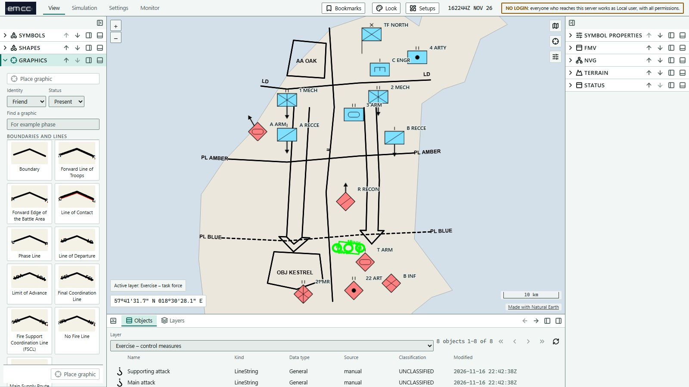

# emcc

**A command and control picture, built by AI agents.** Website: [www.emcc.dev](https://www.emcc.dev)

emcc is a web-based mock-up of a military command and control (C2) system. It shows units, tactical graphics and tracks on a map that every user shares live, and it exchanges objects with other systems. Humans as architects set the goals and made every decision. Claude Code agents wrote almost all of the code, the tests and the documents.

> **emcc is a demonstration.** It is not an operational system, it does not protect classified information, and it is not certified for any use. It is not affiliated with or endorsed by NATO, any armed force or any company. Standards are named only to say what emcc reads and writes.

*The real user interface of the M8 release, with a made-up exercise on Natural Earth's map of Gotland. Every unit, name and position is fictional.*

## What it does

- **A shared live picture.** A change made by one user reaches every other user's map at once. The server holds the master copy and checks every change against the user's permissions.
- **Symbols and tactical graphics.** APP-6 unit symbols, and tactical graphics such as boundaries, phase lines, axes of advance, objectives and minefields.
- **Layers with security labels.** Every layer and object carries a security label after STANAG 4774.
- **Links to other systems.** Cursor on Target (CoT) in and out, AIS, ADS-B, GMTI (STANAG 4607), NATO Vector Graphics (NVG) and full motion video (STANAG 4609, in and out), each as a plugin.
- **A simulator** with routes, convoys, formations, sensors and events, sending its tracks out through the same links, and simulated cameras on its tracks, as on a UAV, whose video emcc draws from orthophotos and height data that you add, and sends as STANAG 4609.
- **Polar maps and military grids:** Web Mercator, Arctic and Antarctic projections; DMS, decimal degrees, UTM/UPS and MGRS.
- **Terrain:** range and bearing, viewsheds and height maps from DTED height data that you add.
- **Works without internet.** The browser talks only to the emcc server, and Natural Earth maps ship with it.

The server is Java 25 with a plain-Java core and a thin Spring Boot edge; the web client is TypeScript with OpenLayers. Everything beyond the core is one of 21 plugins, built on a Java and a TypeScript plugin SDK.

## How it was built

emcc is an experiment: a software project run with AI agents as the team. Each agent is a long-lived Claude Code session with one role (architect, plugin designer, core developer, one coder per plugin, integration tester, manager, reviewers, external services, user experience, writers), its own written instructions and its own git worktree.

- Agents never talk to each other. Everything goes through files in git: handover notes, the status board and change requests.
- Every folder has one owner. A change in someone else's part needs a change request, and the owner decides.
- The owner approves every merge into `main`.
- Claude Opus where a mistake spreads to everyone, Claude Sonnet for work against clear specifications, Claude Fable for the reviews.

Where to read more:

| | |
|---|---|
| What the system must do | [requirements.md](requirements.md) |
| How it is built | [docs/architecture/overview.md](docs/architecture/overview.md) and the decision records in [docs/adr/](docs/adr/) |
| The user manual | [documents/manual/src/](documents/manual/src/01-00-product.md) |
| Building and testing | [tools/README.md](tools/README.md) |

The agents' setup and the project's working records are not in this repository. A later release adds the agents that another developer needs for plugin development.

## Status

Ten releases so far, M0 to M9 (10 October to 19 November 2026); M7 was the first release for outside users. M9, released on 19 November 2026, brings HTTPS, emcc as a Windows service, guides for admins and plugin authors, a help menu with the manual and the version, a start without login by a double-click (`start_standalone.bat`) and the UAV simulator. Its user manual has 74 chapters.

## Licence

emcc is licensed under the [Apache License 2.0](LICENSE). The third-party software and data in a release, with their licence texts, are listed in its `THIRD-PARTY-NOTICES.txt`. Map data: Made with Natural Earth (public domain).

Security: see [SECURITY.md](SECURITY.md).

## Sources

No classified STANAGs or specifications were used to make emcc, and no document marked NATO UNCLASSIFIED: only unmarked or public documents. Most of them were downloaded from NATO's NSDD, the NATO Standardization Document Database, or from other publicly available sources.
