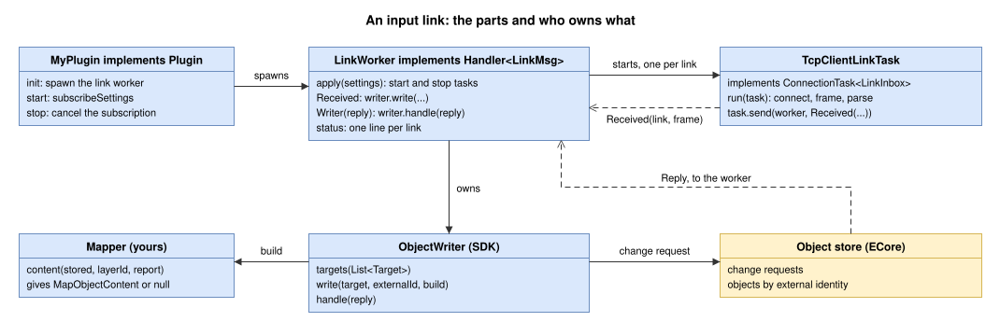
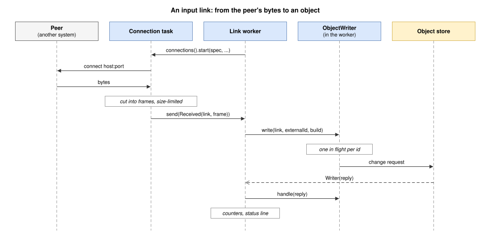

# Recipe: an input link

**You get:** links an admin adds in your settings, each a connection to another system (a TCP client, a TCP server or UDP) whose messages become objects on the map, in the link's own layer, with each link's state in your status.





## You need

- **Manifest:** `connections` (what your sockets do, pointing at the links setting), the `links` setting with stable item ids, `dataTypes` for what you create ([manifest.md](../reference/manifest.md), [connections.md](../reference/connections.md)).
- **Java SDK:** connection tasks (`dev.emcc.sdk.connection`), `ObjectWriter` (`dev.emcc.sdk.store`), `LayerChoice`, `ListenAddress`, `SecurityLabel` ([connections.md](../reference/connections.md), [objects.md](../reference/objects.md)).
- **The template's `transport` package**, which already has the whole link pattern for UDP, a TCP client and a TCP server.
- **Rules:** R13 and R14 (sockets only in connection tasks, closed on stop), R53 (hosts and ports only from settings), R55 (listen on loopback unless an admin says otherwise), R73 (key by the item's id), R83 and R84 (status, counted skips). Received data is untrusted: limit every size and never resolve entities in XML.

## Steps

### 1. Declare the links

Copy the template's `links` setting and `connections` entry, then cut them down to what your protocol uses (say `"kinds": ["tcp-client"]` and `"direction": "in"`). Each item gets a stable `id` that ECore fills in, so a rename keeps the link:

```json
"connections": [{
  "kinds": ["tcp-client", "udp"], "direction": "in", "settings": "/links",
  "reason": "Track reports from the feeds each link names: a TCP client or a UDP receiver."
}],
```

```json
"links": {
  "title": "Links",
  "description": "The feeds to read, one entry per link. Without an entry the plugin reads nothing.",
  "type": "array", "default": [],
  "x-emc2": { "item": { "name": "name", "noun": "link", "state": "enabled", "id": "id" } },
  "items": {
    "type": "object", "required": ["name"],
    "properties": {
      "id": { "title": "Id", "description": "The link's stable id.", "type": "string", "readOnly": true },
      "name": { "title": "Name", "description": "Lowercase words with hyphens; the data source of what the link receives.", "type": "string", "pattern": "^[a-z][a-z0-9]*(-[a-z0-9]+)*$", "maxLength": 64 },
      "targetLayer": {
        "title": "Layer", "description": "Where the tracks go; absent: a new layer named like the link.",
        "type": "object", "properties": { "id": { "type": "string" }, "name": { "type": "string" } },
        "x-emc2": { "kind": "layer", "allowNew": true }
      }
    }
  }
}
```

The template's item also has `mode`, `direction`, `enabled`, `host`, `port`, `listen` and `idleSeconds`; keep those you use. Add `label` (the link's security label) as adsb and ais do.

### 2. Keep the transport, and set your framing

The template's `LinkWorker` reads the links, starts one connection task per enabled link, named after the link, stops it when the link goes or changes, restarts a failed run with a back-off, and writes one status line per link. Change only what your protocol needs:

- `MAX_FRAME_BYTES`: the most bytes of one message (an AIS sentence has at most 82).
- The framing: `LineFramer` cuts lines; replace it for a binary protocol (a length prefix, a sync word).
- `Link.from(item)`: read your extra fields, e.g. `target()` from `LayerChoice.from(item.get("targetLayer"))` and `label()`, as adsb's `Link` does; throw `IllegalArgumentException` with a short reason for a bad item, which the worker puts in the status.

Every socket lives in a connection task and is registered with `task.closeOnStop`, so that a stop closes it under a blocking read (R13, R14). The task hands each frame to the worker as a message and never touches the store.

### 3. Turn frames into objects with the object writer

The link worker owns one `ObjectWriter`. It finds your objects again by their external identity after a restart, makes and keeps each link's layer, keeps one change request in flight per object (the latest wins), and counts what it created, updated and was refused.

```java
// LinkMsg gets one more record: the writer's own replies come back to this worker.
record Writer(ObjectWriter.Reply reply) implements LinkMsg {}

// LinkWorker.handle, with the first message:
if (writer == null) {
  writer = ObjectWriter.create(context, ctx.self(), "acme-tracks", LinkMsg.Writer::new);
  writer.start();
}

// on the settings, after apply(...): one target per link
writer.targets(links.values().stream()
    .map(r -> new ObjectWriter.Target(r.link.name(), r.link.target(), r.link.label(), r.task == null ? null : r.task::count))
    .toList());

// on a received frame:
case LinkMsg.Received m -> {
  Report report = Parser.parse(m.frame());                 // yours; null for what you skip
  if (report != null) {
    writer.write(m.link(), report.trackId(), (stored, layerId) -> Mapper.content(stored, layerId, report, m.link()));
  }
}

// on the writer's reply:
case LinkMsg.Writer m -> writer.handle(m.reply());
```

`Mapper.content(stored, layerId, report, link)` is yours: it returns the `MapObjectContent` to write, built on `stored` when the object exists, with `layerId` as given (so an object a user moved stays in its layer), the link's name as its data source, and the report's time; or `null` for nothing. See `ShipMapper` in ais and `AircraftMapper` in adsb for whole examples.

The writer never deletes: your objects end by their data type's expiry, so declare a data type with `defaults.expiresAfterSeconds` ([manifest.md#data](../reference/manifest.md#data)).

### 4. Report each link

The template's `refreshStatus` already writes one line per link: up, connecting, listening or down with the reason, and the frames received. Add your own counters with `task.count(name, delta)` (frames dropped as too long, frames that did not parse). The Monitor shows them per task ([monitor.md](../reference/monitor.md)).

## Test it

Unit-test the parser and the mapper on their own, with recorded messages. Then one end-to-end test with a real peer on loopback, as the template's `LinkEndToEndTest` does:

```java
peer = new ServerSocket(0, 1, InetAddress.getLoopbackAddress());
peer.setSoTimeout(10_000);
JsonObject settings = (JsonObject) TestJson.parse(
    "{\"links\":[{\"name\":\"feed\",\"host\":\"127.0.0.1\",\"port\":" + peer.getLocalPort() + "}]}");
context = FakePluginContext.builder("acme-tracks").settings(settings).build();
plugin.init(context);
plugin.start();
awaitStatus("feed [in tcp-client to 127.0.0.1:" + peer.getLocalPort() + "]: up");
try (Socket accepted = peer.accept()) {
  accepted.getOutputStream().write(RECORDED_REPORT);
  waitUntil(() -> { context.runUntilIdle(); return context.store().objects().size() == 1; }, "the track");
}
```

Also test: a restart finds the objects again (`context.store().restart()`), a rejected change (`rejectNext`), a frame that is too long, and a link removed in the settings stops its task. Keep `TransportTest` for the transport's modes.

## Pitfalls

- **A socket outside a connection task**, or a name lookup in a worker: `PluginRules` fails the build (R13).
- **A host from a message or an object** instead of the settings: forbidden (R53).
- **Writing to the store from the task**: the task only reads and frames; the worker writes.
- **Creating a new layer per restart:** use the writer's targets; it keeps the layers in a plugin document.
- **One change request per frame** from a busy feed: the writer keeps one in flight per object; never submit beside it.
- **State keyed by the link's name**: a rename then loses it. Key it by the link's `id` (R73).

## See also

[connections.md](../reference/connections.md) (tasks, TLS, the link pattern) · [objects.md](../reference/objects.md) (the writer, extensions, field sets) · [in-out/playbook.md](../in-out/playbook.md) (an in/out plugin, work package by work package) · adsb's `LinkWorker` (the writer in a link worker) · [An output link](output-link.md)
