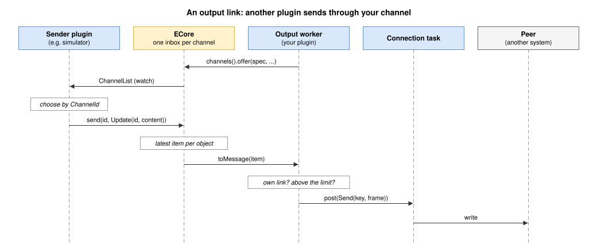

# Recipe: an output link

**You get:** output links an admin adds in your settings, each sending objects to another system in its protocol. Each link is also an **output channel**: other plugins (a simulator, a drawing plugin) can send to it, and your plugin sends only what is within the link's highest classification.



## You need

- **Manifest:** `connections` with `"direction": "out"` (or `both`), the `links` setting with stable item ids, `sourceLayers` and `highestClassification` per link ([channels.md](../reference/channels.md#in-the-manifest)).
- **Java SDK:** `context.channels()` (`Channels`, `ChannelSpec`, `ChannelRef`, `ChannelItem`), `ClassificationLimit`, `context.classifications()` ([channels.md](../reference/channels.md), [permissions-and-labels.md](../reference/permissions-and-labels.md)).
- **The template's `transport` package**, as for [an input link](input-link.md): a link with direction `out` already writes what the worker posts.
- **Rules:** one channel per output link, withdrawn when it goes; never send an object back to its own link; skip and count what is above the highest classification; log a skip at most once a minute per link (R83); key by the link's `id` (R73).

## Steps

### 1. Declare the output links

As for an input link, with direction `out` and the two settings an output link needs:

```json
"highestClassification": {
  "title": "Highest classification",
  "description": "Objects above it are not sent. Absent: the highest classification of the server's default label's policy.",
  "type": "object",
  "properties": {
    "policy": { "title": "Policy", "description": "The security policy, e.g. NATO.", "type": "string" },
    "classification": { "title": "Classification", "description": "A classification of that policy.", "type": "string" }
  }
}
```

`sourceLayers` (a list of picked layers, `"x-emc2": { "kind": "layer" }` on its items) names the layers whose objects the link sends by itself; other plugins add to that through the channel.

### 2. Offer a channel per link

When the link worker starts an output link, it offers the link's channel; when the link goes, it withdraws it. Name the channel from the link's stable id, so that a rename keeps it for the senders that chose it:

```java
ChannelRef ref = context.channels().offer(
    ChannelSpec.of("out-" + link.id(), link.name(), "acme-feed")   // the channel's link name, display name, output type
        .can(ChannelCapability.DELETE),                             // only if your protocol can say "gone"
    self, item -> new LinkMsg.FromChannel(link.id(), item));        // each ChannelItem, with its link, to this worker
r.channel = ref;

// when the link goes:
r.channel.withdraw();
```

`toMessage` gets only the item, so the lambda adds the link's id; it must stay pure and non-blocking, since ECore runs it in your worker. `offer` throws `IllegalArgumentException` for a link name you already offer, and `IllegalStateException` at 100 channels; put the reason in the link's status.

### 3. Send what arrives, within the limit

ECore keeps one inbox per channel with the latest item per object, and hands the items to your worker one at a time:

```java
case LinkMsg.FromChannel m -> {
  Running r = byId.get(m.linkId());                        // the worker's links, by their stable id
  if (r == null || r.task == null) {
    return;                                                // the link went: nothing to send to
  }
  switch (m.item()) {
    case ChannelItem.Update u -> {
      MapObjectContent content = u.content();
      if (content.dataSource().equals(r.link.name())) {
        return;                                            // never back to the link it came from
      }
      ClassificationLimit limit = ClassificationLimit.from(r.link.highestClassification(), context.defaultLabel());
      if (!context.classifications().within(content.label(), limit)) {
        r.task.count("skipped: above the classification", 1);
        return;
      }
      r.task.post(new LinkInbox.Send(u.id().toString(), Encoder.frame(content)));   // Encoder is yours
    }
    case ChannelItem.Removal gone -> r.task.post(new LinkInbox.Send(gone.id().toString(), Encoder.gone(gone.id())));
    default -> { }                                         // e.g. a SensorReport, which this channel does not take
  }
}
```

The task's inbox coalesces by the same key, so a busy object costs one frame at a time. Your source layers' own objects come from a store subscription in the same worker and take the same path through `Encoder`.

### 4. Tell the user what is skipped

Count every skip per link and reason with `task.count`, show the counts in the link's status line, and log a skip at most once a minute per link. When a link's limit is one the server does not know (`!context.classifications().knows(limit)`), nothing passes: say so in the status.

## Test it

Drive your channel as a sender would, with `FakeChannels.deliver`, and look at what the link's task got:

```java
var ctx = FakePluginContext.builder("acme-feed").settings(outLinkSettings).build();
plugin.init(ctx);
plugin.start();
ctx.runUntilIdle();
var id = new ChannelId("acme-feed", "out-" + LINK_ID);
ctx.channels().deliver(id, new ChannelItem.Update(trackId, unclassifiedTrack));
ctx.channels().deliver(id, new ChannelItem.Update(otherId, secretTrack));
ctx.runUntilIdle();
assertThat(ctx.connectionTask("feed").posted()).hasSize(1);
assertThat(ctx.connectionTask("feed").counter("skipped: above the classification")).isEqualTo(1);
```

Also test: an object whose data source is the link itself is not sent; a removed link withdraws its channel (`ctx.channels().offered()`); a rename keeps the channel's id. For the bytes on the wire, keep `TransportTest`'s out modes.

## Pitfalls

- **Sending an object back to its own link**: a link that is `both` would echo every track (always check `dataSource`).
- **Forgetting `withdraw`**: senders then keep sending to a link that is gone.
- **The channel named after the link's name**: a rename gives a new channel, and every sender shows the old one as missing. Use `"out-" + id`.
- **Logging every skip**: a busy feed fills the log. Count, and log at most once a minute per link (R83).
- **Leaving senders guessing**: when a link cannot send (no connection, no destination), say so with `ref.state(ChannelState.NOT_SENDING, "No connection")`, and `READY` when it sends again; senders show it to their users.

## See also

[channels.md](../reference/channels.md) (watching, sending, declared kinds) · [permissions-and-labels.md](../reference/permissions-and-labels.md) (labels, classifications) · [in-out/playbook.md](../in-out/playbook.md) · cot's `OutputEngine` (a full output) · [An input link](input-link.md)
