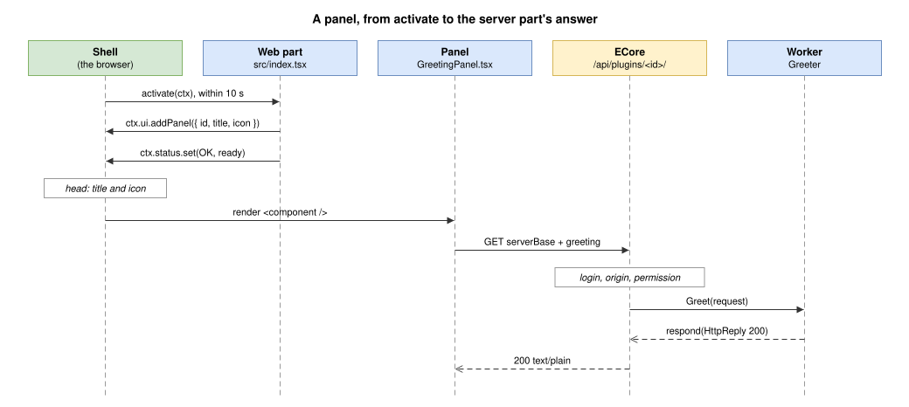

# Recipe: a panel

**You get:** a panel in the shell, with your plugin's icon, built from the SDK's shared components, that asks your plugin's server part for data over its own HTTP endpoint.



## You need

- **Manifest:** `web` (`entry`, `css`), `server.entryClass`, `icon` ([manifest.md](../reference/manifest.md)).
- **Web SDK:** `definePlugin`, `ctx.ui.addPanel`, `ctx.serverBase`, `ctx.status`, `PanelFrame` and the other shared components ([panels-and-workspaces.md](../reference/panels-and-workspaces.md)).
- **Java SDK:** a worker, `context.endpoints().register`, `Endpoint.get`, `HttpReply` ([connections.md](../reference/connections.md#http-endpoints), [workers.md](../reference/workers.md)).
- **Rules:** R12 (`activate` within 10 s), R51 (the browser talks only to the emcc server), R75 (name once), R76 to R81 (the look), R84 (status).

## Steps

### 1. Register the panel in `activate`

The shell imports the entry module and calls `activate(ctx)` once. Register everything there and return quickly.

```tsx
// web/src/index.tsx
import { definePlugin } from '@emc2/plugin-sdk';
import { Radar } from 'lucide-react';
import { TracksPanel } from './TracksPanel.tsx';
import './acme-tracks.css';

export default definePlugin({
  activate(ctx) {
    ctx.ui.addPanel({
      id: 'acme-tracks',
      title: 'Tracks',
      icon: Radar,                 // every panel has an icon (R80)
      defaultPane: 'right',        // where it starts; the user may move it
      component: () => <TracksPanel serverBase={ctx.serverBase} />,
    });
    ctx.status.set('OK', 'ready');
  },
});
```

The user may move the panel to any pane, so it must work narrow and tall as well as wide and low (R81).

### 2. Build the panel from the shared components

The shell's head shows the title and the icon. The panel shows neither again: `PanelFrame` with `heading={false}` keeps the title as the region's accessible name without drawing it (R75).

```tsx
// web/src/TracksPanel.tsx
import { useState } from 'react';
import { Button, Notice, PanelFrame } from '@emc2/plugin-sdk';

export function TracksPanel(props: { readonly serverBase: string }) {
  const [answer, setAnswer] = useState<string | null>(null);
  const ask = async () => {
    const response = await fetch(`${props.serverBase}summary`);   // /api/plugins/acme-tracks/summary
    setAnswer(response.ok ? await response.text() : `The server answered ${String(response.status)}`);
  };
  return (
    <PanelFrame title="Tracks" heading={false}>
      <div className="acme-tracks-content">
        <Button onClick={() => void ask()}>Ask the server</Button>
        {answer !== null && <Notice>{answer}</Notice>}
      </div>
    </PanelFrame>
  );
}
```

Your own CSS is one file, `<id>.css`, with classes that start with your id, and only design tokens for colours, sizes and fonts (R76, R77).

### 3. Serve the endpoint from a worker

The browser reaches only the emcc server, and your server part only under `ctx.serverBase` (`/api/plugins/<id>/`). Register the endpoint in `init`; each request arrives at a worker as a message, and the worker answers once.

```java
// TracksPlugin.init
WorkerRef<SummaryMsg> summary = context.workers().spawn(
    WorkerSpec.of("summary", SummaryMsg.class, SummaryWorker::new).mailbox(100, Overflow.dropNewest()));
context.endpoints().register(Endpoint.get("/summary"), summary, SummaryMsg.Ask::new);

// SummaryMsg.java: one sealed interface per worker, one record per message
sealed interface SummaryMsg extends Message {
  record Ask(EndpointRequest request) implements SummaryMsg {}
}

// SummaryWorker.handle
case SummaryMsg.Ask ask -> ask.request().response().respond(
    HttpReply.of(200, Headers.of("Content-Type", "text/plain; charset=utf-8"), Bytes.utf8(summaryText())));   // yours
```

A `GET` may go without a permission of its own (only logged-in users reach it); every `POST` names one with `.requires(permission)`, and ECore checks it ([permissions-and-labels.md](../reference/permissions-and-labels.md)). ECore answers `504` itself when the worker does not answer within the endpoint's timeout.

## Test it

Web, with the fake context and Testing Library:

```tsx
const ctx = createFakeContext({ pluginId: manifest.id, settings: defaults });
await plugin.activate(ctx);
const panel = ctx.addedPanels[0]?.panel;
expect(panel?.icon).toBeDefined();
const Panel = panel!.component;
render(<Panel />);
expect(screen.queryByRole('heading', { name: panel!.title })).toBeNull();   // name once (R75)
expect(screen.getByRole('region', { name: panel!.title })).toBeDefined();
vi.stubGlobal('fetch', vi.fn(() => Promise.resolve(new Response('3 tracks', { status: 200 }))));
fireEvent.click(screen.getByRole('button', { name: 'Ask the server' }));
expect(await screen.findByText('3 tracks')).toBeDefined();
```

Java, with `FakePluginContext.call`:

```java
FakeHttpExchange call = context.call("/summary");
context.runUntilIdle();
assertThat(call.reply().status()).isEqualTo(200);
```

Keep the template's CSS test (`checkLookCss`, R89) and test the panel in a light and a dark look.

## Pitfalls

- **An inner heading that repeats the title**, or a panel without an icon: the template's test fails (R75, R80).
- **A URL outside the emcc server** in `fetch`, `src` or CSS `url()`: forbidden; everything goes through `ctx.serverBase` (R51).
- **Slow work in `activate`**: the shell times it out after 10 s (R12). Fetch data when the panel mounts, not before.
- **A literal colour or size in CSS**: `checkLookCss` finds it (R77).
- **Reading settings once in `activate`** and never again: see [Settings](settings.md).

## See also

[panels-and-workspaces.md](../reference/panels-and-workspaces.md) (panels, windows, workspaces, the components) · [connections.md](../reference/connections.md#http-endpoints) (endpoints) · [testing.md](../reference/testing.md) · the template's `web/src/` and `TemplatePluginTest`
