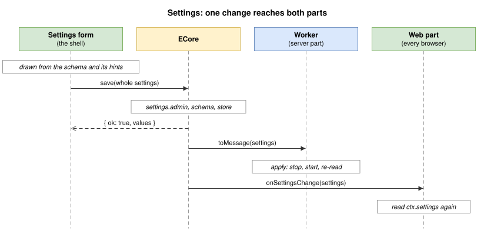

# Recipe: settings

**You get:** settings an admin changes in the Settings workspace, in a form generated from your manifest, applied by your server part and your web part at once, without a restart.



## You need

- **Manifest:** `settings`, a JSON Schema of an object, with `x-emc2` hints ([manifest.md#settings](../reference/manifest.md#settings), [the hints](../reference/manifest.md#settings-hints)).
- **Java SDK:** `context.settings()`, `context.subscribeSettings(worker, toMessage)`, the `dev.emcc.sdk.json` values ([settings.md](../reference/settings.md)).
- **Web SDK:** `ctx.settings`, `ctx.onSettingsChange` ([settings.md](../reference/settings.md#web-part-typescript)).
- **Rules:** R69 (a default for every setting), R70 (a title and a description for every setting, a description for every group), R71 (well-formed hints), R72 (validate where you read; apply without a restart), and no secrets in settings: they reach every browser.

## Steps

### 1. Declare the settings

Every setting has a `title`, a `description` and a `default`. Hints shape the form; they never change validation.

```json
"settings": {
  "type": "object",
  "x-emc2": {
    "groups": [
      { "id": "display", "label": "Display", "description": "How the panel shows the tracks.", "properties": ["maxRows", "showSpeed"] }
    ]
  },
  "properties": {
    "maxRows": {
      "title": "Most rows",
      "description": "The most tracks the panel lists at once; the newest first.",
      "type": "integer", "minimum": 1, "maximum": 1000, "default": 100,
      "x-emc2": { "unit": "rows", "width": "short" }
    },
    "showSpeed": {
      "title": "Show speed",
      "description": "Whether the panel shows each track's speed.",
      "type": "boolean", "default": true
    }
  }
}
```

ECore validates every save against this schema and fills in the defaults for what is not configured, so `settings()` always has every value. For a list of links with stable ids, see [An input link](input-link.md).

### 2. Apply them on the server

Read the current settings in `init`, and subscribe a worker to every change in `start`. The worker gets the **whole** new settings, always delivered, and applies them itself (R72).

```java
// MyPlugin
public void init(PluginContext context) {
  this.context = context;
  tracks = context.workers().spawn(WorkerSpec.of("tracks", TrackMsg.class, () -> new TrackWorker(context)));
}
public void start() {
  subscription = context.subscribeSettings(tracks, TrackMsg.SettingsChanged::new);
  tracks.send(new TrackMsg.SettingsChanged(context.settings()));   // the current ones first
}
public void stop() {
  subscription.cancel();
}

// TrackWorker.handle
case TrackMsg.SettingsChanged m -> {
  long rows = m.settings().getNumber("maxRows").longValueExact();
  if (rows < 1) {                                   // validate where you read, report in the status
    context.status().set(PluginState.DEGRADED, "maxRows must be at least 1");   // context: the PluginContext the worker was built with
    return;
  }
  this.maxRows = (int) rows;                        // worker state: no locks needed (R8)
}
```

### 3. Follow them in the browser

`ctx.settings` is replaced as a whole at each change, and `ctx.onSettingsChange` returns an `Unsubscribe`, so React's `useSyncExternalStore` follows it directly:

```tsx
import { useSyncExternalStore } from 'react';
import type { PluginContext, Settings } from '@emc2/plugin-sdk';

function useSettings(ctx: PluginContext): Settings {
  return useSyncExternalStore((changed) => ctx.onSettingsChange(changed), () => ctx.settings);
}

function TracksPanel({ ctx }: { readonly ctx: PluginContext }) {
  const settings = useSettings(ctx);
  const showSpeed = settings['showSpeed'] === true;
  // ...
}
```

Read each value defensively (`typeof`, `=== true`): the settings are JSON values.

### 4. Check the manifest in your build

Keep the template's manifest guard, `web/test/manifest.test.ts` (or, without a web part, the same three checks as a Node test): `manifestProblem(manifest)`, `settingsTextProblem(manifest.settings)` and `settingsHintsProblem(manifest.settings)` each return `null`. ECore and the shell do not check the texts; this test is where a missing one is found.

## Test it

Java:

```java
var settings = (JsonObject) TestJson.parse("{\"maxRows\":100,\"showSpeed\":true}");
var ctx = FakePluginContext.builder("acme-tracks").settings(settings).build();
plugin.init(ctx);
plugin.start();
ctx.changeSettings(settings.with("maxRows", JsonNumber.of(0)));   // settings() and every subscriber
ctx.runUntilIdle();
assertThat(ctx.effectiveStatus().state()).isEqualTo(PluginState.DEGRADED);
```

Web:

```tsx
const ctx = createFakeContext({ pluginId: 'acme-tracks', settings: { maxRows: 100, showSpeed: true } });
await plugin.activate(ctx);
const Panel = ctx.addedPanels[0]!.panel.component;
render(<Panel />);
act(() => ctx.changeSettings({ maxRows: 100, showSpeed: false }));
expect(screen.queryByText(/km\/h/)).toBeNull();
```

## Pitfalls

- **A setting without a title or description**, or a group without a description: the manifest guard fails (R70).
- **A password, token or key in settings:** the settings reach every logged-in browser. Name a credential from the server's local configuration instead, e.g. a TLS credential with `"kind": "tls-credential"`.
- **Reading settings once** in `init` or `activate` and never again: an admin's change then needs a restart (R72).
- **A field hidden by `visibleWhen`** keeps its value: ignore it in your code when its condition is off.
- **Keying state by a list item's name**: a rename then looks like a new item. Key it by the item's stable `id` (R73).

## See also

[settings.md](../reference/settings.md) (the own settings panel, the TLS credential field) · [manifest.md#settings-hints](../reference/manifest.md#settings-hints) (every hint) · [monitor.md](../reference/monitor.md) (status)
