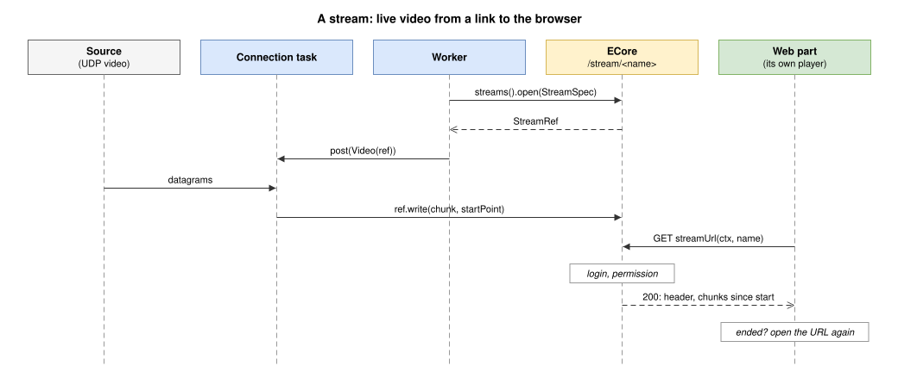

# Recipe: a stream

**You get:** live video (or other endless binary data) that a link receives, played in your web part. ECore serves every viewer, checks the permission, and lets a new viewer start at the last start point; your plugin only writes chunks.



## You need

- **Manifest:** your own permission for watching, e.g. `"permissions": ["plugin.acme-video.view"]`; a link setting as in [an input link](input-link.md) ([streams.md](../reference/streams.md#in-the-manifest)).
- **Java SDK:** `context.streams()` (`Streams`, `StreamSpec`, `StreamRef`), `Permissions.ofPlugin`; for MPEG-2 video, `context.conversions()` ([streams.md](../reference/streams.md)).
- **Web SDK:** `streamUrl(ctx, name)`, and a player you bundle in your own build, under a licence the project allows.
- **Rules:** never start a program and never hold a browser connection (ECore does both); name a permission for every stream; count every dropped write; close a stream when its link stops (R5, R13, R16, R84).

## Steps

### 1. Open the stream in a worker, write it in the task

The link worker opens one stream per link and hands the `StreamRef` to the link's connection task. Name the stream from the link's stable id, so that the web part finds it again after a rename:

```java
// LinkWorker, when it starts a link:
StreamRef video = context.streams().open(StreamSpec.of(
    "link-" + link.id(), "video/mp2t", Permissions.ofPlugin("acme-video", "view"), link.label()));
r.stream = video;
r.task.post(new LinkInbox.Video(video));      // the ref may travel in messages

// when the link stops:
r.stream.close();
```

```java
// The connection task, for each datagram it receives:
if (video.write(Bytes.of(datagram), isRandomAccess(datagram)) == SendResult.DROPPED) {   // isRandomAccess is yours
  task.count("stream dropped", 1);
}
```

`startPoint` marks where a new viewer may start; for MPEG-TS, a packet with the random access indicator. Give each new viewer what it needs first with `video.header(bytes)`, e.g. the latest PAT and PMT. A chunk is at most 64 KiB, and a plugin has at most 32 streams open.

For MPEG-2 video the browser cannot play, let ECore convert it to H.264 straight into the stream: `context.conversions().start(ConversionSpec.mpeg2ToH264(video), self, LinkMsg.Conversion::new)`, and the task writes to the `ConversionRef` instead. Show its `Waiting` and `Failed` events in your status ([streams.md](../reference/streams.md#conversions)).

### 2. Play it in the web part

```tsx
import mpegts from 'mpegts.js';
import { streamUrl } from '@emc2/plugin-sdk';

const player = mpegts.createPlayer({ type: 'mpegts', isLive: true, url: streamUrl(ctx, `link-${linkId}`) });
player.attachMediaElement(videoElement);
player.load();
```

The web part takes the link ids from `ctx.settings` (and follows them, [Settings](settings.md)). The response ends when the stream closes, for example when the link restarts: open the URL again. Hide the video from users without your permission (`ctx.user`); ECore refuses them with `403` anyway.

### 3. Report it

Put each stream's viewers (`video.viewers()`) and its dropped writes in the link's status line, and a conversion's state when it waits or failed.

## Test it

```java
var ctx = FakePluginContext.builder("acme-video").settings(oneLink).build();
plugin.init(ctx);
plugin.start();
ctx.runUntilIdle();
FakeStreams.FakeStream video = ctx.stream("link-" + LINK_ID);
// drive the link's task with recorded datagrams, then:
assertThat(video.startPoints()).isNotEmpty();
FakeStreams.FakeViewer viewer = video.join();   // what ECore would send a new viewer: the header, then from the last start point
```

Also test: a stream closes when its link is removed, and opens again under the same name when the link comes back; a conversion that waits or fails shows in the status (`ctx.conversions().holdNew(true)`, `conversion(name).fail(...)`). In the web part, test that the URL is `streamUrl(ctx, …)` and that a user without the permission sees no video.

## Pitfalls

- **Starting ffmpeg yourself**, or any process: `PluginRules` fails the build. Conversions are ECore's.
- **Serving the video from your own endpoint**: ECore owns every viewer's connection; write to a `StreamRef`.
- **A stream named after the link's name**: a rename breaks the web part's URL. Use the link's `id`.
- **Never marking a start point**: a new viewer then waits for ever. Mark every random access point.
- **A CDN player**: the browser loads nothing from the internet (R51). Bundle the player.

## See also

[streams.md](../reference/streams.md) (conversions, encoders, limits) · [connections.md](../reference/connections.md) · [permissions-and-labels.md](../reference/permissions-and-labels.md) · fmv's `transport` package and `VideoWindow.tsx` (a full video link)
