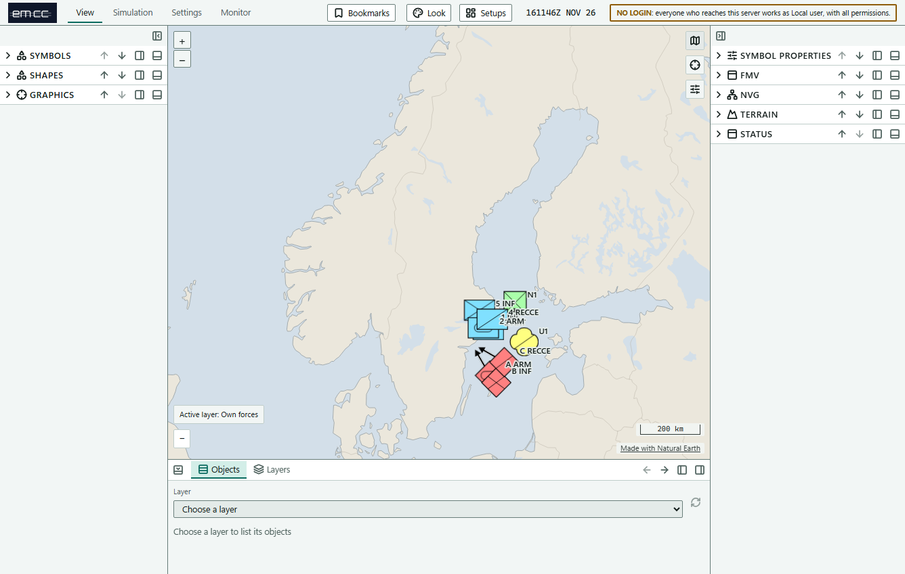

# The product and its plugins

emcc is a web-based command and control picture. It shows objects on a map that all its users share live, and it exchanges objects with other systems. You use it in a web browser. The server runs on one computer and the users connect to it.

emcc is a demonstration system. It shows what a modern command and control system can look like. It is not an operational system, and it does not protect classified information: a banner reminds you of this when it runs without login.

## What you can do with it

- **Work on a shared map.** Place military symbols and draw shapes. Everyone who looks at the same layers sees every change at once.
- **Organise the picture in layers.** Each layer has a name and a security classification. You can switch layers on and off for yourself, lock them, and change what is drawn on top.
- **Receive objects from other systems.** Aircraft from an ADS-B decoder, ships from AIS, and units from TAK systems appear on the map as symbols.
- **Send objects to other systems.** Objects from chosen layers can be sent to TAK systems.
- **Draw tactical graphics.** Place APP-6 boundaries, phase lines, areas, axes of advance and more, as the map draws them from their points. See [Graphics](03-12-graphics.md).
- **Measure the terrain.** Range and bearing between two points, the ground that an observer can see (a viewshed), and the heights of the ground in a circle (a height map), from height data that an administrator provides. See [Terrain](03-13-terrain.md).
- **Watch video from a camera.** See where a camera is and looks, and watch its video, when it is sent as STANAG 4609 over UDP. Make live video of your own: a simulated camera on a track in the simulation. See [FMV: full motion video](03-19-fmv.md) and [A simulated camera](04-06-camera.md).
- **Exchange NVG.** Read an NVG file into a layer and write layers as an NVG file, and read or offer NVG web services. See [NVG: import and export](03-18-nvg.md).
- **Work with radar data.** Receive ground moving target indicator (GMTI) data from radars and recordings, and send the simulator's sensor reports in the same format. See [GMTI on the map](03-17-gmti.md).
- **Run a simulation.** Simulated units move along routes and can be sent to other systems, as if they were real.
- **Choose your own look.** Pick a look, light or dark, and how dense the screen is. Arrange the panels the way you like and save arrangements.

## The ideas behind it

These words are used throughout this manual. [The glossary](90-03-glossary.md) lists them all.

| Word | Meaning |
|---|---|
| Object | One thing on the map: a symbol, a shape, an aircraft, a ship, a track. Every object is in a layer, and has a security label |
| Layer | A named group of objects, with a classification. Layers are drawn in order, and can be shown, hidden and locked |
| Data type | The kind of an object, for example General, ADS-B aircraft, AIS vessel, CoT or Route. It decides how long the object stays current |
| Field set | A group of extra fields that a plugin adds to objects, for example CoT unit or AIS ship. See [Symbol properties](03-10-symbol-properties.md) |
| Data source | Where an object comes from: "manual" for what users place, or the name of a link for what arrives from another system |
| Workspace | A tab in the top bar with its own map, panes and layers: View and Simulation |
| Plugin | A part of emcc that adds a function: a panel, a map, a connection to another system. See [The plugins](01-01-plugins.md) |

## The picture is live and shared

The server keeps the picture: all the layers and objects. Every browser shows the part of it that its user looks at, and the server sends each change to every browser that needs it. When you place a symbol, it reaches the server, and from there everyone's map. The server enforces what each user may do. The browser only hides what you may not use.

Objects are kept in the `data` folder of the server, so the picture is still there after a restart.

## Positions

All positions are WGS84. emcc can write them as decimal degrees, degrees minutes seconds, UTM/UPS or MGRS: see [Coordinates](03-04-coordinates.md). Heights are in metres above the ellipsoid.

## Works without internet

emcc works on a computer that is not connected to the internet. The browser only ever talks to the emcc server, and loads nothing from the internet. A background map that does not need the internet is part of emcc: Natural Earth. Only some plugins on the server go to other systems, and only to the addresses an administrator gives them: the OpenStreetMap background, WMS servers, and the links to decoders, receivers and TAK systems. The [Monitor](06-00-monitor.md) shows which plugins are allowed to do that.

## Licence

emcc is licensed under the Apache License 2.0. The third-party software and data it includes are listed in the file `THIRD-PARTY-NOTICES.txt` in the release. The Natural Earth map data is in the public domain, and the Java runtime is OpenJDK, under GPL-2.0 with the Classpath Exception.

## Where to go next

- To start emcc for the first time: [Running emcc](01-02-running.md).
- To learn the screen: [The user interface](02-00-ui-overview.md), then [A first session](02-01-first-session.md).
- To set emcc up: [Settings](05-00-settings.md).
- To read this manual while emcc runs: choose Manual in the help menu, the `?` button at the right end of the top bar. To read it without the server: it is in the release, in the folder `manual`. Open `manual/index.html`.
- To do one job from the beginning to the end, use a [task guide](07-00-task-guides.md). The task guides are also one document of their own, `manual/task-guides.html`.
