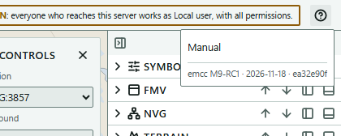
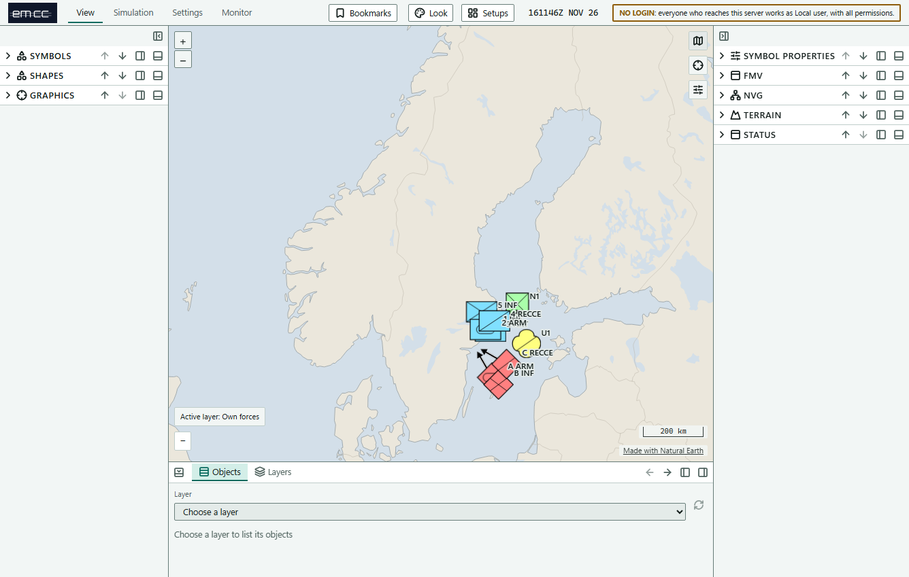

# The user interface

This chapter is a map of the screen. It names the parts and tells where each is described.

## The top bar

The bar across the top of the page is the same in every workspace.

| Part | What it is |
|---|---|
| The emcc logo | Click it to show the emcc splash screen |
| View, Simulation, Settings, Monitor | The tabs. Each tab is a workspace or a page. Click a tab to go to it. You only see the tabs you may use |
| Bookmarks | Saved map views. See [Bookmarks](03-06-bookmarks.md) |
| Scenario | Only in the Simulation workspace, between Bookmarks and Look: Export scenario and Import scenario. See [Routes](04-02-routes.md) |
| Look | Colours, light or dark, and density. See [Look](03-07-look.md) |
| Setups | Your arrangement of the workspace, remembered and saved. See [Setups](03-08-setups.md) |
| The time control | Next to the clock, but only when a plugin that works with time is loaded. No plugin of this release does, so you do not see it. When it is there, you pick "now", a time or an interval, and plugins that follow time show what was true then |
| The clock | The date and time as a date-time group, for example `032218Z NOV 26`: the day of the month and the time, a letter for the time zone, the month and the year. The letter Z means UTC. Click the clock to switch between UTC and your local time. The choice is part of your setup |
| The notice at the right | In the no-login mode: "NO LOGIN: everyone who reaches this server works as Local user, with all permissions." |
| Help, the `?` button | The last button in the bar, at the far right. It opens the help menu: the manual, and which release you are using. See "The help menu" below |

## The help menu

Click the `?` button at the right end of the top bar. A small menu opens. Press Escape, or click the button again, to close it. Everyone who may use emcc has it, in every workspace.

- **Manual** opens this manual in a new browser tab. The server itself serves the manual, at the address of the server followed by `/manual/`, so you can also type that address. You can read it without logging in. If the release was installed without its manual, the item says **Manual not installed** and is switched off.
- **The line under it** names the release that the server runs: the name of the release, the day it was built and its build number. In the picture it is `emcc M9-RC1 · 2026-11-18 · ea32e90f`. Give this line when you report a problem, so that it is clear which release you used. The menu asks the server each time you open it, so the line is what the server runs now.

The line can also read:

| The line | What it means |
|---|---|
| `emcc M9-RC1 · 2026-11-18 · ea32e90f · uncommitted changes` | The release was built from source files that had been changed after they were saved in the project's history, so its build number does not name exactly what is in it. A release that you were given does not say this |
| `emcc · dev build · SDK 1.9.0` | A developer's run of the server, not a release. It has no name, date or build number, only the version of the plugin SDK it implements. It also has no manual, so Manual is switched off |
| `emcc · version not known` | The server did not answer when the menu asked, or its answer was not understood |

## The tabs

| Tab | What it is | Who sees it |
|---|---|---|
| View | The map and its panels. This is where you work. [Part 3](03-00-view.md) | Everyone |
| Simulation | A second map for simulated units. [Part 4](04-00-simulation.md) | Users with permission to see Simulation |
| Settings | The settings of emcc and of every plugin. [Part 5](05-00-settings.md) | Administrators |
| Monitor | How the server and the plugins are doing. [Part 6](06-00-monitor.md) | Administrators |

View and Simulation are workspaces. A workspace has a map in the middle and panes on the left, right and bottom. Each workspace has its own map view, panel arrangement, layers and setups. You see one workspace at a time. To see two at once, open emcc in a second browser window.

## The workspace

The map is in the middle. Around it are three panes: a left pane, a right pane and a bottom pane. The panes hold panels. Three small buttons at the top right of the map open Map controls, Coordinates and Display settings. See [The View workspace](03-00-view.md).

## Things that work the same everywhere

- **Menus and boxes that open from a button** close when you press Escape. Map controls, Coordinates and Display settings, the three small buttons on the map, look and work alike.
- **The right-click menu** on the map and on the rows of the Objects list offers the actions that work on the selected objects. You only see what you may use.
- **Hints.** When something is switched off because you lack a permission, or because a layer is locked or missing, a hint tells why. Point at a switched-off button to read it.
- **Changes are saved when you commit them.** In a panel, press Enter or leave the field. A choice in a list is saved at once. A rejected change shows a message with the reason, and the field keeps what you typed.
- **Last write wins.** If two users change the same object at the same time, the last change is kept.
- **Everyone's changes appear without reloading.**
- **Keyboard.** The lists and menus work with the arrow keys, Enter, Space and Escape. A list of the mouse and keys is in [Mouse and keys](90-01-mouse-keys.md).

## Remembered for you

emcc remembers your arrangement and your choices. Your panels, the visibility of layers, the map view and the clock come back when you open emcc again, also on another computer if you log in as the same user. Your bookmarks follow you in the same way. Your choice of look is remembered too.

Some choices are only remembered in the browser you made them in: whether Map controls and Coordinates are open, the coordinate format, your choice of category and data type for new symbols, and your units for speed and altitude.
