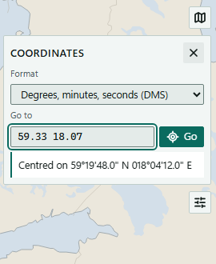

# A first session

This chapter takes about ten minutes. It leads you through the things you do most. You work in the View workspace. The demo scenario is on the map. If you break something, nothing is lost that cannot be made again.

You need a user who may edit objects. In the no-login mode everyone may.

## 1. Choose a background map

Click the Map controls button at the top right of the map. In **Background** choose **Natural Earth**. This map is part of emcc and works without internet. Close the box. See [Map controls](03-03-map-controls.md).

## 2. Go to a place

Click the Coordinates button next to it. Type `59.33 18.07` in the **Go to** field and press Enter. The map moves to Stockholm. See [Coordinates](03-04-coordinates.md).

## 3. Save the view as a bookmark

Click **Bookmarks**, then **Add bookmark**. Type a name, for example `Stockholm`, and press Enter. You can come back to this view at any time by clicking the bookmark. See [Bookmarks](03-06-bookmarks.md).

## 4. Place a symbol

Open the **Symbols** panel on the left with the arrow at its name; the panels start collapsed. In it, choose **Friend** in **Identity**, and click a symbol, for example **Command and control**. Click **Place on map**, then click the map. The symbol appears. Press Escape to stop placing. See [Symbols](03-09-symbols.md).

The symbol went into the active layer. Open the **Layers** tab at the bottom to see which one it is: it is the highlighted row. See [Layers](03-14-layers.md).

## 5. Give it a name

Click the symbol you placed. The **Symbol properties** panel on the right shows it (open it if it is collapsed). Type a name in **Name** and press Enter. See [Symbol properties](03-10-symbol-properties.md).

## 6. Draw a shape

Open the **Shapes** panel and click the circle tool. Press on the map and drag. When you let go the circle is drawn. Press Escape to switch the tool off. See [Shapes](03-11-shapes.md).

## 7. Look at the objects

Open the **Objects** tab at the bottom and choose the layer you placed your symbol in. The list shows its objects. Click the row of your symbol: the symbol is selected on the map. See [Objects](03-15-objects.md).

## 8. Delete what you made

Right-click your symbol on the map and choose **Delete**. emcc asks you to confirm. Do the same for the circle.

## 9. Make a layer of your own

In the **Layers** panel, click **New layer**. Click the pencil to rename it. Place a symbol again: it goes into the new layer, because a new layer becomes the active one.

## 10. Save your arrangement

Click **Setups**, type a name, and press Enter. Now move a panel to another pane, and then click the setup's name to bring the arrangement back. See [Setups](03-08-setups.md).

## What next

- [The View workspace](03-00-view.md) explains every panel.
- [The Simulation workspace](04-00-simulation.md) shows how to make symbols move.
- Administrators: [Settings](05-00-settings.md).
