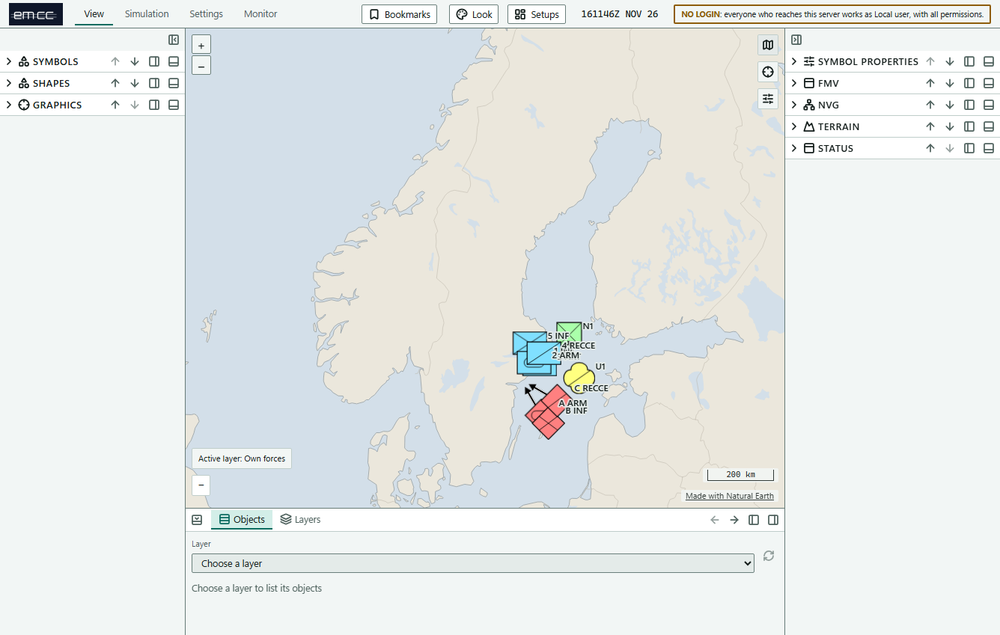

# The View workspace

The View workspace is where you work with the map. It is the first tab in the top bar. Everything you see in it is shared live: when someone else places a symbol or draws a shape, you see it appear.

The workspace has four areas:

| Area | Where | What it holds |
|---|---|---|
| Map pane | In the middle | The map, with three small icons at its top right: Map controls, Coordinates and Display settings |
| Left pane | Left of the map | The Symbols, Shapes and Graphics panels |
| Right pane | Right of the map | The Symbol properties, FMV, NVG, Terrain and Status panels. The Edit shape and Edit graphic panels open here when you need them |
| Bottom pane | Below the map | The Objects and Layers panels, as tabs |

This is the arrangement the release starts with. You can move the panels and change the size of the panes, and emcc remembers your arrangement (see [Working with panes and panels](03-01-general.md) and [Setups](03-08-setups.md)).

## In this part

The first chapter explains what is common to all panels. After that there is one chapter for each part of the workspace: the map and its three icons, the three controls in the top bar (Bookmarks, Look and Setups), and one chapter for each panel. The last three chapters are about GMTI, the radar data that the map can show, about NVG, and about FMV, video from a camera.

| Chapter | What it explains |
|---|---|
| [Working with panes and panels](03-01-general.md) | Resizing, collapsing and moving |
| [The map](03-02-map.md) | Moving around, selecting, the right-click menu |
| [Map controls](03-03-map-controls.md) | Projection, background map and dimming |
| [Coordinates](03-04-coordinates.md) | The position under the pointer, formats, going to a position |
| [Display settings](03-05-display.md) | Symbol size, labels, speed vectors and lines between objects |
| [Bookmarks](03-06-bookmarks.md) | Saving and returning to map views |
| [Look](03-07-look.md) | Colours, light or dark, and density |
| [Setups](03-08-setups.md) | Saving and restoring your arrangement |
| [Symbols](03-09-symbols.md) | Choosing and placing symbols |
| [Symbol properties](03-10-symbol-properties.md) | Changing a symbol |
| [Shapes](03-11-shapes.md) | Drawing and editing shapes |
| [Graphics](03-12-graphics.md) | Placing and editing tactical graphics |
| [Terrain](03-13-terrain.md) | Range and bearing, viewsheds and height maps |
| [Layers](03-14-layers.md) | Showing, ordering and locking layers |
| [Objects](03-15-objects.md) | The list of a layer's objects |
| [Status](03-16-status.md) | The state of the server and the plugins |
| [GMTI on the map](03-17-gmti.md) | Radar platforms, dwell areas and detections |
| [NVG: import and export](03-18-nvg.md) | Reading an NVG file into a layer, writing layers as an NVG file, and NVG links |
| [FMV: full motion video](03-19-fmv.md) | A camera and its field of view on the map, and its video in a window |

The Simulation workspace has the same layout and uses most of the same panels. [The Simulation workspace](04-00-simulation.md) explains what is different there.
