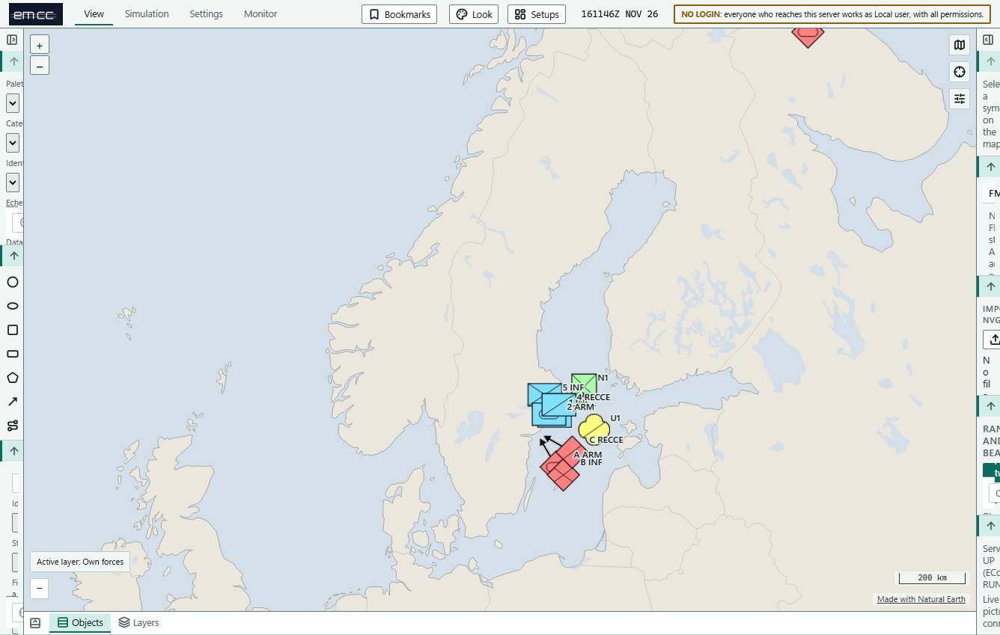
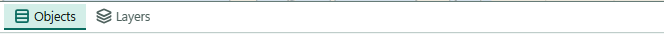
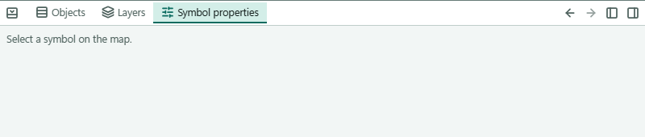
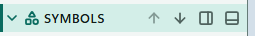

# Working with panes and panels

This chapter explains what is the same for every panel in the View workspace: how to resize and collapse the panes, and how to move the panels between them.

## Panes

The workspace has a left, a right and a bottom pane around the map pane. The panes sit next to the map. They never cover it: when a pane grows, the map gets smaller.

**Resize a pane.** Drag the edge between the pane and the map. You can also use the keyboard: press Tab until the edge is in focus, then use the arrow keys to move it in steps of 16 pixels. Home makes the pane as small as it can be. A pane has a smallest and a largest size, and the edge stops there.

**Collapse a pane.** Each pane has a button at its top that collapses it ("Collapse the left pane", "Collapse the right pane", "Collapse the bottom pane"). A collapsed pane leaves a small button in its place. Use it to open the pane again ("Expand the left pane" and so on). Collapse the panes you do not need to give the map more room.

## Panels

Each panel has a head with the panel's name and a few buttons.

**Collapse a panel.** The arrow at the left of the name collapses a panel to its head, or opens it again. When you open emcc for the first time, every panel is collapsed: open the ones you need. In the left and right panes the panels stand one above the other, and each collapses on its own, so you can scroll down to the next one.

**Move a panel.** The head has buttons that move the panel:

- **Move up** and **Move down** change its place in the pane;
- **Move to the left pane**, **Move to the right pane** and **Move to the bottom pane** put it in another pane. The buttons for the pane the panel is already in are left out.

The bottom pane is different: it shows one panel at a time, with a tab for each panel. Click a tab to bring its panel forward. In the bottom pane, **Move back** and **Move forward** change the order of the tabs.

Panels work in every pane, both in a narrow, tall pane and in a wide, low one.

Some panels open by themselves when you start something that needs them. For example, when you choose **Edit** on a shape, the Edit shape panel opens and comes to the front of its pane.

## What is remembered

emcc remembers your arrangement: which pane holds each panel, in which order, how large the panes are and what is collapsed. It is restored the next time you open emcc, also on another computer if you log in as the same user. See [Setups](03-08-setups.md) for how to keep several arrangements and switch between them.

## The top bar

The bar across the top of the page is the same in every workspace. It is described in [The user interface](02-00-ui-overview.md). The three controls that belong to working with the map are described in their own chapters: [Bookmarks](03-06-bookmarks.md), [Look](03-07-look.md) and [Setups](03-08-setups.md).
