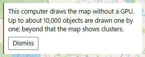
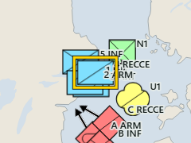
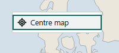
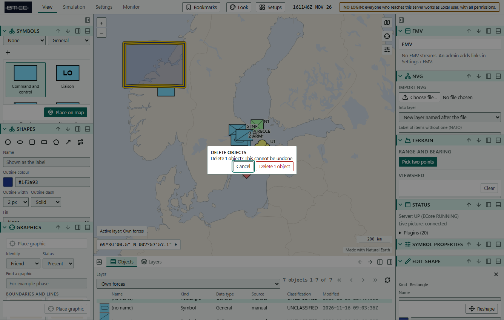

# The map

The map fills the middle of the View workspace. It shows a background map, and on top of it all the layers you have switched on, with their symbols and shapes.

## Moving around

| To do this | Do this |
|---|---|
| Move the map | Drag it |
| Zoom in or out | Turn the mouse wheel, or use the **+** and **-** buttons at the top left of the map |
| Zoom in on one spot | Double-click it |
| Zoom to a box | Hold Shift and drag a box |
| Go to a saved view | Use [Bookmarks](03-06-bookmarks.md) |
| Go to a position you know | Use **Go to** in [Coordinates](03-04-coordinates.md) |
| Centre the map on a point | Right-click the point and choose **Centre map** |

A scale line at the bottom right shows the distance on the map. The background map's credit is shown next to it, for example "Made with Natural Earth".

Three buttons sit at the top right of the map. The first one opens [Map controls](03-03-map-controls.md) (projection, background map and dimming). The second one opens [Coordinates](03-04-coordinates.md). The third one opens [Display settings](03-05-display.md) (symbol size, labels, speed vectors and lines between objects). While you move the pointer over the map, its position is shown at the bottom left.

## Symbols, shapes and graphics on the map

Objects are drawn in the order of their layers: the layer at the top of the Layers list is drawn on top (see [Layers](03-14-layers.md)). Inside one layer, shapes are drawn first, then tactical graphics, then symbols, so that a unit is never hidden by a boundary or an area.

A symbol can carry texts (its labels) and a speed vector. You choose them in [Display settings](03-05-display.md).

When many objects are close together, zoomed out, the map shows a circle with a number instead. The number is how many objects it stands for. Click it to zoom in on them. Double-click it to zoom in once.

Objects that have expired, for example a track that has not been updated for a long time, are drawn faded. They stay on the map until the server removes them.

## Selecting objects

Selecting works the same for every kind of object: symbols, shapes, tactical graphics and tracks that come from other systems. A selected object has a yellow frame (symbols) or a thicker yellow line (shapes).

| To do this | Do this |
|---|---|
| Select one object | Click it. This replaces the selection |
| Add an object to the selection, or remove it | Hold Ctrl and click it (Cmd on a Mac) |
| Select all objects in a box | Hold Ctrl and drag a box (Cmd on a Mac). This replaces the selection |
| Clear the selection | Click empty map, or press Escape |

Keep these limits in mind:

- You can select at most 1 000 objects. If a box covers more, the first 1 000 are selected and a notice says how many were left out.
- You can only select objects that the map has loaded. Objects inside a cluster are not selectable. Zoom in until you see them.
- Where objects overlap, a click selects the one on top. Right-click to choose among overlapping objects.
- Filled shapes and area graphics are selected by their outline. A click inside the fill passes through to what is below.

The selection is shared with the lists and panels. The [Symbol properties](03-10-symbol-properties.md) panel shows the selected symbol, and the rows of selected objects are marked in the [Objects](03-15-objects.md) list.

## The right-click menu

Right-click on the map to open a menu.

, Zoom to object(s), Edit, Move to layer, Copy to layer and Delete.")

**On an object** the menu works on the selected objects:

| Menu item | What it does |
|---|---|
| Centre on object(s) | Moves the map so that the objects are in the middle. The zoom stays |
| Zoom to object(s) | Zooms the map so that the objects fill the view. For a single object the view is about 10 km wide |
| Edit | Opens the object's panel for editing: **Symbol properties** for a symbol, **Edit shape** for a shape, **Edit graphic** for a tactical graphic. It is only offered for one object |
| Move to layer… | Moves the objects to another layer. See [Moving and copying to a layer](03-15-objects.md) |
| Copy to layer… | Makes a copy of the objects in another layer. See [Moving and copying to a layer](03-15-objects.md) |
| Delete | Deletes the objects after you confirm. The question states how many objects it will delete. There is no undo |

If the object you right-click is not selected, it becomes the selection first. If the selection holds several objects, the menu only offers what works on several. You only see the items you may use: without permission to edit objects, **Edit**, **Move to layer…**, **Copy to layer…** and **Delete** are left out.

**On empty map** the menu has one item, **Centre map**.

You can also delete the selected objects with the Delete key. The same question appears first.

## Moving a symbol

To move a symbol or a shape, select it and drag it to its new place. **Edit** and **Reshape** change a shape: see [Shapes](03-11-shapes.md).

## When your computer has no graphics card

The map is drawn with WebGL. If your computer draws it without a graphics card, a notice at the top of the map says so, for example "This computer draws the map without a GPU". The map still works. Up to about 10 000 objects are drawn one by one. Beyond that, the map shows clusters. Click **Dismiss** to close the notice.

If the browser cannot draw the map at all, the map pane shows a message that says so instead of the map.
