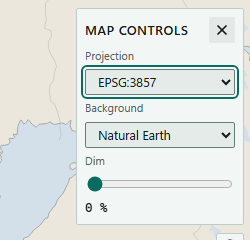

# Map controls

The Map controls button is the first of three buttons at the top right of the map. It opens a box where you choose the projection, the background map and how much the background is dimmed.

Close the box with the close button at its top right, or press Escape. If something in the box needs your attention, for example a background map that is not available, the button shows a warning marker even while the box is closed.

Whether the box is open or closed is remembered in your browser.

## Projection

The projection decides how the round earth is drawn on the flat map. emcc has three:

| Projection | Use it for |
|---|---|
| EPSG:3857 | The ordinary world map (Web Mercator). This is the default |
| EPSG:3413 | The Arctic, with the North Pole in the middle |
| EPSG:3031 | The Antarctic, with the South Pole in the middle |

When you change the projection, the map keeps its centre where it can. A position that the new projection cannot show is replaced by the nearest one it can show.

 with Natural Earth as the background.")

## Background

The background map is drawn under all layers. The list only offers backgrounds that work in the projection you have chosen.

| Background | What it is |
|---|---|
| Natural Earth | A simple world map that is part of emcc. It always works, also without internet |
| OpenStreetMap | A street map. The emcc server fetches its tiles, so it needs a connection to the internet. It exists in EPSG:3857 |
| None (grid) | No map, only a graticule of latitude and longitude lines |

An administrator can add more backgrounds from a WMS server. They appear in this list under the names given to them: see [WMS background maps](05-21-wms.md).

emcc remembers your last choice for each projection. If you switch to a projection in which the chosen background does not exist, emcc picks the one you last used there, or else the first available. The map is never left without a background while one is available. If a background cannot be loaded, the map says so and falls back in the same way.

## Dim

The slider dims only the background map, from 0 % (no dimming) to 90 %. Symbols, shapes, labels and clusters are never dimmed. Dim the background when a symbol is hard to see against a busy map.

## What is remembered

The projection, the background and the dim level are part of your [setup](03-08-setups.md). A [bookmark](03-06-bookmarks.md) keeps the projection and background too.
