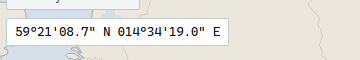
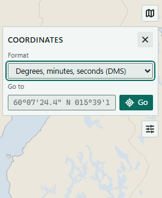
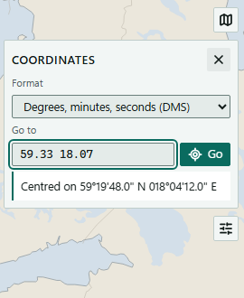

# Coordinates

The Coordinates button is the second of the three buttons at the top right of the map. It opens a box where you choose how positions are written, and where you can go to a position by typing it.

## The position under the pointer

While you move the pointer over the map, the position under it is shown at the bottom left of the map, in the format you have chosen.

## Choosing the format

Choose the format in the **Format** list:

| Format | Example |
|---|---|
| Degrees, minutes, seconds (DMS) | `60°07'24.4" N 015°39'15.6" E` |
| Decimal degrees (DD) | `60.123456° N 15.654321° E` |
| UTM/UPS | `33V 536000 6664000` |
| MGRS | `33VWG 36000 64000` |

UTM and MGRS stop at 84° north and 80° south. Beyond them the polar grid (UPS) is used, so the polar maps have positions in every format.

Your choice is kept in your browser. It is used everywhere positions are shown, for example in [Symbol properties](03-10-symbol-properties.md) and as the proposed name of a [bookmark](03-06-bookmarks.md). An administrator sets the format that new users start with: see [Coordinates](05-09-coordinates.md) in Settings.

## Going to a position

1. Click the Coordinates button.
2. Type a position in the **Go to** field. Any of the formats above works, with or without spaces and degree signs. A position without N, S, E or W letters is read with the latitude first, as people write it: `59.33 18.07` is 59.33° north, 18.07° east.
3. Press Enter, or click **Go**.

The map centres on the position, and the box says "Centred on" and the position. If the text is not a position, the box says so and the map stays where it is.

Close the box with its close button or with Escape. Whether it is open is remembered in your browser.
