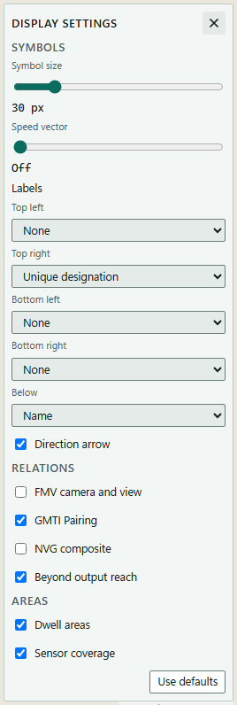
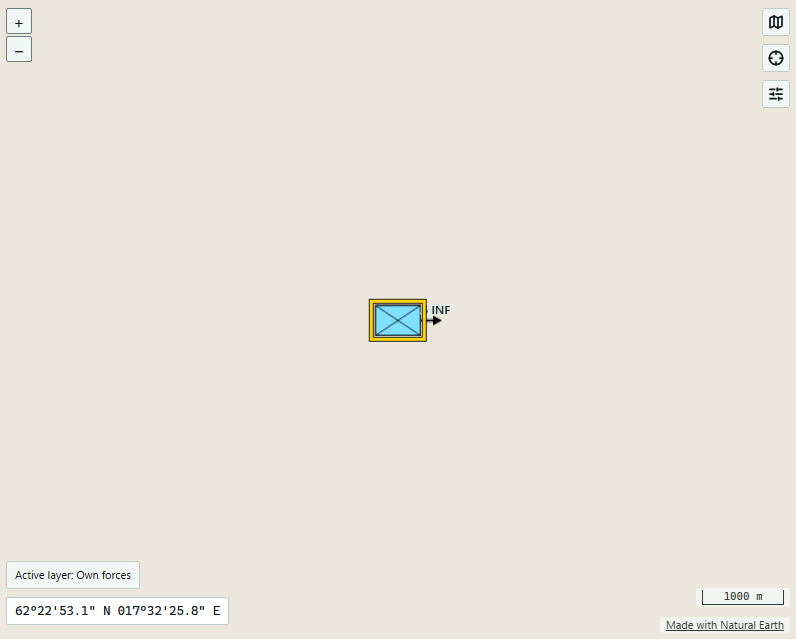
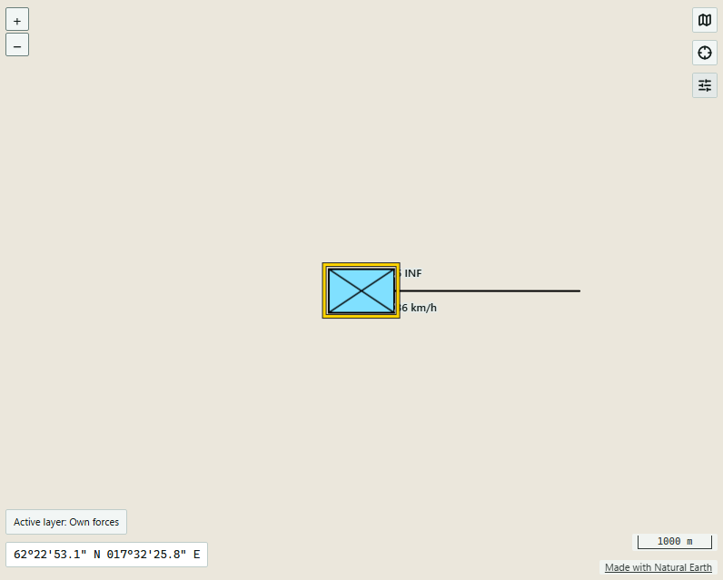

# Display settings

Display settings decide how the symbols on your map are drawn: how big they are, which texts they carry and where, whether they show their speed and their heading, and which lines are drawn between related objects. They are yours alone. Nobody else sees the change, and it follows you to another browser or computer when you log in as the same user. They are the same in every workspace.

The Display settings button is the third small icon at the top right of the map, under Map controls and Coordinates.

Click the button to open the window. A change takes effect at once. The window closes with its close button, when you click the button again, and when you press Escape. Map controls, Coordinates and Display settings look and work alike.

## Symbols

| Setting | What it does |
|---|---|
| Symbol size | How big the symbols are, from 16 px to 96 px. The default is 30 px |
| Speed vector | A line from each moving symbol, as long as the symbol travels in the time you choose. The slider has steps: Off, 5 s, 10 s, 15 s, 30 s, 1 min, 2 min, 5 min, 10 min, 20 min and 30 min. Off draws no line |

A speed vector is drawn for a symbol that has both a speed and a heading. It points the way the symbol heads, is black for every identity, and lies under the symbols. A symbol with a speed vector has no heading arrow: the vector replaces it. You set a symbol's heading and speed in [Symbol properties](03-10-symbol-properties.md); symbols that arrive from other systems, and the simulator's tracks, bring their own.

## Labels

A symbol can carry a text in each of five **places**: **Top left**, **Top right**, **Bottom left**, **Bottom right** and **Below**. The window has one list for each place. Choose the text for the place, or **None** for no text. The texts are:

| Label | What it shows |
|---|---|
| Name | The object's name. By default it is below the symbol |
| Unique designation | The unit's own designation, such as `2 ARM` |
| Higher formation | The formation the unit belongs to |
| Additional information | Free text about the object |
| Staff comments | The comments of the staff |
| Type | The kind of equipment |
| Date-time group | The time of the information |
| Altitude or depth | The height or depth |
| Speed | The speed |

The default is the unique designation at the top right and the name below the symbol; the other places are empty. A text only shows when the object has a value for it, and when the map is zoomed in far enough to carry text. The symbol's own amplifiers that you do not place stay where the symbol standard puts them.

The heading is not a text. The checkbox **Direction arrow**, below the lists, switches the arrow that shows the way a symbol heads. It is on by default. A symbol with a speed vector has no arrow: the vector replaces it.

## Relations

Some objects are related to others, and the map can draw a line between them. There is one switch for each kind of line:

| Switch | The line | Default |
|---|---|---|
| GMTI Pairing | A line from each GMTI detection to the platform that reported it, yellow unless an administrator has chosen another colour. See [GMTI on the map](03-17-gmti.md) | On |
| FMV camera and view | A dotted line from an FMV camera to its field of view. See [FMV: full motion video](03-19-fmv.md) | Off |
| NVG composite | A grey line from the first part of an NVG composite to each of its other parts. See [NVG: import and export](03-18-nvg.md) | Off |
| Beyond output reach | A red line from a detected unit that a sensor's output could not send. See [Sensors](04-04-sensors.md) | On |

A line goes to the other end also when that end is outside your view: it is drawn while both objects exist, and it follows them as they move. A line fades with the object that carries it: the GMTI pairing line fades with its detection. It is under the symbols and it cannot be selected. A kind of line only has a switch while a plugin that makes it is loaded.

## Areas

The window has a part **Areas**, with two switches. Both are on by default, and both are your own, like the switches for the lines. An administrator can change the default: see [Display](05-02-display.md) in Settings.

| Switch | What it hides |
|---|---|
| Dwell areas | The dwell areas of GMTI radars and, in the Simulation workspace, the dwells that the simulated sensors draw |
| Sensor coverage | The coverage of GMTI radars and, in the Simulation workspace, the coverage of the simulated sensors, their job areas and their bearing and range labels |

Hiding deletes nothing: the platforms, the detections and their lines stay. What is hidden is not drawn and cannot be clicked. See [GMTI on the map](03-17-gmti.md) and [Sensors](04-04-sensors.md).

## Use defaults

**Use defaults** sets everything back to the installation's default. An administrator chooses that default: see [Display](05-02-display.md) in Settings.

## What the window cannot do

The window changes how things are drawn on your map only. It changes no object and no setting of the system.
