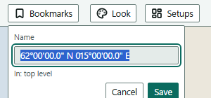
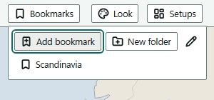
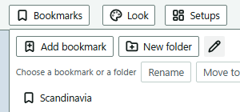

# Bookmarks

A bookmark saves a map view: the projection, the background, the centre and the zoom. Use bookmarks to return quickly to the places you look at often.

The Bookmarks button is in the top bar. Bookmarks belong to you: other users do not see them, and they follow you to another browser or computer when you log in as the same user. They are the same in every workspace. They save the map view of the workspace you are in, and going to a bookmark moves that workspace's map.

A bookmark holds less than a [setup](03-08-setups.md): it does not hold the panels, the layers' visibility or the dim level.

## Adding a bookmark

1. Move the map to the view you want to keep.
2. Click **Bookmarks** and then **Add bookmark**.
3. Type a name. emcc proposes the centre of the map, written in your coordinate format (see [Coordinates](03-04-coordinates.md)). The box says in which folder the bookmark will go ("In: top level").
4. Press Enter, or click **Save**.

## Going to a bookmark

Click **Bookmarks**, then click the bookmark. The menu closes and the map moves to the saved view. If the bookmark's background map is no longer available, emcc uses another one and a notice says so. If its centre cannot be shown in the saved projection, the map shows the nearest point it can show.

## Folders

Folders keep a long list in order. Folders can hold folders, up to five levels deep.

- **New folder** opens a small box. Type a name and click **Create folder** (or press Enter). The box says where the folder goes, for example "In: top level". Click **Cancel** to give up.
- Click a folder to open it. Its bookmarks and folders show under it, a little to the right. Click it again to close it. A bookmark that you add goes into the folder you have open.

## Organising

Click the pencil button in the menu to organise. The menu says "Choose a bookmark or a folder". Click one, and the menu says "Selected:" and its name, with three buttons:

| Button | What it does |
|---|---|
| Rename | Changes the name |
| Move to… | Opens a list of the folders, headed Move "name" to:. Click the folder to move it there, or **Cancel**. This works without a mouse |
| Delete | Deletes it. A folder that holds anything asks first, and says how many bookmarks and folders go with it |

You can also move bookmarks and folders by dragging them. Click the pencil button again to go back to the bookmarks.

## Keyboard

Use the arrow keys to move in the list, Enter to open a bookmark or a folder, and Escape to close the menu.

## Limits

A name can be 1 to 100 characters long. By default you can have at most 1 000 bookmarks and folders. An administrator can change that: see [Bookmarks](05-08-bookmarks.md) in Settings.
