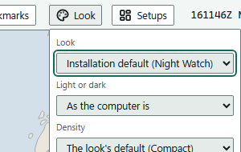

# Look

The Look button in the top bar changes how emcc looks: its colours, whether it is light or dark, and how much room the controls take. It changes the controls, not the map. The colours of symbols on the map stay the same in every look.

Your choices belong to you and are remembered. They apply in every workspace.

Click **Look** to open a small box with three lists.

## Look

| Look | Made for |
|---|---|
| Installation default | The look the administrator has chosen for everyone who has not chosen one (the name of that look is shown in brackets) |
| Night Watch | Dim operations rooms and long shifts. Compact, with small corners |
| Chart Room | Daylight, briefings and projectors. Comfortable, with rounded corners and soft shadows |
| Signal | A distinct console look with square corners and an orange accent. Compact |

The administrator chooses the installation default in Settings: see [General](05-01-general.md).

## Light or dark

| Choice | Meaning |
|---|---|
| As the computer is | emcc follows your computer's light or dark setting. This is the default |
| Light | Always light |
| Dark | Always dark |

## Density

| Choice | Meaning |
|---|---|
| The look's default | Each look has a density of its own, shown in brackets |
| Compact | Smaller text and rows, so more fits on the screen |
| Comfortable | Larger text and rows that are easier to hit |

The size you give the panes does not change when you change the density.
