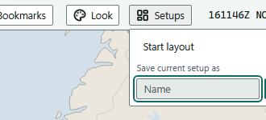

# Setups

A setup is your arrangement of the workspace. emcc can remember it for you, and you can also save arrangements under a name and switch between them. Use named setups for tasks you come back to, for example an Arctic overview with the right panels open.

A setup holds:

- the panels' arrangement: which pane holds each panel, in which order, how large the panes are and what is collapsed;
- which layers you have switched on with the eye in the [Layers](03-14-layers.md) panel;
- the projection, background, centre, zoom and dim level of the map;
- your choice of clock (UTC or local time).

A setup belongs to you and follows you to another browser or computer. Each workspace has its own setups: the Setups button works on the workspace you are in. The setups you made in View are not shown in the Simulation workspace.

## The remembered setup

You do not need to do anything for this. emcc saves your setup as you work and restores it the next time you open emcc.

## Named setups

Click **Setups** in the top bar.

**Save the current arrangement.** Type a name in the field **Save current setup as** and press Enter, or click **Save**. The setup appears in the list above the field.

**Restore a setup.** Click its name in the list. The panels, the layers' visibility and the map change to what the setup holds.

**Delete a setup.** Click the bin button next to its name.

If there are no named setups yet, the box says "No named setups yet."

## Bookmarks and setups

A [bookmark](03-06-bookmarks.md) only holds a map view. A setup holds the whole arrangement. A layer that was deleted since the setup was saved is ignored when it is restored. A new layer starts as the layer's own setting says.
