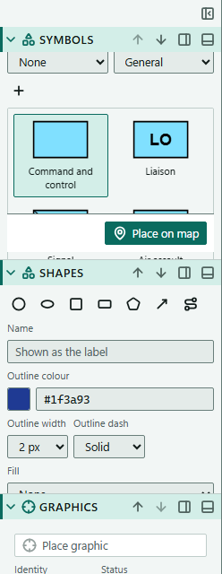
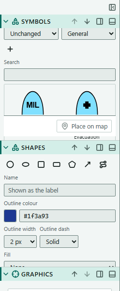
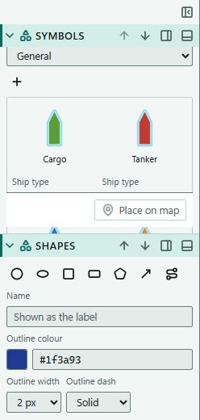
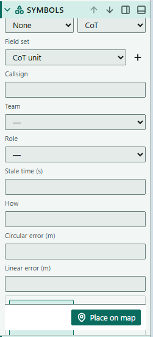
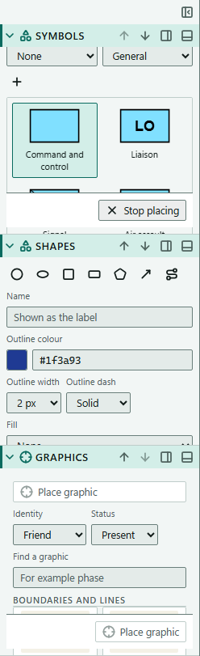

# Symbols

The Symbols panel is where you choose a military symbol and place it on the map. It is in the left pane. Symbols follow the APP-6D standard.

## Choosing a symbol

Set these first:

| Field | What it sets |
|---|---|
| Category | The kind of symbol: Land unit, Land equipment, Land installation, Air, Air missile, Space, Sea surface, Sea subsurface, Mine warfare, and Signals intelligence (space, air, land, sea surface, subsurface). The symbols below change with the category |
| Identity | Pending, Unknown, Assumed friend, Friend, Neutral, Suspect or Hostile. It sets the colour of the symbol: blue for friends, red for hostile, green for neutral and yellow for unknown |
| Echelon | The size of the unit, from Team/crew to Command. It is only offered for land units |
| Data type | What kind of object this is: General, ADS-B aircraft, AIS vessel or CoT. Choose General for ordinary symbols. See [Data types](05-03-data-types.md) |

Your choice of category and data type is remembered in your browser.

Below the fields is a grid of the symbols in the chosen category. Click a symbol to choose it. A preview shows the symbol as it will look with your identity and echelon, with its symbol code (SIDC) underneath.

## Palettes

At the top of the panel the list **Palette** chooses what the panel offers.

- **General symbols** is what is described above: the categories and their symbols.
- **CoT** is a palette that the Cursor on Target plugin brings: the symbols that emcc can send to a TAK system as a CoT type, 147 of them, in the order of the CoT table. A symbol shows the CoT type without its affiliation, and its name, for example "A-M – Military".

A palette has no categories. It has a **Search** field, which filters its symbols by their text, and the same **Identity** and **Data type** as before.

The **Echelon** list has one more choice with a palette: **Unchanged**. It is chosen when you choose a palette, and it keeps the echelon that the palette's symbol has. Choose **None** to take the echelon away, or another echelon to set it. In General symbols there is no "Unchanged".

Place a palette symbol as any other symbol (see "Placing a symbol" below). A symbol placed from the CoT palette goes out through a Cursor on Target link as the CoT type that it shows. See [Cursor on Target](05-10-cot.md).

Your choice of palette is remembered in your browser. When the plugin that brings a palette is not running, the panel shows General symbols. Palettes come from plugins and cannot be changed in the panel. A symbol that the symbol service refuses shows an error frame and cannot be placed.

## Vessels

The last category, **Vessels**, is for ships. A vessel symbol is a ship hull that points the way the ship heads, coloured by the group of its ship type. On the map the hull turns in steps of 10°; the heading in [Symbol properties](03-10-symbol-properties.md) is exact. The panel shows one hull for each group: Cargo, Tanker, Passenger, Fishing, Pleasure craft and the others. Under each hull a **Ship type** list gives the exact type of the group, for example "Tanker, hazardous category A". Identity colours the frame as for other symbols. Echelon is not offered for vessels.

Place a vessel as any other symbol. A vessel has no heading until you give it one in [Symbol properties](03-10-symbol-properties.md).

**Data type and field sets.** The data type decides which field sets the new symbol carries. Choose **CoT**, and the **Field set** list appears under Data type with the set **CoT unit** and its fields (Callsign, Team, Role and so on): fill in the ones you need. The **+** button next to the list adds another set to every symbol you place, until you leave the panel. With the data type General there is no field set. See [Symbol properties](03-10-symbol-properties.md) for what field sets are.

The data type list holds the types that people place by hand: General, ADS-B aircraft, AIS vessel and CoT. A symbol with one of the last three does not fade: it was not observed by a sensor.

**Advanced: type a SIDC.** If you know the symbol code, open this and type it in the field SIDC (APP-6D). emcc checks the code.

## Placing a symbol

1. Choose the symbol as described above.
2. Click **Place on map**. The panel says "Click the map to place the symbol. Esc stops placing." and the button changes to **Stop placing**.
3. Click the map where the symbol should go.

The symbol is placed in the active layer (see [Layers](03-14-layers.md)). Placing stays on, so you can click again to place the next one. Press Escape, right-click the map or click **Stop placing** to stop.

Two clicks in quick succession place one symbol, not two.

After you have placed a symbol, select it to change its name, position and other fields: see [Symbol properties](03-10-symbol-properties.md).

## When placing is switched off

Place on map is switched off, with a hint, when:

- there is no active layer: "Select or create a layer in the layer panel";
- the active layer is locked: the button's title says The active layer is locked, with its name;
- you may not edit objects: "You may not edit objects".
