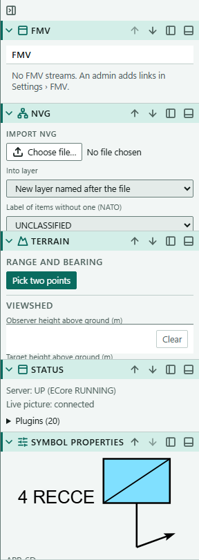
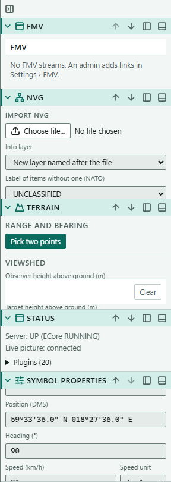
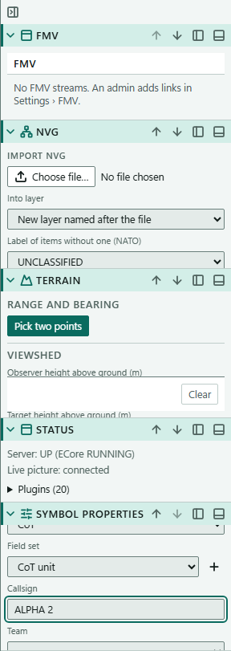

# Symbol properties

The Symbol properties panel shows the symbol you have selected, and lets you change it. It is in the right pane. It shows nothing until exactly one symbol is selected: the panel says "Select a symbol on the map." With several objects selected it says how many, and shows no fields. With a shape selected, use [Shapes](03-11-shapes.md) instead.

To open the panel for a symbol, click the symbol on the map, or right-click it and choose **Edit**.

## What you can change

At the top is a preview of the symbol, with APP-6D, the symbol standard, below it.

| Field | What it does |
|---|---|
| Identity | Pending, Unknown, Assumed friend, Friend, Neutral, Suspect or Hostile |
| Echelon | The size of the unit (land units only) |
| Category | The symbol set, for example Land unit or Air |
| Entity | The kind of symbol within the category, for example Reconnaissance |
| SIDC | The symbol code. You can also type a code here |
| Name | The name of the object. It is shown in the [Objects](03-15-objects.md) list |
| Unique designation | The text shown with the symbol on the map, for example `4 RECCE` |
| Higher formation | The unit this one belongs to |
| Additional information | Free text shown with the symbol |
| Position | Where the symbol is, in the format you have chosen (see [Coordinates](03-04-coordinates.md)). You can type a new position |
| Heading (°) | The direction the symbol points, in degrees. A symbol with a heading and a speed can show a speed vector: see [Display settings](03-05-display.md) |
| Speed | The speed, with a unit list: m/s, km/h, knots or mph |
| Altitude | The height, with a unit list: metres or feet |
| Layer | The layer the symbol is in. Change it to move the symbol to another layer |
| Data type | What kind of object it is. Change it if it was placed with the wrong one |

## Field sets

A field set is a group of fields that belongs to one part of emcc. It lets you give an object extra information that the system can use. For example, the set **CoT unit** holds the Callsign, Team, Role, Stale time, How and the errors of the position that Cursor on Target sends to TAK systems (see [Cursor on Target](05-10-cot.md)), and **AIS ship** holds the call sign, length and destination of a ship.

**The data type brings its field sets.** When you choose a data type that has field sets, the panel shows them at once. Choose **CoT** in **Data type**, and the field set **CoT unit** appears below it. The data type General has none, so a symbol of that type shows no field set.

- The **Field set** list shows one set at a time: the sets the symbol carries. Choose a set to see and change its fields. The list is not shown while the symbol has no set.
- The **+** button next to the list offers the sets that the symbol does not carry yet. Choose one to add it to the symbol: it appears in the list, chosen. The button is not shown when no set is left to add. A symbol can carry more sets than its data type brings: an AIS vessel can also carry CoT unit, for example, if it is to be sent to TAK.
- Fill in the fields of a set as you do any other field. Emptying a field removes its value.
- Changing the data type keeps the sets the symbol carries and their values, and adds the sets of the new type.
- A set that the symbol does not carry but has values for is in the list too. It is shown read only until you add it.
- **The list of data types** holds only the types that people place by hand: General, ADS-B aircraft, AIS vessel and CoT. The types that only the system makes, Route and the two GMTI types, are not in it. An object that has one of them shows it, so that a change does not alter it unseen.

Objects that come from other systems already carry the set of their plugin: ships carry AIS ship, aircraft carry ADS-B aircraft, GMTI detections carry GMTI report. You can read their values here. A symbol that you place by hand with one of these data types stays on the map: it does not fade or expire, since it was not observed by a sensor. See [Data types](05-03-data-types.md).

At the bottom, some information is shown that you cannot change: the Data source, the Security label (the classification), the Version of the object and when it was last modified and by whom.

## Saving a change

You do not need a Save button. A change is saved when you press Enter or leave the field, and at once for a choice in a list. If emcc cannot save it, a message gives the reason and the field keeps what you typed.

If someone else changes the symbol while it is open, the panel shows the new values. A field you are typing in is not overwritten. If your change and someone else's meet, the last one saved is kept.

If the symbol is deleted by someone else, the selection is cleared and a message says so.

## Moving a symbol

You can also move a symbol by dragging it on the map: select it, then drag it.

## When you cannot change a symbol

- Without permission to edit objects, the fields are read only, with the hint "You may not edit objects".
- If the symbol is in a locked layer, the fields are read only and the panel says that the layer is locked. The panel follows the lock: when the layer is unlocked, the fields become editable.
- A symbol that is outside the map's current view stays in the panel, marked "not in view". You can still edit it. Use **Centre on object(s)** or **Zoom to object(s)** from the right-click menu to bring it into view.
- The layer list does not offer a locked layer as a place to move the symbol to.

## Deleting a symbol

The panel has no Delete button. Delete with the Delete key or with the right-click menu: see [The map](03-02-map.md).
