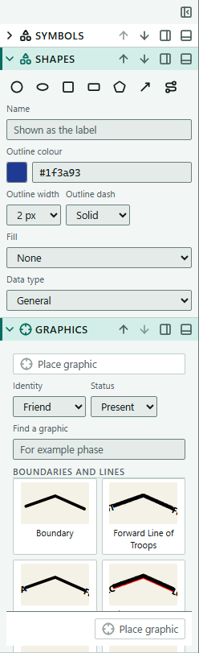
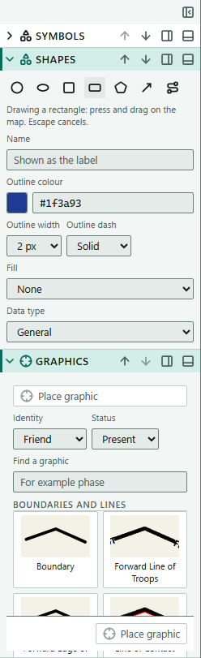
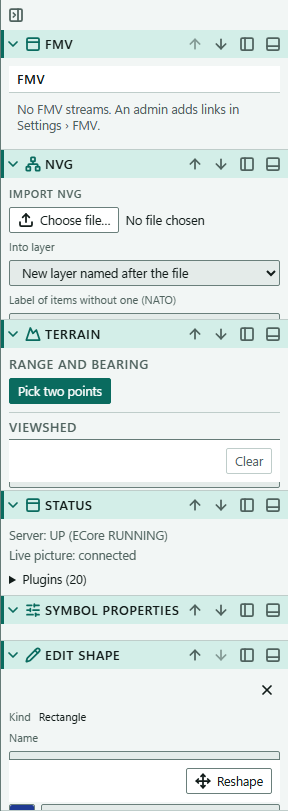
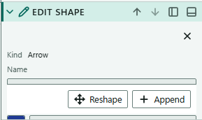
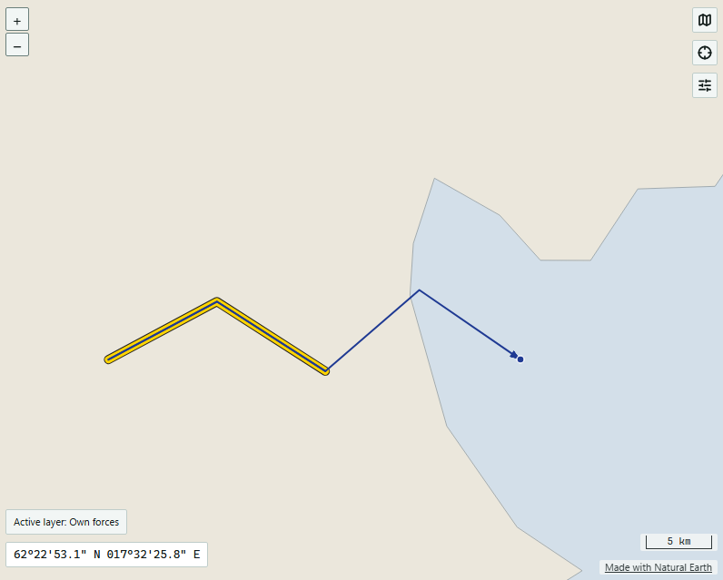

# Shapes

The Shapes panel is where you draw shapes on the map: circles, ellipses, squares, rectangles, areas, arrows and routes. It is in the left pane. A shape is an object like a symbol. It lives in a layer, it is shared live with everyone, and it can be selected, edited and deleted.

## The tools

| Tool | What it draws | How |
|---|---|---|
| Circle | A circle | Press on the map and drag |
| Ellipse | An ellipse | Press on the map and drag |
| Square | A square | Press on the map and drag |
| Rectangle | A rectangle | Press on the map and drag |
| Area | A polygon with any number of corners | Click each corner in turn |
| Arrow | A line with an arrowhead at its last point. It can bend | Click each point in turn |
| Route | A line with a marker at each point | Click each point in turn |

When a tool is on, the panel tells you what to do, for example "Drawing a rectangle: press and drag on the map. Escape cancels."

For an area, an arrow and a route: click each point. The panel says, for an area, "Drawing an area: click each point on the map; double-click or Enter finishes, Escape cancels." Finish with a double-click or Enter. A right-click removes the last point. With no points left, a right-click cancels the drawing. Escape cancels it too. Nothing is saved when you cancel.

A finished shape is placed in the active layer (see [Layers](03-14-layers.md)). The tool stays on, so you can draw the next shape. Press Escape to switch the tool off.

## Setting the style before you draw

Set the style first, and the next shapes you draw get it. You can change the style of a finished shape later in [Edit shape](#editing-a-shape).

| Field | What it sets |
|---|---|
| Name | The text shown with the shape on the map. Leave it empty for no text |
| Outline colour | The colour of the line. Click the colour box to pick one, or type a colour code such as `#1f3a93` |
| Outline width | The thickness of the line, from 1 px to 20 px |
| Outline dash | Solid, Dashed or Dotted |
| Fill | None: only the outline. Transparent: a see-through colour with a chosen opacity. Hatched: diagonal lines in the fill colour. Only shapes with an area have a fill |
| Data type | What kind of object it is. Choose General for ordinary shapes. See [Data types](05-03-data-types.md) |

## Editing a shape

To edit a shape, right-click its outline and choose **Edit**. The **Edit shape** panel opens in the right pane. It stays open while that one shape is selected.

| Field | What it does |
|---|---|
| Kind | What kind of shape it is: Circle, Rectangle and so on. You cannot change it |
| Name | The text shown with the shape |
| Outline colour, Outline width, Outline dash, Fill | The style, as above |
| Layer | The layer the shape is in. Change it to move the shape to another layer |
| Data type | What kind of object it is |
| Reshape | Changes the shape on the map, see below |
| Append | Only for a line (an arrow or a route): adds points after its last point, see below |

At the bottom, you see what you cannot change: the Classification, the Version, when it was Last modified and by whom, and the Data source.

A change is saved when you press Enter or leave the field, and at once for a choice in a list.

### Reshape

Click **Reshape**. The panel says "Move the shape or drag its handles on the map. Enter finishes, Escape cancels." Then you can move the whole shape on the map, or drag its corners and points. For a circle you drag its radius, and for an ellipse its axes and rotation. Finish with Enter. Press Escape to cancel, and the shape stays as it was.

Reshaping a square or a rectangle does not keep its right angles.

### Append

An arrow or a route is a line, and so are lines that come from NVG. For a line the panel has a second button, **Append**, next to Reshape. A circle, an area or another kind of shape has only Reshape.

Append continues the line from its **last point**:

1. Click **Append**. The panel says "Click to add points after the last point. Double-click or Enter finishes, Escape cancels."
2. Click on the map to add a point after the last one. A thin line shows where the line will run, from the last point to the pointer.
3. Press Backspace, or right-click, to take back the last point that you added. It never takes away a point that the line had.
4. Finish with a double-click (it adds a point there) or with Enter. The line is changed in one step, as if you had drawn it longer. It stays selected, and the Edit shape panel stays open.

Escape cancels. A finish with no point added changes nothing. Append is switched off, with its reason as the hint, on a locked layer and without the permission to edit objects. Only one of Reshape, Append and moving the shape works at a time. If you switch workspace while Append runs, it ends and nothing is changed.

The routes of the simulator are lines too, but they are edited in the Simulation workspace: see [Editing a route](04-03-route-edit.md).

### Moving a shape

To move a shape without changing it, select it and drag it to its new place, as you drag a symbol. Reshape does the same, and also lets you drag the handles.

## Deleting a shape

The panel has no Delete button. Delete with the Delete key or with the right-click menu: see [The map](03-02-map.md).

## When you cannot draw or edit

- Without permission to edit objects, the tools are switched off with the hint "You may not edit objects".
- With no active layer, drawing is switched off with the hint "Select or create a layer in the layer panel".
- When the active layer is locked, the tools are disabled. The panel says that the layer is locked.
- A shape in a locked layer opens in Edit shape read only, with a notice. It becomes editable when the layer is unlocked.
- A shape outside the map's current view is marked "not in view" in the panel. You can still edit it.
