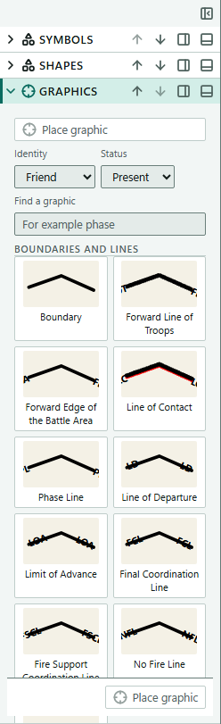
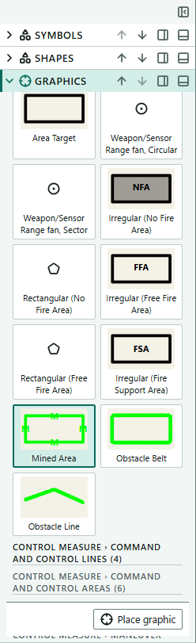
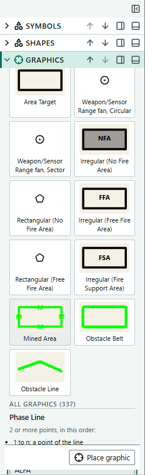
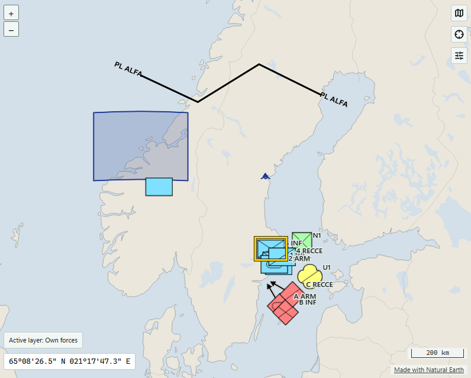
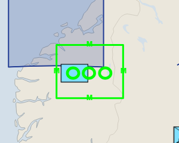
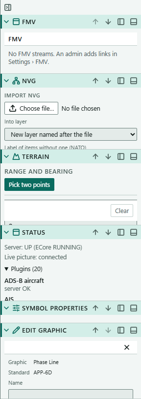

# Graphics

The Graphics panel is where you place tactical graphics on the map: boundaries, phase lines, areas, axes of advance, fire support areas, range fans, obstacles and the rest of the APP-6 graphics. It is in the left pane, under Shapes. A graphic is an object like a symbol or a shape. It lives in a layer, it is shared live with everyone, and it can be selected, edited and deleted. Every graphic that you place has the data type **General**.

A graphic is drawn by the map from its points. You click the points, and the map draws the graphic, in the right colours and line styles, as you go.

## Choosing a graphic

1. Choose the **Identity** (Unknown, Friend, Neutral or Hostile) and the **Status**. A graphic with the status **Planned** is drawn dashed. For a graphic that has an echelon, an **Echelon** list appears as well.
2. Choose the graphic. The panel shows the graphics as **tiles**: a small picture of each graphic, with its name under it. Click a tile to choose it, or use the arrow keys, Home, End, Enter and Space (the whole grid is one stop for the Tab key). The chosen tile is marked.
   - The first tiles are a short list of the **common graphics**, in four groups with a heading each: Boundaries and lines, Areas, Axes and tasks, and Fires and obstacles. Click a group's heading to fold it.
   - **Find a graphic** is a search field above the tiles. Write a part of a name, for example `phase`, and the panel shows the graphics whose name or folder has it.
   - The button **All graphics** at the end of the short list, with the number of graphics, adds every graphic that the symbol set has, in folders, for example "Control Measure › Maneuver Lines (22)". The folders are closed at first, so the list stays short: click a folder's heading to open it. While you search, the folders that hold a match are open.
3. Fill in what the graphic needs. When you have chosen a graphic, the panel shows, under the tiles:
   - **How many points it has, and what each point is**, in the order you click them. For example, for a phase line: "2 or more points, in this order: 1 to n: a point of the line".
   - **Its amplifiers**, the texts and numbers that belong to the graphic, each with its APP-6 letter, for example "T Unique designation 1". A graphic with required amplifiers, such as a range fan with its distances, cannot be placed until you have filled them in.
   - **Name**, the text shown with the graphic.

A tile's picture is the graphic itself, drawn small, with its lines, fills and labels, but on sample points: graphics of one kind look alike. A graphic that needs amplifiers, such as a range fan with its distances, shows an icon of its kind instead.

## Placing a graphic

Click **Place graphic**. There are two buttons with that name, with the same label and state: one at the top of the panel and one at the bottom, which stays in view when you scroll the tiles. While the tool is on, both say **Stop placing**, and a click on either ends it. The panel says "Placing Phase Line: click its points on the map in the order shown; double-click or Enter finishes, a right click takes back a point, Escape cancels." The map draws the graphic as it will look, from the points you have set so far and the position of the pointer.

- Click each point in turn.
- A graphic with a fixed number of points ends by itself after the last one.
- Double-click or press Enter to finish a graphic with any number of points. A graphic is not finished before it has enough points.
- A right-click takes back the last point. Escape cancels, and nothing is saved.

A finished graphic goes into the active layer (see [Layers](03-14-layers.md)). The tool stays on, so you can place the next graphic. Press Escape to switch it off.

### Graphics with a picture inside

Some graphics have a small picture in them as well as lines and text: the minefields, the mine line and the contaminated areas of the CBRN graphics. The map draws the picture with the graphic, for example the three rings in the middle of a Mined Area. It is drawn at a fixed size on the screen, turns with the graphic where the graphic says so, fades with it, and is not an object of its own: you select the graphic by its line, as for any graphic.

## Editing a graphic

Right-click the graphic's line and choose **Edit**. The **Edit graphic** panel opens in the right pane. It stays open while that one graphic is selected. Close it with the **×** at its top right.

| Field | What it does |
|---|---|
| Graphic and Standard | Which graphic it is, and the APP-6 standard. You cannot change them |
| Name | The text shown with the graphic |
| Identity, Status, Echelon | As in the Graphics panel |
| The amplifiers | The texts and numbers of the graphic, as when you placed it |
| Layer | The layer the graphic is in. Change it to move the graphic to another layer |
| Reshape | Changes the graphic on the map, see below |

At the bottom you see what you cannot change: the Classification, the Version, when it was last modified and by whom, and the Data source. A change is saved when you press Enter or leave the field, and at once for a choice in a list.

### Reshape

Click **Reshape**. Then you can drag the whole graphic to a new place, or drag its points. The map draws the graphic again as you drag. Finish with Enter. Escape cancels, and the graphic stays as it was. You cannot add or remove points of a graphic in this release.

### A graphic that is not drawn

A graphic that the symbol set does not have, for example an APP-6B graphic that came from another system, is shown as a marker at its first point. The Edit graphic panel then shows its properties only, with the hint "This graphic is not drawn", and Reshape is not offered.

## Selecting, moving and deleting

- Click a graphic's line to select it. Click inside an area graphic does not select it: use its outline. Ctrl and drag a box selects the graphics whose lines reach into it.
- Drag a selected graphic to move it. Every point moves by the same distance.
- The panel has no Delete button. Delete with the Delete key or with the right-click menu: see [The map](03-02-map.md).

Graphics are drawn in the order of their layer: within one layer, shapes first, then graphics, then symbols on top, so that a unit is never hidden by a boundary or an area.

## When you cannot place or edit

- Without permission to edit objects, the tool is switched off with the hint "You may not edit objects".
- With no active layer, placing is switched off with the hint "Select or create a layer in the layer panel".
- When the active layer is locked, the tool is disabled.
- A graphic in a locked layer opens in Edit graphic read only.

The standard and the identity that a new graphic starts with are set by an administrator: see [Draw tactical graphics](05-13-draw-tactical.md). A new graphic always has the data type General: a graphic that was made with another type before keeps it, and you cannot change it.
