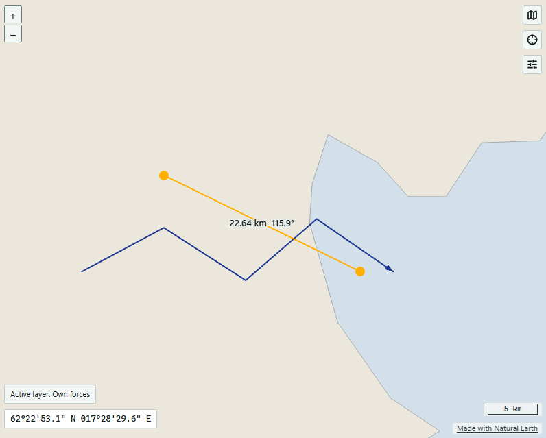
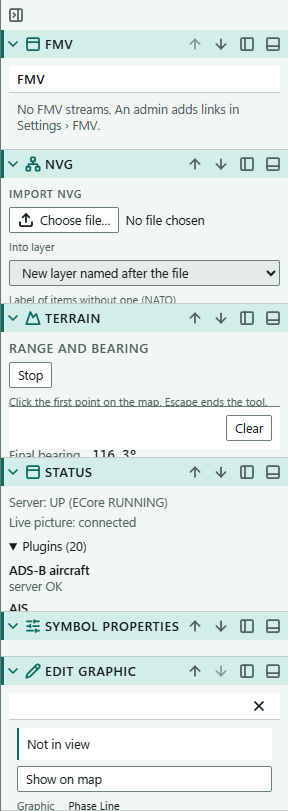
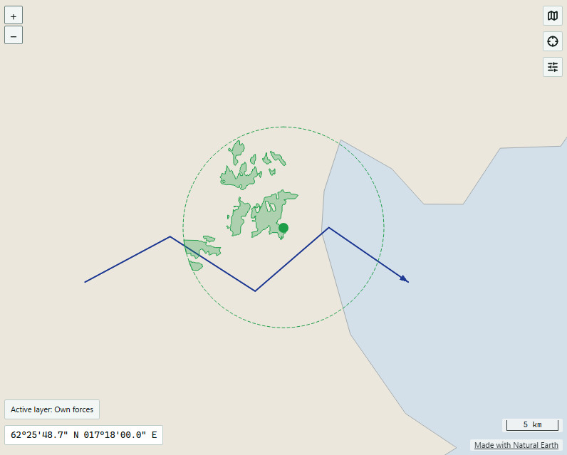
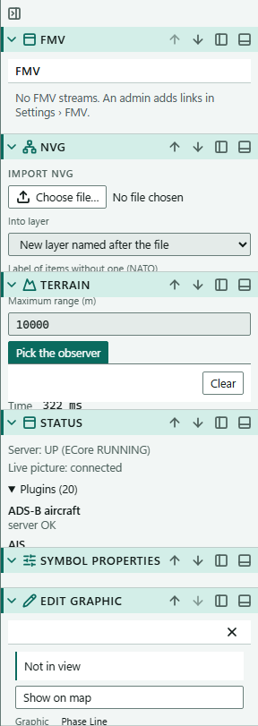
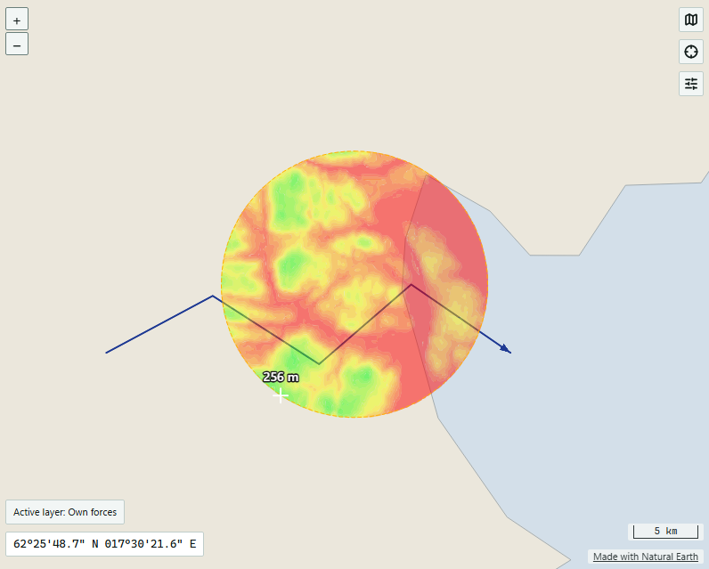
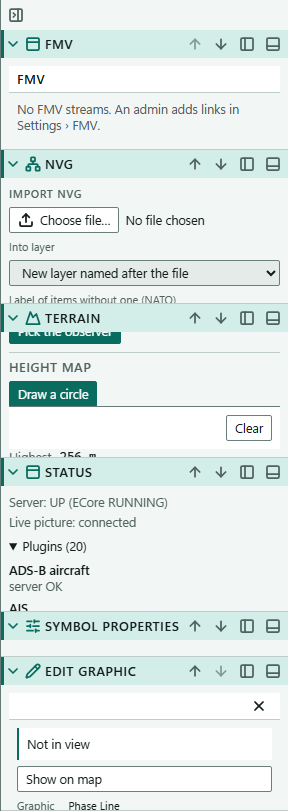

# Terrain

The Terrain panel has three tools: **range and bearing** between two points, a **viewshed**, which shows the ground that an observer can see, and a **height map**, which shows how high the ground is inside a circle. It is in the right pane, after the NVG panel and before Status, and it is in every workspace.

What the tools draw is yours alone. It shows in your browser only, and it is not shared with other users and not saved. It goes when you click **Clear** or reload the page.

Without the permission to use the terrain tools, the panel is not shown. See [Users and permissions](01-03-permissions.md).

## Range and bearing

The distance and the directions between two points on the map.

1. Click **Pick two points**. The panel says "Click the first point on the map. Escape ends the tool." and the button changes to **Stop**.
2. Click the first point, then the second.

The map draws a line between the points, a mark at each end, and a label in the middle with the distance and the bearing. The panel lists:

| Result | What it is |
|---|---|
| Distance | The distance along the surface of the earth. In metres below 1 000 m, otherwise in kilometres with two decimals |
| Initial bearing | The direction from the first point to the second, in degrees from true north, at the first point |
| Final bearing | The direction at the second point, when you arrive |
| Back bearing | The direction from the second point back to the first |
| From, To | The two positions, in the format you chose (see [Coordinates](03-04-coordinates.md)) |

Bearings are written with three digits before the point, for example `045.2°`. The tools use the shape of the earth (WGS84), so the distance is right also over a long way. Range and bearing needs no height data.

Click **Pick two points** again to measure another pair. The new result replaces the old one. Escape ends the tool.

## Viewshed

A viewshed shows where an observer at a point can see a target of a given height, up to a range. The ground in view is drawn in green.

1. Set the three fields:

   | Field | What it means | Default |
   |---|---|---|
   | Observer height above ground (m) | How high the observer's eye is above the ground, from 0 to 1 000 | 2 |
   | Target height above ground (m) | How high the thing to be seen is above the ground, from 0 to 1 000 | 2 |
   | Maximum range (m) | How far the observer looks, from 100 m. The most an administrator allows is set in [Terrain](05-20-terrain.md) | 10 000 |

2. Click **Pick the observer**, then click the observer's point on the map.
3. The panel says "Computing…" while the server works. Then the map shows the viewshed: the ground that can be seen in green, the observer as a dot, and a thin circle at the maximum range.

The panel gives the data that was used, the number of areas that the green ground is made of, and the time it took. The line of sight takes the curve of the earth and the bending of the air into account. A point is in view when a straight line from the observer's eye to the top of the target passes above all the ground between them.

Notes under the result:

- **The data used.** The viewshed uses the finest level of height data that exists at the observer's point (DTED level 2, then 1, then 0). When that level would need more height cells than the administrator allows, a coarser level is used, and the panel says so.
- **Partly without data.** When some ground within the range has no height data, the panel says so. That ground is not drawn as visible.
- **One at a time.** Each user can run one viewshed at a time. A second one is refused until the first has finished.
- **Large areas.** When the green ground is very detailed, the server simplifies it, and the panel says that it did.

A new viewshed replaces the one that is shown. **Clear** removes the viewshed and the range and bearing.

## Height map

A height map shows the heights of the ground inside a circle that you draw. The ground is coloured in 16 steps from the lowest to the highest, and the highest point is marked.

1. Click **Draw a circle** in the Height map part of the panel. The panel says "Press on the centre and drag to the radius. Escape cancels." and the button changes to **Cancel**.
2. Press on the centre of the circle, drag to its radius and let go. The radius is from 100 m up to the longest range that an administrator allows for a viewshed (50 km unless it is changed in [Terrain](05-20-terrain.md)). A larger circle is refused with the message "At most 50 km".
3. The panel says "Computing…". Then the map shows the heights.

The map shows:

- **Bands.** The lowest and the highest ground inside the circle are found, and the span between them is divided into 16 equal steps. Each step is drawn as a filled area, half see-through, without an outline. The colour runs from **red** for the lowest steps through yellow to **green** for the highest. A circle where all the ground is equally high gives one band.
- **The highest point.** A white cross, always 16 pixels wide however far you zoom, with a label that gives its height in metres above mean sea level, for example "412 m".
- **The circle** as a thin outline.

The panel lists the **Highest** and the **Lowest** height, the **Data** that was used (the finest level of height data that fits, as for a viewshed), the **Time**, and a **legend** of the 16 steps with the lowest and the highest height at its ends. Heights are above mean sea level. When some ground inside the circle has no height data, the panel says "Partly without data", and that ground is left out.

The limits are the viewshed's: one at a time for each user (a height map and a viewshed also wait for each other), the same timeout and the same most height cells. A new height map replaces the one that is shown. **Clear** removes it, together with a viewshed and the range and bearing.

## When a viewshed is not possible

| The panel says | What it means |
|---|---|
| The height folder holds no usable DTED cells. | The folder that emcc reads exists but has no height data in it. This is how a new release starts: put the data in `settings\terrain`. See [Terrain](05-20-terrain.md) |
| The height folder cannot be read, with a reason in brackets. | The folder in the setting does not exist, or is not readable, or lies outside the emcc folder (for a setting that starts with `%emcc%/`). An administrator checks the setting |
| The height folder is not set, so viewsheds are not available. | An administrator has emptied the setting |
| There is no height data at the observer's point. | The folder has no data for the place you clicked. Choose a point that the data covers |

The first three of these notices name the tool you are looking at: in the Height map part it says "height maps" where the Viewshed part says "viewsheds".

A viewshed that takes too long, or needs more height cells than allowed, is refused with the reason. Choose a shorter range.
