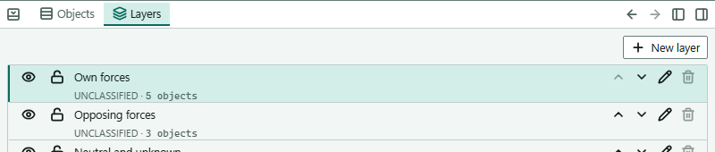
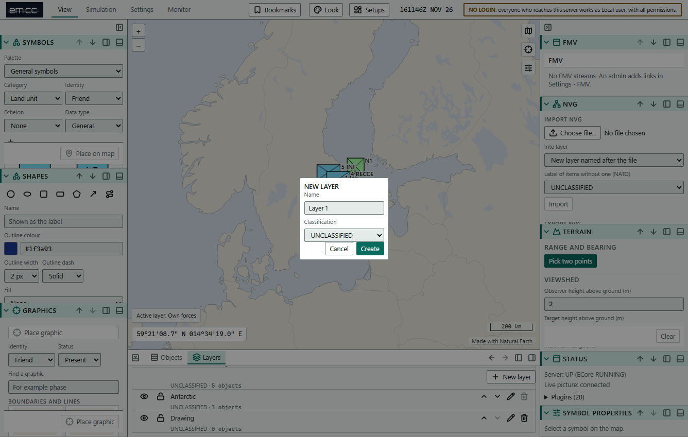
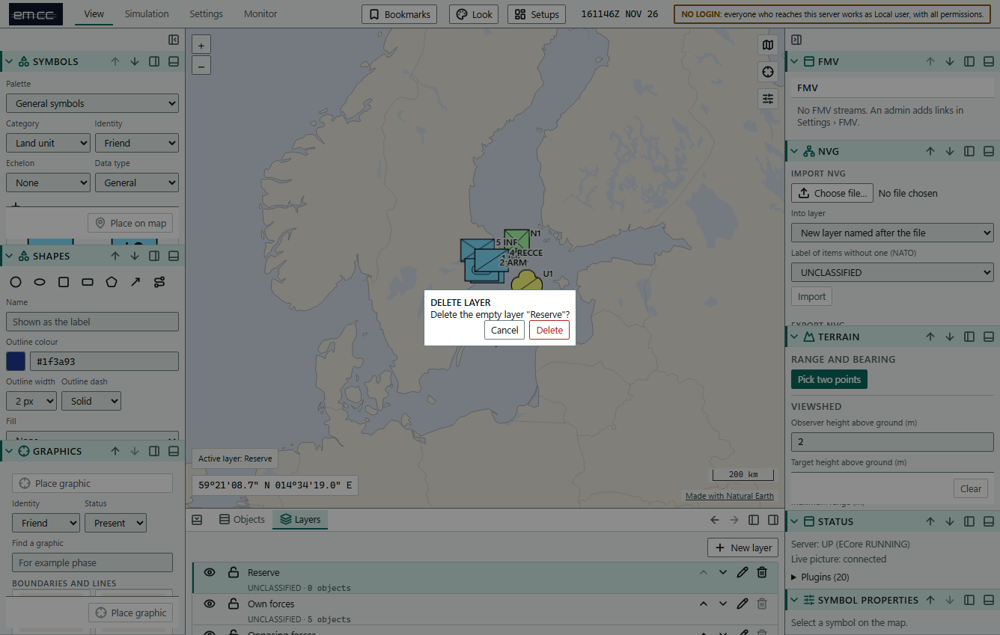
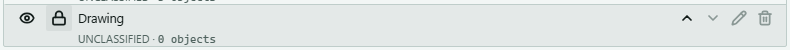

# Layers

Every object on the map is in a layer. Layers let you group objects, switch groups on and off, and decide what is drawn on top. The Layers panel lists them. It is a tab in the bottom pane, next to Objects.

The layers are the same for every user. When someone creates, renames, reorders or deletes a layer, you see it without reloading.

When you start emcc for the first time and there are no layers, emcc creates one called "Drawing". The demo scenario has the layers Own forces, Opposing forces, Neutral and unknown, Arctic, Antarctic and Drawing.

## The list

The layer at the top of the list is drawn on top on the map. Each row shows:

| Part | What it does |
|---|---|
| Eye | Shows or hides the layer on your map only (button title "Hide in this browser"). Other users are not affected |
| Lock | Locks or unlocks the layer for everyone (see below) |
| Name | The name of the layer. The highlighted row is the active layer |
| Classification and count | For example "UNCLASSIFIED · 5 objects" |
| Up and down | Moves the layer up or down in the order |
| Pencil | Renames the layer |
| Bin | Deletes the layer |

Your eyes are part of your [setup](03-08-setups.md): they come back when you restore it.

## The active layer

The active layer is where new symbols, shapes and graphics go. The map shows its name in a small label at its bottom left, "Active layer:" and the name of the layer, with a lock in front of the name when the layer is locked, in every workspace. The label only shows: you change the active layer in the Layers panel. When you start, it is the layer at the top. Click a layer's row, or press Space on its name, to make it the active layer. If the active layer is deleted, the next one down becomes active.

## Creating a layer

Click **New layer**. A box asks for the layer's **Name** and its **Classification**.

- **Name.** The box suggests "Layer 1", "Layer 2" and so on, one more than the highest of those names. Type another if you like.
- **Classification.** The list holds the classifications of the label policy, lowest first, and the layer starts with the default one, UNCLASSIFIED in the demo. Choose a higher one if the layer is for objects that need it. An administrator can change it later: see [Layers](05-04-layers.md). For now the classification is a mark: it does not limit who sees the layer.

**Create** makes the layer on top. An empty name is refused with "Enter a name", and the box stays open. **Cancel** and Escape close the box and make nothing.

If all layers have been deleted, the panel shows **Create first layer**.

## Renaming a layer

Click the pencil, or press F2 on the row. Type the name and press Enter. Press Escape to cancel.

## Changing the order

Use the up and down buttons on a row, or drag the row to its new place. The order is shared by everyone.

## Deleting a layer

Only an empty layer can be deleted. For a layer that holds objects, the bin is disabled and its title says so, for example "Own forces has 5 objects: only empty layers can be deleted". Delete the objects first (see [The map](03-02-map.md)). A question asks you to confirm, for example Delete the empty layer "Layer 1"?, with the buttons **Cancel** and **Delete**.

## Locking a layer

Locking a layer stops everyone from changing what is in it. Use it to protect objects that must not change, for example an agreed plan.

Click the lock to lock the layer, and click it again to unlock it. The lock belongs to the layer and counts for every user. The button's title is "Lock layer" or "Unlock layer".

While a layer is locked:

- nobody can place into it, draw into it, edit, move or delete its objects, or move objects into it. Their panels show the objects read only and say that the layer is locked;
- you can still switch the layer on and off with the eye, and make it the active layer. You then cannot place into it until it is unlocked;
- you can still move the layer up and down, but you cannot rename or delete it;
- objects that arrive from other systems still update it: the lock stops people, not incoming data.

If someone locks a layer just as you are about to change it, you get a message that the layer is locked, with its name.

## Who may change layers

Creating, renaming, reordering, deleting and locking need permission to edit layers. Without it these buttons are switched off with the hint "You may not change layers". The lock button then shows the state, disabled, with the title "You may not change this layer". Everyone can see the list, switch layers on and off for themselves, and choose the active layer.

## Opening a layer's objects

Double-click a layer's row, or press Enter on its name, to show its objects in the [Objects](03-15-objects.md) panel.

## The classification of a layer

The classification shown in each row is part of the layer's security label. An administrator changes it in Settings: see [Layers](05-04-layers.md).
