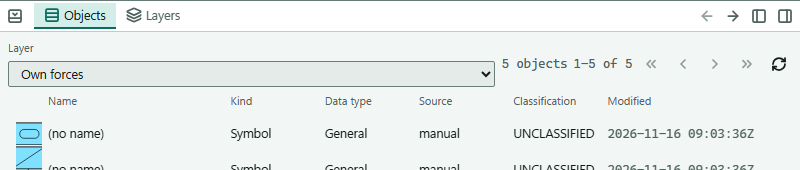
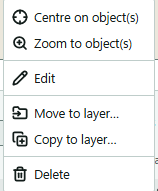
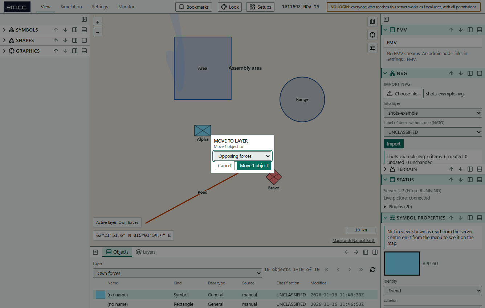
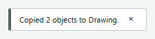

# Objects

The Objects panel lists the objects in one layer, page by page. It is a tab in the bottom pane, next to Layers. Use it to find an object, to see what a layer holds, or to select objects that are hard to click on the map.

## Showing a layer's objects

Choose a layer in the **Layer** list at the top of the panel, or double-click a layer in the [Layers](03-14-layers.md) panel, which brings Objects forward with that layer. A layer that is switched off on the map is listed like any other. Until you choose a layer, the panel says "Choose a layer to list its objects".

Next to the layer's name the panel says how many objects the layer holds and which ones you see, for example "5 objects 1–5 of 5". When the layer has more objects than fit on a page, use the buttons to go to the first, previous, next and last page. A page holds 100 objects by default. An administrator can change that: see [Objects](05-16-objects.md) in Settings.

The **Refresh** button reads the page again. The list also reads itself again when the number of objects in the layer changes.

An empty layer shows "No objects in this layer".

## The columns

| Column | What it shows |
|---|---|
| (picture) | The symbol itself, for symbols |
| Name | The name of the object, or "(no name)" |
| Kind | Symbol, or the kind of shape: Circle, Rectangle and so on |
| Data type | The object's data type |
| Source | Where the object comes from. Objects you place yourself have the source "manual"; others come from other systems |
| Classification | The security classification of the object |
| Modified | When the object was last changed |

In a narrow pane the picture, the name and the kind stay, and the rest is shown when you point at a row.

## Selecting

The rows and the map share one selection.

- Click a row to select that object. This replaces the selection.
- Hold Ctrl and click a row (Cmd on a Mac) to add the object to the selection or remove it.
- Objects you select on the map are marked in the list.
- You can select at most 1 000 objects.

Use the arrow keys to move between rows, Space to select, and Shift+F10 or the menu key to open the menu.

## The menu on a row

Right-click a row to open the same menu as on the map: **Centre on object(s)**, **Zoom to object(s)**, **Edit**, **Move to layer…**, **Copy to layer…** and **Delete** (see [The map](03-02-map.md)). It works on the selection, as on the map. This is how you reach an object that is outside the current view: right-click its row and choose **Zoom to object(s)**.

Double-click a row to zoom the map to that object.

## Moving and copying to a layer

**Move to layer…** and **Copy to layer…** are in the menu on the map and in the menu on a row. They work on one object or on the selection, up to 1 000 objects at a time, in the current workspace only.

1. Select the objects, right-click one of them and choose **Move to layer…** or **Copy to layer…**.
2. A box asks "Move 1 object to" or "Copy 2 objects to". Choose a layer from the list. The list holds the layers of this workspace that you may change: a locked layer is not in it.
3. Click the button, which says how many objects it works on, for example **Move 1 object**. **Cancel** closes the box and does nothing.

When it is done, a note at the bottom left says what happened, for example "Copied 2 objects to Drawing." If some objects could not be moved or copied, the note says how many and why, for example that a layer was locked. Each object is handled by itself, so the others are done.

- **A move** puts the same object in another layer. It keeps its name, its place, its fields and what it is related to. It is changed in one step, and you move it back in the same way. A track that arrives from another system stays in the layer where you put it: the layer of the link is where new tracks appear.
- **A copy** is a new object of its own, a snapshot. It has the same content, the same field sets and the same label as the original, and it belongs to the manual source, as an object you place by hand. It does not fade and does not expire, also when the original is a track that does. It is not connected to the original: a later change of one does not change the other. To get rid of a copy, delete it.
- **Locked layers.** You cannot move objects out of or into a locked layer. You can copy out of a locked layer, but not into one.
- **The permission** is the one for editing objects in that workspace. Without it the items are not in the menu.

## What the list does not do

You cannot sort or filter the list, search across layers or change objects in the list. Use the menu to edit or delete an object.
