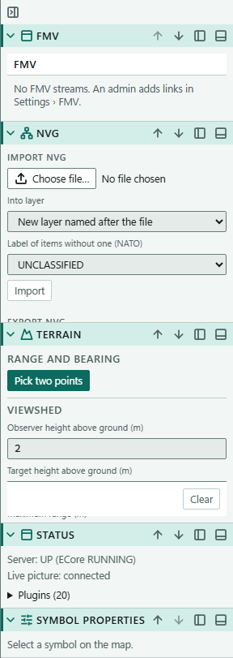
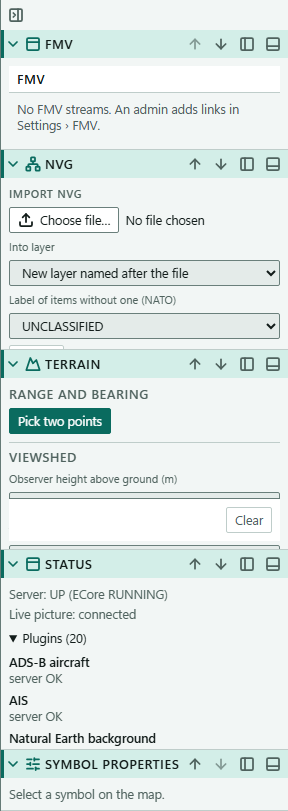

# Status

The Status panel shows whether emcc is working. It is in the right pane. It is short: use it as a quick check. Administrators get the full picture in the [Monitor](06-00-monitor.md).

## What it shows

| Line | Meaning |
|---|---|
| Server | The state of the emcc server. "UP (ECore RUNNING)" means the server is up and running |
| Live picture | Whether your browser is connected to the shared live map. "connected" is what you want to see. When it is not connected, changes by other users do not reach you |

**Plugins** shows the number of plugins that run. Click it to open the list. Each plugin has one line for its server part and one for its web part, for example "server OK · web OK: ready". A plugin that has only one part shows only that one. A few plugins say a little more:

- "WMS background maps": "0 background maps provided" means no WMS background has been set up yet (see [WMS background maps](05-21-wms.md)).
- "2D map view": "DEGRADED: drawn without a GPU" is not an error. It means your computer draws the map without a graphics card: see [The map](03-02-map.md).

A problem is shown in colour. Something that works with limits is DEGRADED, and something that is not working is shown as an error, with the reason.

If a plugin is not OK and you are not an administrator, tell one. The list of plugins and what each does is in [The plugins](01-01-plugins.md).
