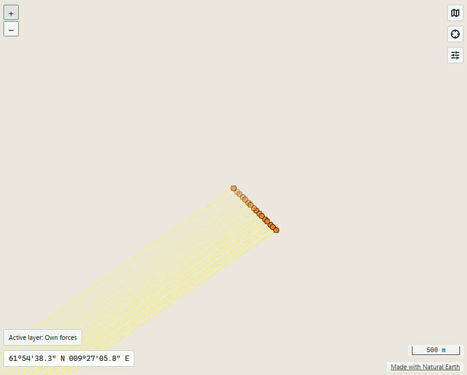
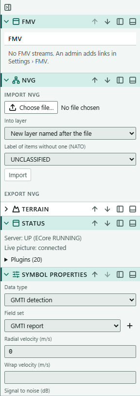
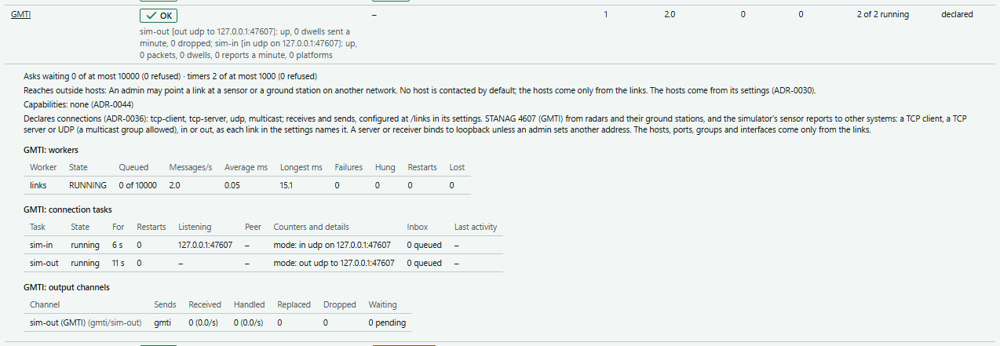

# GMTI on the map

GMTI stands for ground moving target indicator: a radar on an aircraft or a vehicle that sees what moves on the ground. Its data is exchanged in the NATO format STANAG 4607. The GMTI plugin receives that data from radars and from recordings, and shows it on the map. It also sends the simulator's sensor reports out in the same format.

This chapter tells what you see. The administrator sets up the links: see [GMTI](05-14-gmti.md) in Settings. Sensors in the simulation are described in [Sensors](04-04-sensors.md).

## Where GMTI comes from and goes to

- **In:** a link that receives goes into a layer of View. It can connect to a radar, a ground station or a replay over TCP, or listen for UDP packets.
- **Out:** GMTI goes out only from the simulator's ground radars, and only to a GMTI link that is set to send.

## What you see

The dwell areas are green (`#7EF26A`) and the coverage box is yellow-green (`#BDCF3D`) by default, and the pairing line is yellow. An administrator can choose another colour for the dwell areas, for the coverage and for the pairing line: see [GMTI](05-14-gmti.md), where "Which setting colours what" tells which setting colours which thing. A new colour for the dwell areas shows from each sensor's next dwell, and the areas already drawn keep theirs; the pairing line changes at once. You can hide the dwell areas and the coverage for yourself, and the pairing line too: see "Hiding what you do not need" below.

A radar's report is a **dwell**: one look at a patch of ground. emcc shows it as four kinds of objects, all in the layer that the link writes to:

| On the map | What it is |
|---|---|
| The **platform** | The aircraft or vehicle that carries the radar. Its name is the radar's identity: at most 10 characters. A longer name is cut, and letters such as å, ä and ö are replaced |
| The **dwell area** | The patch of ground the radar looked at in one revisit, drawn as a circle or as a band round the platform, with a solid outline 2 px wide. It has no name. It is never wider than 255.99 km on either side of its centre |
| The **coverage** | The area the radar has been told to scan, which it sends in its job description: a box with four corners, drawn as a thin dashed outline. The dwell areas usually lie inside it |
| The **detections** | One mark for each thing the radar saw moving. They are sensor reports, not tracks: they have no name and no identity, and they never move. Every detection is drawn with the same small sensor report symbol, a dot, a cross, a ring or the like, in a colour of its own |

, its coverage (the dashed yellow-green box), and a detection with the yellow line to its platform.")

A detection shows where the radar saw something at one moment. Its mark does not change with the symbol size of [Display settings](03-05-display.md), and it has no label or speed vector. An administrator chooses its shape, colour and size: see [Symbology](05-19-symbology.md). You still select a detection by clicking it, and read its values in [Symbol properties](03-10-symbol-properties.md). A newer dwell makes new detections. The old ones **fade in steps** (see "How detections and dwell areas fade" below): with the settings as delivered, a detection is drawn fully until 10 seconds after the report; from then on it gets fainter in steps of 5 %, the first step 4.5 seconds later, and it is not drawn from 100 seconds after the report. An administrator can change that: see [GMTI](05-14-gmti.md).

The **speed** of a detection is its speed towards or away from the radar, and not its speed over the ground. A radar cannot tell which way a vehicle moves across its line of sight.

Nothing shows until the radar has sent its mission description. That can take up to two minutes after the link starts. If the sender sent it only once, before the link joined, it never comes, and nothing shows.

 and the detections.")

### A revisit's dwells

A radar looks at its search area one dwell after another, and it goes round the area again and again. One round is a **revisit**. The map shows **one dwell area for each revisit**, and it has no name. The area is the smallest band that holds all the dwells of the revisit, so it grows while the dwells come, and you see the radar's scan as it happens. A new revisit starts a new area. The old ones are not taken away by the new one: each fades in steps, counted from its newest dwell, and goes by itself (see "How detections and dwell areas fade" below). A radar whose revisits take 2.5 to 3 seconds has about 35 to 40 areas at a time, and not about 1 000, one for each dwell. Some of the dwells have no detections: they show where the radar looked and saw nothing, and they are part of the revisit's area too.

emcc decides which dwells belong to one revisit. A dwell starts a new one when its revisit number (the field `D2` of the format) differs from the group's, when its dwell number (`D3`) is lower than the last one's, or when it comes more than 10 seconds after the first dwell of the group; a dwell that is marked as the last of its revisit ends its group. A radar that does not mark its revisits therefore gets one area for each 10 seconds of scanning.

### The coverage box

The coverage shows where the sender says the radar works. The sender repeats it at least every 30 seconds, and it goes when the radar's job ends. It is the **job area** of the radar: the area that the radar is tasked to scan.

 and, inside it, a dwell area of a sensor that looks to the right of its platform (bearings 45° to 135°). Each revisit has its own area.")

The box is thin and dashed, so that it differs from the dwell area. The dwell area is green and the box yellow-green, unless an administrator has chosen other colours for them. A radar that has sent no job description shows no box, and a box that encloses no area is not drawn. There is one box for each platform: when a radar has several jobs, the box of the latest job description is drawn, so the box can change from one job's area to another's.

When the sender is the simulator of another emcc (see "Trying it without a radar" below), the box is the sensor's **job area** if you have drawn one for it (see [Sensors](04-04-sensors.md)). The corners go out starting with the first one you drew, and then clockwise, as the format asks. A job area that is not a four-cornered, convex area is sent as the box round it. Without a job area the box is drawn round the dwell area, with its sides north and south, east and west, so you see the sensor's dwell inside the box.

The administrator can switch the coverage off for a link: see [GMTI](05-14-gmti.md). You can hide the coverage on your own map with the switch **Sensor coverage** in Display settings: see below.

### How detections and dwell areas fade

A detection is not a track, and it is old as soon as the radar looks again. So the map lets each detection **fade in steps** after its report, and does the same for each dwell area. The steps are the same for every user, and an administrator sets them in [GMTI](05-14-gmti.md) (Settings, Data Links, GMTI). With the settings as delivered:

| Time after the report | How much of the detection is drawn |
|---|---|
| 0 to 14.5 s | All of it |
| from 14.5 s | 95 % |
| from 19 s | 90 % |
| from 55 s | 50 % |
| from 100 s | Nothing: it is **invisible** |

Each further step is 5 % less, about every 4.5 seconds. The time counts from when the radar saw the target (the time of the dwell, for an area). A change of the settings reaches what is already on the map within a second, without a reload.

- **An invisible detection is not gone.** It stays in the layer and in the Objects list until its data type removes it: with the data type's settings as delivered, 180 seconds after the report (60 seconds until it expires, then 120 seconds). You can still find it in the Objects list, but it is not drawn. See [Data types](05-03-data-types.md).
- **A dwell area** fades the same way, from the time of its newest dwell, and a new dwell of the same revisit draws it fully again, as it grows. When it is invisible it is gone: its data type removes it 100 seconds after its newest dwell, which is when the steps as delivered make it invisible. The platform and the coverage box do not fade by these steps: they keep the fading of the data type GMTI platform.
- **Fade in steps off.** An administrator can switch the steps off. The detections and areas are then drawn fully until their data type's expiry, and faded after it, as the data type says.
- **A replayed recording.** With the link's **Time** set to `as-recorded`, the detections of an old recording have their old times and are invisible at once. Use `as-received` to replay them.

### The yellow line

A detection is paired with its platform. The pairing is drawn as a thin yellow line from the detection to the platform. It is **on by default** from this release; you can switch it off with **GMTI Pairing** in [Display settings](03-05-display.md). An administrator can choose another colour for it.

- **The line stays when the platform is far away.** Zoom in on a detection that is 100 km from its platform, so that the platform is outside your view, and the line still runs to it. It follows the platform within about two seconds when it moves. It goes when the platform is deleted, or when the detection is gone.
- **The line fades with its detection.** When a detection fades, its line fades in the same steps, and it is not drawn when the detection is not drawn. The platform's fading does not fade the line.

### Hiding what you do not need

[Display settings](03-05-display.md) has a part **Areas** with two switches, both on by default and both your own:

| Switch | What it hides |
|---|---|
| Dwell areas | The dwell areas of GMTI, and, in the Simulation workspace, the dwells that the sensors draw |
| Sensor coverage | The coverage boxes of GMTI, and, in the Simulation workspace, the coverage, the job area and the labels of the sensors |

Hiding deletes nothing. The platforms, the detections and the pairing lines stay. A hidden thing cannot be clicked on the map.

## Looking at a detection

Click a detection and open [Symbol properties](03-10-symbol-properties.md). Below the data type is the group **GMTI report**. It holds what the radar said about the detection:

| Field | What it means |
|---|---|
| Radial velocity | The speed along the line of sight, away from the radar positive |
| Wrap velocity | Half the velocity aliasing period of the radar: the true radial velocity may differ from the one shown by a multiple of twice this |
| Signal to noise | How strong the echo was, in dB |
| Classification, Class probability | What the radar thinks it is (for example "tracked vehicle"), and how sure it is, in percent |
| Slant range error, Cross range error, Height error, Radial velocity error | How uncertain the measurement is. One standard deviation |
| Radar cross section | How well the thing reflects radar, in dBsm |
| Truth tag | For simulated targets: the identity of the simulated target |
| Job, Revisit, Dwell, Report | Where in the radar's job the report belongs |

You cannot change these fields. The plugin sets them.

The classification of each object is the one the packet says, or the layer's label, depending on how the link is set up.

## Trying it without a radar

You can feed emcc its own GMTI. It needs two links and a sensor:

1. In [GMTI](05-14-gmti.md) in Settings, add a link that sends: Mode udp, Direction out, Host 127.0.0.1, Port 47607. Add a second one that receives: Mode udp, Direction in, **Set Listen on** with the address 127.0.0.1 and the port 47607, and a new layer for it with the **+** button. Save each link with **Save link**.
2. In the Simulation workspace, put a track on a route and make a [sensor](04-04-sensors.md) on it. Choose the link that sends as its output. A new ground radar looks all round its platform, between 20 and 150 km. Tick **Detect all in range** to see every track in range, at its true position.
3. Put other tracks on a route near the platform, and start the simulation.
4. In View, switch on the new layer and look at the map.

In View you see the sensor's coverage box as a dashed outline, and the dwell areas of the radar inside it. In the Simulation workspace, the sensor draws its own coverage: see [Sensors](04-04-sensors.md).

When the platform moves, each dwell is centred on the platform **where it is when the dwell is sent**, and it keeps its own shape and width: a dwell of 2° is still a narrow wedge of 2° in View, and not a wide sector or a ring. View draws the dwell from what it is sent, so the shape follows the Simulation workspace's.

The Monitor shows the two links, and how many dwells they have sent and received: click GMTI in the plugin table. See [The Monitor](06-00-monitor.md).

## Good to know

- **Replays.** A recording that is replayed carries its old times, so its detections would be expired at once. An administrator sets the link's Time to `as-received` to make the newest dwell count as now.
- **Empty dwells.** The empty dwells of a simulated radar are spread over the whole search area, so that a revisit looks like a radar that scans. The revisit of a simulated radar is filled with dwells, one for each dwell interval, and the ones that have no targets are empty. A radar that has no targets shows only empty dwells. Nothing sets a share of them: see [Sensors](04-04-sensors.md).
- **Large dwells.** A dwell has at most 1 000 detections by default. The rest are left out and counted.
- **One segment per packet.** A sending link sends each part of a report in a packet of its own, because some tools read only the first part of a packet. An administrator can change that. See [GMTI](05-14-gmti.md).
- **Sending.** A receiving system sees each restart of a sending link as a new mission. A sending link can mark its data as exercise data, and holds back detections above a classification you choose. See [GMTI](05-14-gmti.md).
