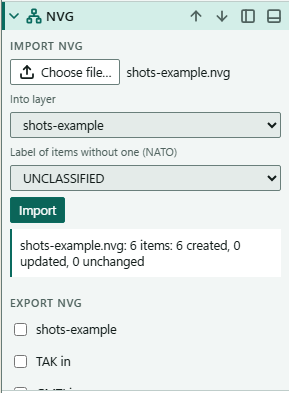
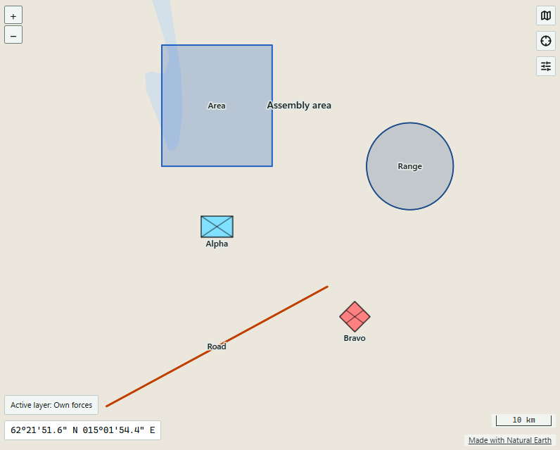
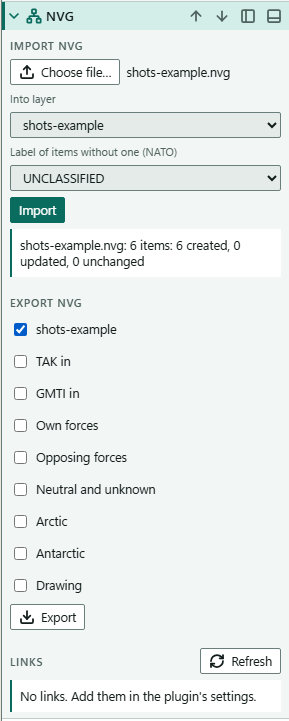
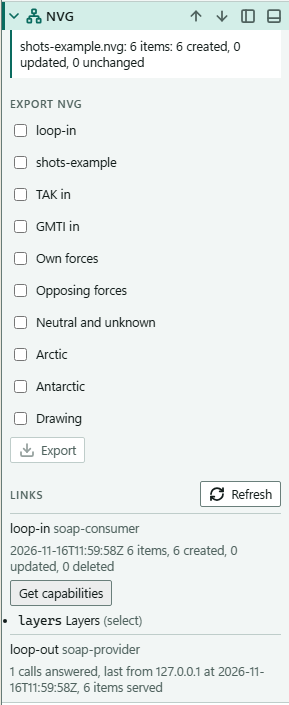

# NVG: import and export

**NVG** (NATO Vector Graphics) is a format for exchanging a picture made of symbols, lines, areas and texts between systems. The **NVG panel** reads an NVG file into emcc and writes layers out as an NVG file. emcc reads NVG 2.0.0, 2.0.1 and 2.0.2, and writes 2.0.2. The panel is in the right pane, and it is in every workspace.

Other systems can also exchange NVG with emcc over a network, by NVG web service links that an administrator sets up: see [NVG](05-23-nvg.md) in Settings. The panel lists those links for administrators.

## Importing a file

1. Click **Choose file…** and choose an `.nvg` or `.xml` file.
2. Choose where it goes in **Into layer**. The list has **New layer named after the file** (the default: the layer gets the file's name without its ending) and the layers of the workspace that you may edit.
3. Choose **Label of items without one**. It is the security label for the items that have none of their own. It starts as the server's default label, for example UNCLASSIFIED. An item that carries a label in the file keeps it.
4. Click **Import**.

The panel says what happened in one line, for example "shots-example.nvg: 6 items: 6 created, 0 updated, 0 unchanged". If some items were left out it adds why, for example "skipped: content-item 1". If the whole file is refused, the panel gives the reason, for example "NVG 1.5 is not supported; 2.0.x only", "a document with a DTD is refused" or "not XML" with the parser's message. Nothing is imported from a refused file. A new layer that the panel made for the file is removed again, so a refused file leaves nothing behind. The same happens when an import puts nothing into the new layer, for example when the server refuses it before it starts, or when the file has no item that could be made. A layer that you chose in **Into layer** is never removed.

What the items become:

| In the file | On the map |
|---|---|
| A point with an APP-6B, APP-6D or APP-6E symbol | A symbol of that standard. Its speed and course become the symbol's speed and heading |
| A point with another symbol (MIL-STD-2525, APP-6A or APP-6C, or none) | The unknown symbol. The original code is kept, and it goes out again with the layer |
| A text | A **text object**: the text, drawn at its point, turned by its rotation |
| A line, an arrow, an area, a circle, an ellipse, a corridor, an arc band | A shape of the same kind |
| A rectangle or an orbit | An area, built from it |
| An arc, or a line of constant bearing (a rhumb line) | A line, with enough points to follow the curve |
| A multipoint or a line with a tactical graphic's code | A tactical graphic, its points in the order that the file gives |
| A group (`g`) | The items are put in the layer one by one. The group's names are kept in the item |
| A composite | One object for each part. The parts after the first are related to the first one: the relation line **NVG composite** (grey, off by default) can show it in [Display settings](03-05-display.md) |

The items are **ordinary objects** with the data type **General** (a text has its own kind). You move, edit, copy and delete them with the usual tools, like objects that you made by hand. Their source says that they came from an NVG file.

- **The same file again** updates what it made, wherever you have moved it to since. Items that the file has and the layer lacks are made, and nothing is deleted: a file is not the whole picture. Items that have not changed are counted as unchanged.
- **Label of items.** An item's own security label is read from the file when it has one. Otherwise it gets the label of the file as a whole, and otherwise the label you chose in the panel. An item whose classification emcc does not know is left out and counted.
- **A name and a description.** The item's label text becomes the object's name, and its text information the description. Colours, line widths, dashes and fills are read from the item's style. The colour of a text is its `fill`, as in SVG.
- **Everything else** that emcc has no place for, such as the links, extra data and altitudes of an item, is kept in the object and written out again.

### Who may import

Import needs the permission to edit objects in the workspace that you are in. Without it, or without the permission to make layers for **New layer named after the file**, the panel says "You may not edit the layers of Simulation: import is not available" and the button is off. A locked layer is refused with the message "The layer is locked". The list **Into layer** does not offer a locked layer: unlock it in [Layers](03-14-layers.md) first. The server checks the permission again, as for every change.

## Exporting layers

1. In **Export NVG**, tick one or more layers. The list has the layers of the workspace that you are in.
2. Click **Export**. Your browser saves the file `<name of the first layer>.nvg`.

The file has one group for each layer, named after the layer, and **every object** of the layer in it, each with its security label: symbols, texts, shapes and tactical graphics, and also objects of other plugins, such as a route, which are written by their shape. You get what you may see: an object that you may not see is left out.

How an object is written:

- A symbol is written as a point with its APP-6B, APP-6D or APP-6E code, as the symbol has it, and a ship (a vessel symbol) as a sea surface symbol of its identity. A symbol that came in with a code of another standard goes out with that code.
- A circle, an ellipse, a corridor and an arc band are written as the element of the same name.
- A line is written as a polyline, or an arrow when it has an arrowhead. An area is written as a polygon.
- A text is written as a text.

## Text objects

A text object is the text of an NVG `text`, placed on the map. It is drawn centred on its point, in the size and colour that it has, and turned by its rotation (clockwise from north). It is always drawn, at every zoom, since it is an object and not a label. You select it by clicking its text. A selected text is moved with the mouse like other objects, and it is in the menus as other objects. In this release you cannot draw a text, or change what it says, by hand: only NVG makes them.

## Links

The part **Links** of the panel is shown to administrators only. It lists the NVG web service links that have been set up, and what each one is doing. Click **Refresh** to read the state again.

- A link that **reads** (consumer) shows the time of its last call and what it did: "6 items, 6 created, 0 updated, 0 deleted".
- A link that **offers** (provider) shows how many calls it has answered, the address and time of the last one, and how many items it has served. It also shows the address under which other systems reach it, for example `/api/services/nvg/nvg/loop-out`.

At each reading link there is **Get capabilities**. Click it to ask the provider which filters it offers. The panel lists them, each with its id, its name and its kind, for example "layers Layers (select)". The administrator uses the ids when setting the link's filter.

## When something does not work

| What you see | What it means |
|---|---|
| "NVG 1.5 is not supported; 2.0.x only" | The file is another version of NVG. emcc reads 2.0.0 to 2.0.2 |
| "a document with a DTD is refused" | The file has a document type declaration. emcc refuses it, for safety |
| "not XML: …" | The file is not an XML file. The rest of the message is the parser's |
| A message about a limit | The file is bigger than allowed: 16 MB, or deeper than 64 levels, or more than 100 000 items or 1 000 000 points. An administrator can lower the size limit |
| "The layer is locked" | Unlock the layer or choose another |
| "You may not edit this layer" | You do not have the permission to edit objects in that workspace |
| Items are counted as skipped | The panel says why. A `content-item` has no geometry and is always skipped |
