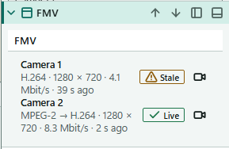
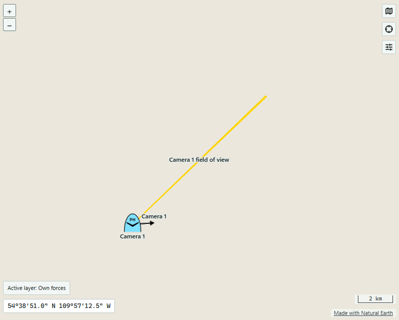
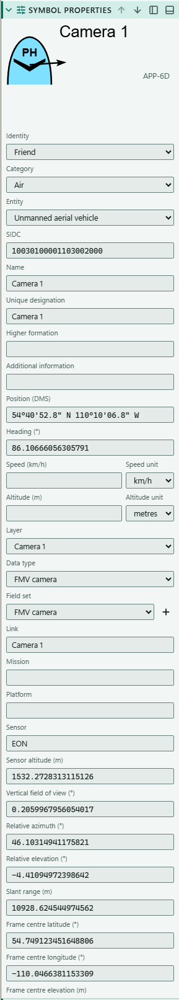
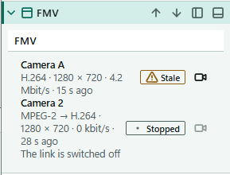

# FMV: full motion video

FMV stands for full motion video: live video from a camera, usually on a UAV, sent in the NATO format STANAG 4609. The video comes with metadata that says where the camera is and where it looks. The FMV plugin receives that stream over UDP and shows three things:

- the **camera** on the map, as a symbol,
- the camera's **field of view** on the map, as an open arc,
- the **video** itself, in a window that you open from the **FMV panel**.

This chapter is about **receiving** video. emcc can also **send** the video of a simulated camera, which it draws itself: see [A simulated camera](04-06-camera.md). It records no video.

The panel is in the right pane of the View workspace. The administrator sets up the links in Settings. This chapter tells what you see and how you watch.

## Setting up a link

A link of the direction **in** is one stream. An administrator adds it in Settings, under Data Links, in the category **FMV**. The links are a table with a form beside it (see [Lists of links](05-00-settings.md)): click **Add link**, fill in the form and click **Save link**. The form has the groups Connection, Picture and Classification, and a folded group Advanced. Its fields are:

| Setting | What it does | Default |
|---|---|---|
| Name | The name of the link, 1 to 64 characters. It names the new layer, and the camera and its arc when the stream names none. Renaming a link keeps its camera, its arc and an open video window | Required |
| Enabled | Whether the plugin runs the link. Stopping a link keeps its camera and its arc, and its row in the panel | On |
| Direction | **in** receives a stream and is what this chapter describes. **out** sends the video of a simulated camera: see [FMV output links, imagery and terrain](05-24-fmv-output.md). The form shows only the fields of the direction that you choose | in |
| Mode | **udp** listens for a unicast stream on an address and a port. **multicast** joins a group on the interface that you name | udp |
| Address, Port | For udp: the local address to listen on and the port. Without an address the link listens on this computer only. The administrator can write another address, or `0.0.0.0` for the whole network | Port required |
| Group, Interface, Port | For multicast: the group, the interface (both required), and the port. A multicast link without an interface stays stopped and says so | Required |
| Layer | The layer for the camera and its arc. Empty: a new layer named like the link | A new layer |
| Camera symbol, Camera identity | The camera's symbol (an APP-6D code of 20 digits) and its identity | A UAV with photographic reconnaissance, friend |
| Field of view colour | The colour of the field of view's line, `#RRGGBB` | `#FFD400` (yellow) |
| Label, Classification, Classification names (group Classification) | The security label of the layer (it is only in force when you click **Set Label**), and how the objects get theirs. **map** gives the camera, the arc and the stream the classification that the stream says (the code of the NATO security metadata, from 1 UNCLASSIFIED to 5 TOP SECRET). **link-label** gives them the link's label | map |
| Time (group Advanced) | **received** gives the objects the time when emcc received the data. **stream** gives them the time that the stream says. A recording that is replayed has old times, so received is the default | received |
| Stale after (group Advanced) | From 2 to 300: how long the stream may go without metadata before the panel says **Stale** | 10 |

A change to the layer, the label, the symbol, the identity, the colour, the classification, the time or the stale seconds applies without a restart of the link. The first program in the stream that has video is the one that is used: one link shows one stream.

Nothing shows until the first datagram arrives. A link that listens and has received nothing says Listening in the [Monitor](06-00-monitor.md). When it has a stream, a row appears in the FMV panel and the camera appears on the map.

To try it without a camera, send a recording of STANAG 4609 to the link's port with a replay tool. The camera, the arc and the video then behave as for a live camera.

## On the map

For each stream the layer gets two objects, both with the link's name in lower case as their data source:

- The **camera**, a symbol at the position that the metadata gives, with the heading of the platform. It is named by the platform's designation (or the mission, or the name of the link) and drawn as a UAV that carries a photographic reconnaissance sensor.
- The **field of view**, an arc from the camera: a line, with no fill, in the link's colour. It points at the **centre of the frame** where the video looks and reaches the ground there, when the metadata says where that is. Otherwise it points the way the platform heads, turned by the sensor's angle, and reaches as far as the slant range. The arc is as wide as the sensor's field of view, so a narrow lens gives a thin wedge, and a very narrow one a line.

The two objects are ordinary objects in a layer: you can select them and look at them in the Objects list. The link writes them again with each new set of metadata, so a change that you make by hand does not last. Their data types are **FMV camera** and **FMV field of view**. They do not expire unless an administrator sets that in [Data types](05-03-data-types.md). When the metadata stops, they keep the last position, and the panel says Stale. Removing the link deletes them. Stopping or disabling it keeps them.

The camera's **Symbol properties** have the field set **FMV camera**. The fields come from the metadata and cannot be changed by you: the link, the mission, the platform, the sensor, the height of the sensor, the sensor's vertical field of view, its angles relative to the platform, the slant range, the frame centre (latitude, longitude and height), the video format, the classifying country, the releasing instructions, the version of the metadata and the time of the last set.

The map follows the metadata at most twice a second for each stream, and the newest set wins. If a set has no direction, no length or no field of view, the arc is not redrawn and keeps what it had.

A dotted line from the camera to its field of view is available as a relation, **FMV camera and view**, in [Display settings](03-05-display.md). It is off by default, and since the arc starts at the camera it shows little.

## The FMV panel

The panel has one row for each link that has received a stream. A row says:

- the name of the stream (the link's name),
- the **format**: H.264, H.265, **MPEG-2 → H.264** (the stream is converted on the server), or the name of another format,
- the size of the picture, when it is known, for example 1280 × 720,
- the bit rate over the last five seconds,
- the age of the last metadata set, for example "9 s ago", or "no metadata",
- a **state**, and the **Watch** icon at the end of the row.

| State | What it means |
|---|---|
| Live | Metadata has arrived within the stale time |
| Stale | No metadata for longer than the stale time. The camera and the arc stay where they were |
| Waiting | An MPEG-2 stream waits for a free slot in the converter. The row says "Waiting for a conversion slot" |
| Not playable | The video cannot be played. The row says why, for example "No converter installed", "No video in the stream" or "Not playable: JPEG 2000" |
| Stopped | The link is stopped or disabled. The row says "The link is switched off" when it is disabled |

**Watch is enabled only for a row that can play: Live or Stale.** For a row that is Waiting, Not playable or Stopped the icon is dimmed, and its tooltip says why, for example "The link is switched off".

With no rows the panel says "No FMV streams. An admin adds links in Settings › FMV." Everybody who is logged in sees the list. The **Watch** icon is shown only to users with the permission **Watch FMV** (`plugin.fmv.view`). The release gives it to everyone who has logged in, and without a login every user has it. An administrator may give it to chosen groups instead. See [Users and permissions](01-03-permissions.md).

## Watching the video

Click **Watch** at the end of a row. A floating window opens over the map, with the name of the stream as its title.

 and the footer with the format, the size and the delay behind live.")

- The **classification line** under the title shows the classification of the stream, so that you see it next to the picture.
- The **footer** says the format, the size and how far the picture is behind live, for example "0.4 s behind live". A normal delay is a fraction of a second.
- Drag the **title** to move the window and the **grip** at the lower right corner to change its size. There is one window for each stream, and you can have several open at once. The windows stay open when you close the pane that holds the panel. They belong to the map, so a workspace without a map has none.
- Click the **×** to close the window. Closing it stops the player.

**What plays.** H.264 plays in the browser. H.265 plays only in a browser that can decode it, and otherwise the window says "This browser cannot play H.265." and the stream is never converted. MPEG-2 is converted to H.264 by the server before it is sent to you, with the converter that is shipped in the release (a small build of ffmpeg, in the folder `tools`; Windows only in this release). The row says "MPEG-2 → H.264", and the stream plays like an H.264 stream. Where the server has no converter, an MPEG-2 stream says "No converter installed", and its state is **Not playable**. Other formats, for example JPEG 2000, are listed in the panel and not played.

**A window follows its link.** If an administrator renames the link, the window stays open and goes on playing: it follows the link, and its title changes to the new name. If the link restarts, or the stream is closed, the window tries again every two seconds as long as it is open, and tells you why in the window:

| The window says | Why |
|---|---|
| Too many viewers. Trying again. | The server has as many viewers of the stream as it allows. It tries again |
| You may not watch this stream. | You do not have the permission to watch. It does not try again |
| The stream has stopped. | The link has stopped or restarted. It keeps trying |
| The video stopped. Trying again. | The stream ended or failed for another reason. It keeps trying |

A browser's video decoder stops for good when a frame in the stream is damaged. The window then starts a new player at once, at the next start point of the stream. You see a pause of a second or two for each damaged frame.

## When it does not work

| What you see | Why, and what to do |
|---|---|
| No row in the FMV panel | The link has not received a stream yet. Check that the link is on, that its port is the port that the sender uses, and that the sender sends a UDP transport stream. The [Monitor](06-00-monitor.md) shows the plugin FMV and its counters |
| A row, but the state says Not playable: "No video in the stream" | The stream's program table lists no video. Another program may be sent, but only the first program with video is used |
| "No converter installed" | The stream is MPEG-2 and the server cannot convert it: the `tools` folder of the release is missing, the system is not Windows, or an ffmpeg that an admin brought lacks what emcc needs. The log says which; see [What you may bring yourself](08-03-infrastructure.md). Send H.264 |
| Stale | The sender has sent no metadata for a while. Some senders send it rarely. Raise **Stale after** to a larger value if that is normal for the sender |
| The camera is there but has no arc | The metadata has no direction, no length or no field of view. The arc is not drawn until it has them |
| The camera is not where the video is | The camera is where the platform is. The video looks at the frame centre, and the arc shows where that is |
| The window is empty | Look at the footer. If it says "no delay measured", nothing has arrived yet. If the stream is H.265, the browser may not play it |

## What FMV does not do

- It receives UDP transport streams only: no RTP or RTSP, no files and no recording or playback of the past. What it sends is the video of a simulated camera, see [A simulated camera](04-06-camera.md).
- It has no sound, it does not show the metadata over the video, and it shows no footprint on the ground and no moving-target marks.
- It shows one stream for each link: the first program that has video.
