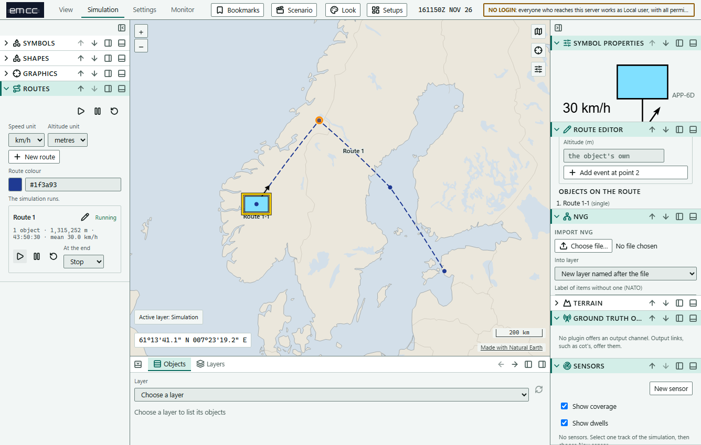

# The Simulation workspace

The Simulation workspace is a second map, in its own tab in the top bar. In it you build a simulated situation: symbols that move along routes, as if they were real units. You can watch the simulation on the map, and you can send it to other systems, for example to a TAK server, so that they see the simulated units as if they were real.

Use it to practise, to test other systems, or to give an exercise a moving picture.

Everything in Simulation is kept apart from the View workspace. Simulated objects are not shown in View, and they do not reach users who may not see Simulation. The tab is only shown to users who have the permission to see it.

The layout is the same as in View: the map in the middle, and panes on the left, right and bottom. How to resize, collapse and move panels is explained in [Working with panes and panels](03-01-general.md).

| Area | Panels |
|---|---|
| Left pane | [Symbols](03-09-symbols.md), [Shapes](03-11-shapes.md), [Graphics](03-12-graphics.md) and [Routes](04-02-routes.md) |
| Right pane | [Symbol properties](03-10-symbol-properties.md), [NVG](03-18-nvg.md), [Terrain](03-13-terrain.md), [Ground truth outputs](04-05-outputs.md), [Sensors](04-04-sensors.md) and [Cameras](04-06-camera.md). The [Route editor](04-03-route-edit.md) and the Event panel open here when you need them |
| Bottom pane | [Objects](03-15-objects.md) and [Layers](03-14-layers.md) |

## What is shared with View, and what is not

Most of the panels are the same as in View and work in the same way: Symbols, Shapes, Graphics, NVG, Terrain, Symbol properties, Objects and Layers. The map, Map controls, Coordinates, Display settings, Bookmarks, Look and Setups work in the same way too. What is different:

- **Layers.** Simulation has its own layers. They are not shown in View. The Layers panel lists them, and below them a group called "View (reference)" with the layers of the View workspace. Those are only for looking: their eyes are off to begin with, and you cannot place into them, edit them or change them from here.
- **Where things go.** Symbols and shapes you place in Simulation go into the active layer of Simulation. When you start emcc for the first time, Simulation has one layer, called "Simulation".
- **Objects.** The Objects panel lists the objects of Simulation's own layers only.
- **Setups.** Each workspace has its own setups. The Setups button saves and restores the arrangement of the workspace you are in. See [Setups](03-08-setups.md).
- **Bookmarks** are the same in both. A bookmark saves the map view of the workspace you are in.
- **Permissions.** What you may do in Simulation depends on three permissions of its own: to see it, to edit it, and to run it. See [What each user may do](#what-you-may-do) below.

## What you may do

| Permission | What it lets you do |
|---|---|
| Simulation: view | See the Simulation tab, its layers and its objects |
| Simulation: edit | Place symbols and draw shapes and routes, edit them, put objects on routes, make sensors, and choose the outputs |
| Simulation: run | Start, pause and reset routes |

The Cameras panel has three permissions of its own: see [A simulated camera](04-06-camera.md). Without the edit permission the panels are read only. Without the run permission the start, pause and reset buttons are disabled. The server checks every action as well, so a button you cannot use is also refused if you somehow reach it. See [Users and permissions](01-03-permissions.md) for how an administrator gives the permissions.

## In this part

| Chapter | What it explains |
|---|---|
| [Working in the Simulation workspace](04-01-general.md) | How a simulation works, step by step |
| [Routes](04-02-routes.md) | Drawing routes, putting objects on them, starting and pausing |
| [Route editor](04-03-route-edit.md) | Speed and altitude along a route, and events |
| [Sensors](04-04-sensors.md) | Radars on tracks that report what they detect |
| [Ground truth outputs](04-05-outputs.md) | Sending the simulation to other systems |
| [A simulated camera](04-06-camera.md) | A camera on a track that makes live video |
