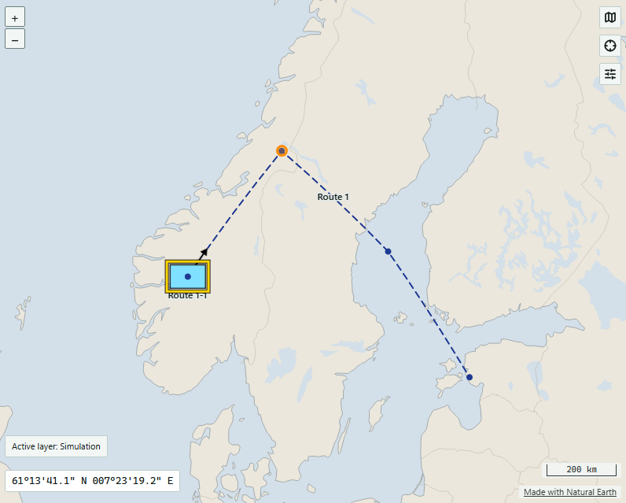

# Working in the Simulation workspace

This chapter shows how a simulation works from start to finish. The details of each step are in the chapters that follow.

## The idea

A simulation has three kinds of things:

- **Tracks.** These are the simulated units. A track is an ordinary symbol that you place in a layer of Simulation, in the same way as in View (see [Symbols](03-09-symbols.md)). The simulator only moves the symbols that you put on a route. It never touches objects that come from other systems.
- **Routes.** A route is a line through points that you draw on the map. At each point you say how fast the track goes and at which altitude. See [Routes](04-02-routes.md) and [Route editor](04-03-route-edit.md).
- **Sensors.** A sensor is a radar on a track. It looks at the ground round the track and reports what it detects. See [Sensors](04-04-sensors.md).
- **Outputs.** An output is a connection that sends the tracks on to another system, for example a TAK server. See [Ground truth outputs](04-05-outputs.md). A sensor has outputs of its own: see [Sensors](04-04-sensors.md).

The simulation runs on the server, once every second, in real time. It runs also when no browser is open. There is one simulation for the whole server: everyone who may see Simulation sees the same routes and the same tracks, live. If the server is restarted, the simulation comes back paused, with the tracks where they were at the last save.

A track that is on no route stands still. It is still sent to the outputs while the simulation runs.

## A first simulation

1. **Open the Simulation tab.** Choose a map background (see [Map controls](03-03-map-controls.md)).
2. **Draw a route.** In the Routes panel click **New route**, then click the points of the route on the map. Finish with a double-click.
3. **Place a symbol.** In the Symbols panel choose a symbol, click **Place on map** and click the map near the start of the route. Press Escape.
4. **Put the symbol on the route.** Right-click the symbol and choose **Put on route**. In the box choose the route and click **Put on route**.
5. **Start.** In the Routes panel click the start button of the route. The symbol begins to move along the route. A text beside it shows its speed.

To stop, click the pause button. To put every track back where it started, click the reset button.

## Placing, drawing and editing

In Simulation you place symbols, draw shapes, and edit objects with the same tools as in View. They work in the active layer of Simulation. Each workspace has its own active layer: see [Layers](03-14-layers.md).

## The right-click menu

The right-click menu in Simulation has two more items on symbols:

| Menu item | What it does |
|---|---|
| Put on route | Puts the selected symbols on a route. See [Routes](04-02-routes.md) |
| Take off route | Takes the selected symbols off their route. They stop where they are |

The menu on a route has **Edit route**, which opens the [Route editor](04-03-route-edit.md).

## Hiding a track

An event can hide a track at a point on its route (see [Route editor](04-03-route-edit.md)). A hidden track stops where it is, and is shown faded on the Simulation map. It is no longer sent to the outputs. Reset or **Put on route** brings it back.

## What happens when objects are changed

- If you delete a track, it is taken off its route and the simulation forgets it.
- If you delete a route, the tracks on it stop where they are.
- If you change a track's fields, they stay as you set them. The simulator only changes a track's position, direction and speed, and the fields its events change.
- A layer can only be deleted when it is empty, so a layer with tracks cannot be deleted by mistake.
- If a layer is locked, the simulation still moves the tracks in it. The lock stops people from editing, not the simulation. See [Layers](03-14-layers.md).
