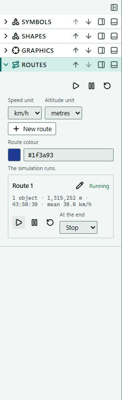
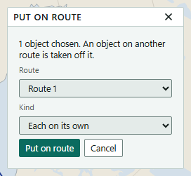
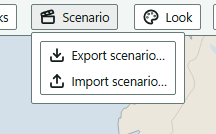
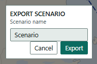
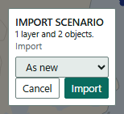

# Routes

A route is a line on the map that tracks follow. The Routes panel is where you make routes, put tracks on them, and start, pause and reset the simulation. It is in the left pane of the Simulation workspace.

## The top of the panel

| Control | What it does |
|---|---|
| Start all routes (the play button) | Starts every route |
| Pause all routes | Pauses every route. The tracks stay where they are |
| Reset all routes | Puts every track back where it started, and leaves the routes paused |
| Speed unit | The unit in which speeds are shown: m/s, km/h, knots or mph. This only changes how speeds are shown |
| Altitude unit | The unit in which heights are shown: metres or feet |
| New route | Draws a new route (see below) |
| Route colour | The colour of the next route you draw. Click the colour box, or type a colour code |

Scenarios are saved and loaded with the **Scenario** button in the top bar: see [Scenarios](#scenarios).

Your choice of units is remembered in your browser. It is also used in the [Route editor](04-03-route-edit.md). Without a choice, speeds are in km/h and heights in metres.

Under the controls the panel says "Everything is paused." or "The simulation runs." and then lists the routes.

## Drawing a route

1. Click **New route**. The button is switched off while the active layer is locked, or when you may not edit Simulation.
2. Click the points of the route on the map, one after the other. A right-click removes the last point.
3. Finish with a double-click or Enter. Escape cancels.

The new route is called "Route 1", "Route 2" and so on, and goes into the active layer of Simulation. It is drawn as a dashed line with a dot at each point, and its [Route editor](04-03-route-edit.md) opens. A new route starts with a speed of 30 km/h at each point.

## Each route in the list

Each route has a card:

| Part | What it shows or does |
|---|---|
| Name | The name of the route |
| Pencil button | Opens the route in the Route editor (the button's title is "Edit Route 1") |
| State | Paused, Running, or Stopped at its end. A route that cannot run says why |
| The line of numbers | For example "1 object · 1,136,241 m · 37:52:29 · mean 30.0 km/h": how many tracks are on the route, its length, how long a track needs for it, and its mean speed |
| Start, Pause, Reset | The same three buttons, for this route only |
| At the end | What the route does when a track reaches the last point: **Stop** or **Restart** |

**Stop** means the tracks stay at the last point with speed 0. They are still sent to the outputs. **Restart** means the route is reset and started again, so its events fire again.

You can also change the route's end behaviour in the Route editor.

## Putting tracks on a route

A track only moves when it is on a route. An object can be on one route at a time: putting it on another takes it off the first.

1. Select one or more symbols in a layer of Simulation, on the map or in the Objects list. You can select symbols that are on no route or on another route.
2. Right-click and choose **Put on route**. A box opens over the right edge of the map.
3. Choose the **Route** and the **Kind**.
4. Click **Put on route**, or **Cancel**.

The box says how many objects you have chosen, and that an object on another route is taken off it. The kinds are:

| Kind | What it does |
|---|---|
| Each on its own | Every chosen object goes to the first point of the route and follows the route alone |
| Convoy | The objects wait at the first point and leave one by one, in the order of the route's object list. Each leaves when the one ahead is the **spacing** away, in metres, along the route. The convoy follows the speeds of the route |
| Formation | The objects keep their places relative to each other, as they are when you put them on the route. The centre of the group follows the route, and the shape turns with the direction of travel. At sharp turns, the objects far from the centre move unnaturally |

An object that has no name gets one, so that the map and other systems can tell the tracks apart. The name is the route's name and a number, for example "Route 1-1". An object that has a name keeps it. Names given this way stay when you take the object off the route.

To take objects off a route, select them, right-click and choose **Take off route**. They stop where they are, with speed 0, and keep their height.

The route's object list is shown in the [Route editor](04-03-route-edit.md), in convoy order.

## Pausing, resetting and editing a running route

- **Pause** stops the movement. Pausing keeps everything where it is.
- **Reset** puts every track of the route where it started, shows the tracks that an event hid, puts back the fields that events changed, and leaves the route paused.
- You can edit a route while it runs. If objects are on it, the editor asks if they should move with the edited route, or be disconnected. See [Route editor](04-03-route-edit.md).

## Deleting a route

Delete a route as any other object: right-click it and choose **Delete**. The tracks on it stop where they are.

## Scenarios

In the Simulation workspace the top bar has a **Scenario** button, beside Bookmarks, Look and Setups. It is not in View. Click it to open a menu with **Export scenario…** and **Import scenario…**. (In earlier releases these were two buttons in the Routes panel.)

A scenario is the whole Simulation workspace in one file: its layers, every object in them (symbols, shapes, routes and tracks), the groups, events and chosen outputs, and the sensors with all their settings. Use it to keep an exercise, to move it to another emcc, or to start again from a known state.

### Export

1. Click **Scenario**, then **Export scenario…**. A box asks for a **Scenario name**. It starts as "Scenario".
2. Click **Export**. Your browser saves the file `<name>.emcc-scenario.json`.

Anyone who may see Simulation may export. The file holds the Simulation workspace only, not the layers of View.

### Import

Import works only while the simulation is paused or reset. While it runs, the menu item is switched off with the title "Pause or reset the simulation before importing a scenario". It needs the permissions to edit and to run Simulation.

1. Click **Scenario**, then **Import scenario…**, and choose the file.
2. A box says what the file holds, for example "1 layer and 5 objects.", and asks how to import:
   - **As new** replaces the Simulation workspace. emcc asks first, and the question says what goes, for example "Delete 1 layer and 5 objects of Simulation?". Click **Delete and import** to go on.
   - **Merge** adds the scenario's layers and objects beside the ones you have.
3. Click **Import**, or **Cancel**.

Every layer and object that is imported gets a new identity, and the routes, tracks, events and sensors are connected to the new objects again. A file made by a newer emcc is refused with a message. Objects in a locked layer, or ones that the server refuses, are listed. An output or a sensor output that this emcc does not have is kept and shown as missing: see [Ground truth outputs](04-05-outputs.md).

## Who may start and stop

Starting, pausing and resetting need the permission to run the simulation. Without it the buttons are disabled. Drawing and editing routes and putting tracks on them need the permission to edit Simulation. See [The Simulation workspace](04-00-simulation.md).
