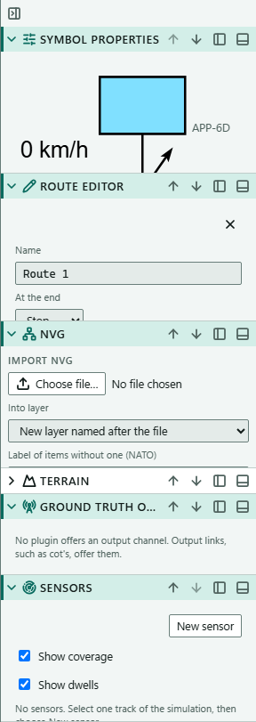
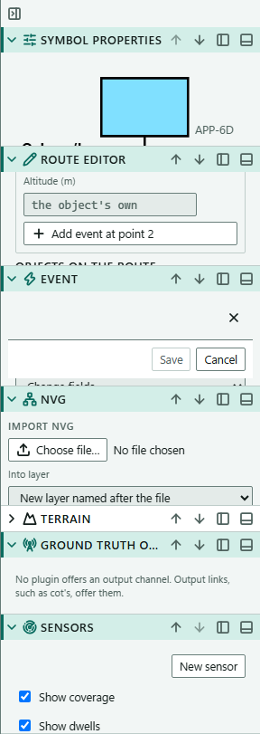

# Route editor

The Route editor is where you say how fast a track goes along a route, at which height, and what happens at each point. It opens in the right pane when you draw a new route or click the pencil button of a route in the [Routes](04-02-routes.md) panel. Close it with the close button at its top right.

## The route

| Field | What it does |
|---|---|
| Name | The name of the route |
| At the end | **Stop** or **Restart**: what the route does at its last point |
| Reshape | Changes the route on the map: drag its points, or move the whole route. Finish with Enter. Escape cancels |
| Append | Continues the route from its last point, by clicking new points on the map. See below |

**Append.** Click **Append**, then click on the map to add points after the route's last point. A thin line shows where the route will run. Backspace or a right click takes back the last point you added, never one the route had. Finish with a double-click (which adds a point) or Enter, and the route is changed in one step. Escape cancels and changes nothing. The new points get the values of the route's last point (its speed and the other values that each point has), so the route stays valid. Append is off for a route in a locked layer and without the permission to edit Simulation, with the reason as its hint.

Under these the editor shows the length of the route and the time a track needs for it, for example "1,136,241 m · 37:52:29".

## All points

This part sets a value on every point at once.

| Field | What it does |
|---|---|
| Speed unit and Altitude unit | The units in which values are shown, as in the Routes panel |
| Speed change | Unchanged, Step at this point, or Ramp over the leg into this point |
| Speed | The speed to set |
| Altitude change | Unchanged, Step at this point, or Ramp over the leg into this point |
| Altitude | The height to set |
| Set on all points | Applies the speed and altitude settings above to every point |

## One point at a time

Below that, the editor shows one point at a time, headed "Point 1 of 4". Use the buttons at the top of the point:

| Button | What it does |
|---|---|
| Up arrow | Goes to the next point |
| Down arrow | Goes to the previous point |
| Plus | Inserts a new point after this one |
| Bin | Deletes this point |

**Copy from previous point** copies the speed and altitude settings of the point before.

### Speed

A point has a **Speed change**:

- **Step at this point:** the speed changes at once when the track reaches the point.
- **Ramp over the leg into this point:** the speed changes steadily along the leg before the point, and has the value at the point. A ramp on the first point works as a step.

A speed of 0 is possible in a ramp, and as a step only at the last point. Every leg needs a mean speed above 0.

### The time helper

Instead of a speed you can type a **Time**. The editor shows both the **Speed** and the **Time (h:mm:ss)**. The one you typed last is marked "typed", and the other is "computed" from it. Under **Counted** choose whether the time is counted **from the previous point** or **from the start**. The time must be at least the time the previous point is reached. A speed worked out from a time is rounded to a whole unit of the speed unit you have chosen. With a ramp, the mean speed of a leg is the mean of its two ends, so the editor says when a time cannot be reached.

The editor also shows the leg: its length and when a track arrives, for example "leg 319,334 m · arrives 10:38:40".

### Altitude

A point has an **Altitude change**, like the speed, and an **Altitude**. If you leave the altitude empty, the track keeps its own: the box says "the object's own". An altitude ramp needs a height at both ends.

### Limits

- Speeds from 0 to 2 000 m/s, in whatever unit you show them.
- Heights from -1 000 to 30 000 m.
- Times up to 7 days.
- At most 1 000 points in a route.

A route that breaks these limits cannot run. If it breaks them while it runs, it pauses and the Routes panel says why.

## Events

An event does something to the tracks that pass a point. Click **Add event at point 2** (the number is the point you are at). The Event panel opens in the right pane.

| Field | What it does |
|---|---|
| Kind | **Change fields** or **Hide** |
| Objects | Choose the tracks the event applies to. With none chosen, it applies to every track on the route, as it passes the point |

**Change fields** changes a field of the track when it passes the point: its Name, Description or SIDC (choose a value in each list, or leave it as it is), text modifiers, and the fields of a field set, such as Team and Role in **CoT unit**. The panel shows one field set at a time: choose the set in the **Field set** list. The Save button is switched off until you choose at least one change.

**Hide:** the track stops where it is, is shown faded on the map, and is no longer sent to the outputs, until a reset or **Put on route**. It stays on the route's list.

Reset puts back what events changed.

## Objects on the route

The last part of the editor lists the tracks on the route, in convoy order, for example "Route 1-1 (single)". It says "None. Use "Put on route" on symbols in Simulation." when there are none.

## Editing a route that has tracks on it

When objects are on a route and you edit it, the editor asks what they should do. You can choose that they **move with the route** (they continue on the same leg, at the same fraction of it), or that they are **disconnected** (they stop where they are and are taken off the route). If another tool changes the route without asking, the tracks move with it.

## When you cannot edit

- Without permission to edit Simulation, the editor is read only.
- If the route is in a locked layer, the editor opens read only, without Reshape, and says that the layer is locked.
