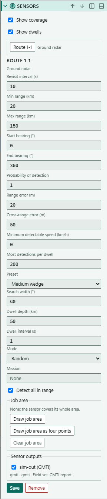
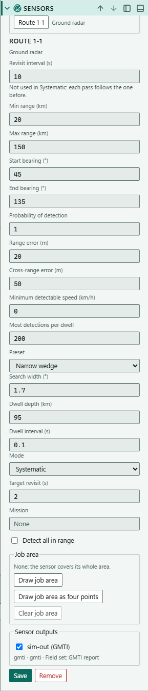
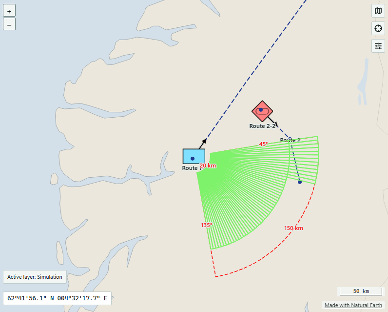
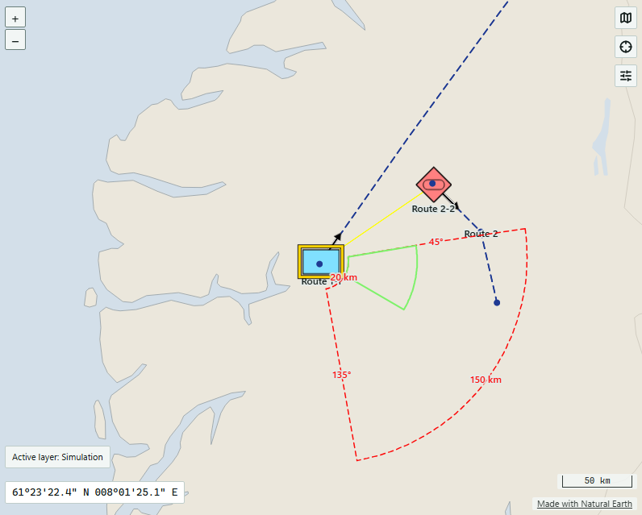
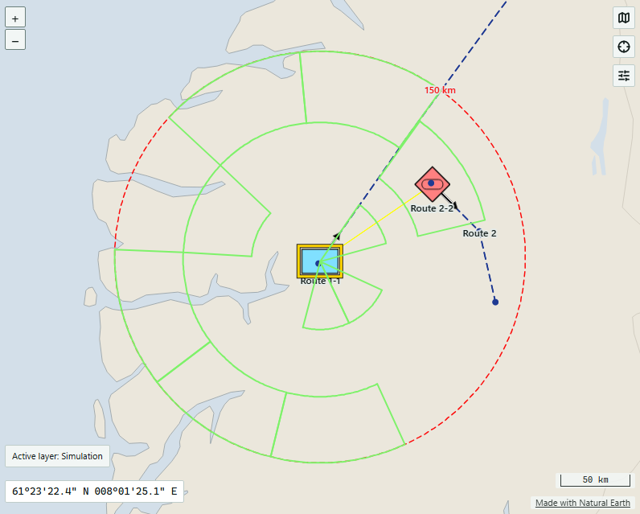

# Sensors

The Sensors panel makes a track into a **ground radar**. A ground radar looks at an area round its platform, one dwell after another, and reports the tracks it detects, as a real ground moving target indicator (GMTI) radar does. The reports go to the outputs you choose, for example a GMTI link that sends them to another system or back into emcc. The panel is in the right pane of the Simulation workspace.

## Making a sensor

A sensor's platform is a track: a symbol that is on a route (see [Routes](04-02-routes.md)). The platform moves along its route as any track does, and the sensor moves with it.

1. Select one track of the simulation, on the map or in the Objects list.
2. Click **New sensor**. The button is switched off with the hint "Select one track of the simulation" when you have selected none or several, and with the hint "The selected track is already a sensor's platform" when it already has a sensor. A track can be the platform of one sensor.
3. A ground radar is made with the values of the preset Medium wedge. Set it, choose its outputs and click **Save**.

A new ground radar **looks all round** its platform: its bearings are 0° to 360°. Set a start and an end bearing to make it look in one direction only.

At the top of the panel are the check boxes **Show coverage** and **Show dwells**. See "Coverage on the map" below.

The panel lists the sensors by the name of their platform. Click a name to open its settings. **Remove** deletes the sensor and not the track. If the track is deleted, its sensor stays in the list, marked as missing, and does nothing.

## The settings of a sensor

| Setting | What it means | Default |
|---|---|---|
| Revisit interval (s) | How long a revisit takes at least, from 1 to 600 seconds. A revisit is the radar's round through its search area, one dwell after another. In the Random mode the revisit is filled with dwells, one for each dwell interval: 10 dwells at 10 seconds and a dwell interval of 1 second. A revisit with many dwells with tracks takes longer. The next one starts when it ends. In the Systematic mode the interval is not used: the field is greyed, with the note "Not used in Systematic: each pass follows the one before." | 10 |
| Min range (km), Max range (km) | The area it looks at: from the minimum to the maximum distance from the platform, from 0 to 1 000 km | 20 and 150 |
| Start bearing (°), End bearing (°) | The directions it looks in, clockwise from the platform's heading, from 0° to 360°. An end below the start wraps across north: 300° to 60° looks 120° round north. **Equal bearings, for example 45° and 45°, look all the way round**, between the minimum and the maximum range, and so do 0° and 360°, or any two bearings that are a whole number of turns apart. A sensor that was saved with other bearings keeps them. Together with the range they make the **search area** | 0 and 360 (all round) |
| Probability of detection | How likely a unit in the area is to be detected at each revisit, from 0 to 1 | 1 |
| Range error (m), Cross-range error (m) | How far the measured position may be from the true one, along and across the line from the platform. One standard deviation, from 0 to 10 000 m. 0 means no error | 20 and 50 |
| Minimum detectable speed | The slowest speed towards or away from the platform that the sensor sees. It is shown in the speed unit you chose in [Routes](04-02-routes.md). 0 sees everything that moves, and what stands still | 0 |
| Most detections per dwell | At most this many detections in one dwell. A dwell that would have more is split in several | 200 |
| Preset | A choice of the dwell settings below: Default, Narrow wedge, Medium wedge, Wide wedge or Custom. A preset sets the search width, the dwell depth, the dwell interval and the mode. See "Dwells" | Medium wedge |
| Search width (°) | How wide one dwell is, from 1° to 360° | 40 |
| Dwell depth (km) | How deep one dwell is, from 1 to 1 000 km | 50 |
| Dwell interval (s) | The time from one dwell to the next, from 0.1 to 60 seconds | 1 |
| Mode | How the radar goes through its search area: **Random** or **Systematic**. See "Dwells" | Random |
| Target revisit (s) | Only in the Systematic mode: how often a target that the radar has found gets a dwell of its own, from 0.5 to 60 seconds | 2 |
| Mission | A free text, up to 64 characters, that goes with every report. Empty means none | None |
| Detect all in range | The sensor detects every track within its maximum range, in any direction, moving or not, at its true position, every time. The probability, the minimum speed and the errors do not apply | Off |

The panel also has the **Job area** and, at its bottom, the **Sensor outputs**.

## What a sensor detects

At each revisit, while the simulation runs, the sensor looks at its **search area**: the part of the ground between the minimum and the maximum range and between the two bearings, turned with the platform's heading. With **Detect all in range** it is a full circle round the platform. The area moves and turns with the platform.

The sensor detects each track of the simulation that is inside the area, is not hidden, and moves towards or away from the platform at least as fast as the minimum detectable speed, with the probability you set. A track that stands still, for example one that is not on a route, is detected while the minimum detectable speed is 0, and is left out when you set a minimum above 0. The measured position is the true position moved by a random error.

A paused simulation sends no reports.

### Dwells

A real radar does not look at its whole area at once. It looks at one patch at a time, a **dwell**, and goes round. The sensor does the same, in one of two **modes**. The mode **Random** is the default and is described first. The mode **Systematic** is described after the presets.

In the Random mode, at the start of a revisit the sensor takes the tracks it detects, goes clockwise round the search area and groups them: one dwell takes the next tracks as long as they are within the **search width** of the first one and the dwell has fewer than **most detections per dwell**. A dwell is as wide as the search width and as deep as the dwell depth, placed over its tracks, and it grows wider or deeper if its tracks need more. A dwell is one report. It goes to each chosen output, with the dwells following each other at the dwell interval.

A revisit is **filled**: it holds as many dwells as the revisit interval holds at one dwell for each dwell interval, rounded down and at least one. At the revisit interval of 10 seconds a dwell interval of 1 second gives 10 dwells, 0.2 seconds gives 50, and 0.1 seconds gives 100. So the radar sends one dwell every dwell interval, as a real radar does. The dwells with tracks come first. The rest are **empty**: they look at ground where no track is. A report says that the area was looked at, also when nothing was detected. When the tracks need more dwells than fit, the revisit has more dwells and takes longer. There is no setting for the share of empty dwells: the tracks decide how many dwells are empty.

The empty dwells are **spread over the whole search area**, as a radar that scans: the area (inside the job area, if there is one) is divided into places as wide as the search width and as deep as the dwell depth, taken one bearing after the other, from near to far. A place that has no track and does not overlap a dwell with tracks is free. The empty dwells take every few free places, evenly, from a starting place that changes from revisit to revisit, so that two revisits do not look alike. A revisit with no tracks is all empty dwells, spread over the area. When there are fewer free places than empty dwells, places are taken again, each about as often, and when every place is taken there are no empty dwells. A revisit that would have no dwell at all still sends one empty dwell, at the start of the search area, so that every revisit sends at least one report.

The **preset** sets the dwell values and the mode at once:

| Preset | Search width | Dwell depth | Dwell interval | Mode |
|---|---|---|---|---|
| Default | 2° | 20 km | 0.2 s | Random |
| Narrow wedge | 1.7° | 95 km | 0.1 s | Systematic, with a target revisit of 2 s |
| Medium wedge | 40° | 50 km | 1 s | Random |
| Wide wedge | 180° | the whole range band | 4 s | Random |
| Custom | what you set | | | |

Change one of the values, or the mode, and the preset becomes Custom. A dwell is never deeper than the range band. The **Default** preset has the values that the Narrow wedge had in the M7 release. The **Narrow wedge** now has the values of a radar that scans in rows: see "The Systematic mode". A sensor that was saved with 2°, 20 km and 0.2 s shows **Default**, and one that was saved with the Narrow wedge when it was 5° keeps the 5° and shows **Custom**.

The presets do not set the bearings.

### The Systematic mode

A real radar often scans its area in a fixed pattern. In the **Systematic** mode the sensor does the same, and finds its targets while it scans:

- **The scan.** The search area (inside the job area, if there is one) is divided into cells as wide as the search width and as deep as the dwell depth: rows from the minimum range outwards, and in each row cells from the start bearing clockwise, side by side without overlap. The last cell and the last row are cut to the area. One **pass** looks at every cell once, row by row, one dwell for each dwell interval, and the next pass starts one dwell interval after the last. So the Revisit interval is not used. Every cell is a dwell, and a report holds the tracks that are detected in it. No dwell is empty on purpose. **The scan turns with the platform.** The bearings of each dwell come from the platform's heading at the moment the dwell is sent, so when the platform turns in the middle of a pass, the dwells that follow turn with it, so that they lie inside the search area (with a job area, see the limit under "The job area"). The pass goes on from its next cell, in the same row and the same column, in the turned frame.
- **Found targets.** A track that is detected in a cell is **found**. A found target gets a dwell of its own, with the search width and the dwell depth, every **target revisit** (2 seconds by default). The dwell is **centred where the target is** at that moment, not where it was last measured, so a target that moves, or whose measured position is off, does not slip out of its own dwell. The detection in the dwell keeps the **range error** and the **cross-range error**, as in a scan dwell. The dwell is centred on the last measured position only when the target is gone or hidden. That dwell takes the next place in the order, and the scan goes on after it. Targets that are due at the same time, and whose dwells would overlap, share one dwell. A target dwell finds no new targets. A found target that is **outside the bearings of the search area** when its dwell is due (the start and the end bearing, turned with the platform, at any range), for example after the platform has turned, gets **no dwell of its own**, and that counts as a dwell that found nothing. When three dwells of its own in a row find nothing, whether they were made or not, the target is dropped, until the scan finds it again. A target beyond the maximum range, or inside the minimum range, but within the bearings, still gets its dwells, which find nothing, so it is dropped after three. A dwell that is centred on a target close to the start or the end bearing may reach a little past it, by up to half the search width.
- **The numbers.** The dwells of a pass are numbered in the order they are sent, scan dwells and target dwells together, so a pass does not always have the same number of dwells.
- **Each dwell lies round the platform where it is when the dwell is sent**, as in the Random mode. The Random mode is not changed by the turning: it keeps the bearings that it planned at the start of its revisit. A settings change, a pause or a platform that is hidden ends the pass, and a settings change and a pause also make the sensor forget its found targets.

### The job area

A **job area** limits where the sensor looks for tracks to a four-cornered area that you draw, as a real radar is tasked to scan an area. A track outside it is not detected. The area is also what a GMTI link sends as the radar's job: a receiving emcc draws it as the radar's coverage (see [GMTI on the map](03-17-gmti.md)).

 and, beside it, the sector that the sensor covers.")

- **Draw job area** lets you press on the map and drag a rectangle.
- **Draw job area as four points** lets you click four points, one for each corner. Another number of points is refused with the message "A job area has four corners".
- **Clear job area** takes it away. The text above the buttons says "None: the sensor covers its whole area" when there is no job area, and "Four corners: only tracks inside it are detected" when there is one.

A limit in the Systematic mode: **the cells of a pass are chosen with the platform's heading at the start of the pass.** When the platform turns in the middle of a pass, the dwells turn with it, but the cells that are left were chosen before the turn, so some of them may lie outside the job area until the next pass starts.

A job area is saved at once, with the sensor and in scenario files. It needs the permission to edit Simulation. It is drawn on the map with a **faint fill** and a **dotted outline** 3 px wide, in yellow-green (`#BDCF3D`) by default, so that it is easy to see. The coverage's dashed line lies on top of it. An administrator can choose another colour, or the platform's identity colour, for it (Settings, Simulator, **Job area colour**): see [Simulator](05-18-simulator.md).

## Coverage on the map

The Simulation map draws what each sensor looks at, so that you can see why a track is or is not detected. The **coverage** of a sensor is its search area as a thin dashed outline, in red (`#FD0909`) by default, with no fill. An administrator can choose another colour, or the platform's identity colour, as the **Coverage colour** in Settings, Simulator. It is the band between the minimum and the maximum range and between the two bearings, or the whole ring when the bearings are equal. With **Detect all in range** it is a circle of the maximum range. The outline moves and turns with the platform.

The coverage has **labels**:

- The **bearings**: the start and the end bearing, as you set them (from the platform's heading), in whole degrees, for example "45°" and "135°", each in the middle of its straight edge. A sensor that looks all round has none.
- The **ranges**: the minimum and the maximum range in kilometres, with at most one decimal, for example "20 km" and "150 km", in the middle of their arcs. There is no label for a minimum range of 0.

The labels have the colour of the coverage, and they move and turn with it.

**A live preview.** While you edit a sensor in the panel, the coverage, its labels and its job area are drawn again at once, from the values in the fields, before you save. A field that is not valid keeps the last valid drawing. If you leave without saving, the drawing goes back to the saved sensor. Nothing is sent until you click **Save**, and the preview is only in your browser.

**The dwells.** The Simulation map also draws each ground radar's **dwells**, one outline for each dwell, 2 px wide and solid, in green (`#7EF26A`) by default. An administrator can choose another colour, or the platform's identity colour, as the **Dwell colour** in Settings, Simulator. A receiving emcc draws its dwell areas in the same green, but one area for each revisit and not one for each dwell (see [GMTI on the map](03-17-gmti.md)). Dwells with tracks and empty ones look alike. A dwell is centred on the platform where it is when the dwell is sent, so for a moving platform each dwell of a revisit lies round the platform's position at that moment, with the bearings planned at the start of the revisit: a turn of the platform does not swing the dwells round. A receiving emcc draws the dwell from what it is sent, so that it follows this shape. They are not objects: they are not saved, not sent, not in a scenario file, and you cannot click them. They are kept per dwell number: a dwell replaces the drawn dwell with the same number, and at the last dwell of a revisit (or of a pass) the drawn dwells with higher numbers go. So the latest revisit stays whole while the next one sweeps across it. They stay while the simulation is paused, and they go on a reset, and when a sensor is removed. They reach your browser up to about a second late.

The check boxes **Show coverage** and **Show dwells** at the top of the Sensors panel switch the coverage (with its labels and the job area) and the dwells on and off. Both are on by default. The choice is yours alone: it follows you to another browser when you log in, and changes nothing for other users. They are drawn also while the panel is closed. They are drawn in the Simulation workspace only, and they are not objects: they are not saved, and a click inside them selects what is under them. The **Areas** switches in [Display settings](03-05-display.md), **Sensor coverage** and **Dwell areas**, hide them too: a thing is drawn only when both its check box and its switch are on.

## Sensor outputs

**Sensor outputs** lists the output channels that take sensor reports. In this release these are the GMTI links that send (**out**): see [GMTI](05-14-gmti.md). Tick the ones the sensor should send to. A channel that goes away is shown as missing.

The Ground truth outputs panel does not list these channels, and the Sensors panel does not list the ground truth channels. See [Ground truth outputs](04-05-outputs.md).

Each output decides what it can send. GMTI, for example, sends detections with the format's own limits: names of at most 10 characters, an area at most 511.98 km deep. It leaves out what it cannot hold, and counts it. What happens to a unit that an output could not send:

- The sensor draws a **red line** from the platform to the unit on the map, when the switch **Beyond output reach** is on in [Display settings](03-05-display.md). It is on by default.
- A text at the bottom of the Simulation map names the sensor and the output, for example "Hawk 1: some units are out of range for sim-out (GMTI)", and goes when nothing is left out.
- The units that are sent get the **GMTI Pairing** line instead (yellow unless an administrator has chosen another colour), from the platform to the unit, on the Simulation map and in the View workspace, when that switch is on. See [GMTI on the map](03-17-gmti.md).

## Sensors from earlier releases

A sensor that was saved by an earlier release, or that is in an older scenario file, becomes a ground radar with the preset **Custom**: one dwell as wide as the search area and as deep as the range band, every second. The share of empty dwells that such a sensor had is not used any more. How such an old sensor looks now was not checked. A scenario file can also hold a generic sensor, which a later release may offer. It is not loaded: the import lists it as "generic sensors come later; not loaded", and loads the rest of the file as usual.

## Who may use it

Adding, changing and removing sensors needs the permission to edit Simulation. Without it the panel is read only. The sensors are saved with the simulation and come back after a restart. See [The Simulation workspace](04-00-simulation.md).
