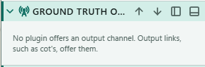

# Ground truth outputs

An output sends the simulated tracks to another system while the simulation runs. The Ground truth outputs panel is where you choose which outputs get the true state of every track. It is in the right pane of the Simulation workspace. Outputs for the reports of a sensor are chosen per sensor instead: see [Sensors](04-04-sensors.md).

## What is an output?

An output is a connection that another part of emcc offers for sending. For example, an outgoing Cursor on Target link to a TAK server offers one. You set up those links in Settings: see [Cursor on Target](05-10-cot.md). When a link can send ground truth, the Ground truth outputs panel lists it.

If no link offers an output, the panel says "No plugin offers an output channel. Output links, such as cot's, offer them." Then the simulation still runs and you see it on the map, but nothing is sent.

## Choosing outputs

Choose the outputs you want in the panel. Each entry in the list shows the name of the link, which plugin offers it, what it sends, whether it can send a delete, and the fields it uses. A choice needs permission to edit Simulation.

Your choice is kept. If a chosen link is renamed, removed or disabled, it is shown as **missing**, it is not dropped. It is used again when a link with the same identity comes back. You can remove it from the list yourself.

## What is sent

While the simulation runs, at every tick (once a second), emcc sends the state of every track to every chosen output. It sends:

- all tracks, also those on paused routes and those on no route;
- also a track that stands still, so that the other system keeps it fresh;
- not the tracks an event has hidden. The outputs that can delete get a delete for it.

"While the simulation runs" means from a start until every route is paused or reset. A route that has stopped at its end counts as running.

Each item carries an expiry: the time of the tick plus the number of seconds an administrator has set (5 by default: see [Simulator](05-18-simulator.md)). That way, when you pause the simulation, the tracks go stale at the receiver and disappear there. The tracks in emcc itself do not expire.

Each output link applies its own highest classification. The simulator adds no limit of its own.

## Fields that an output uses

Some outputs carry fields of their own. For Cursor on Target they are Callsign, Team, Role, Stale time, How and the errors of the position. Set them on the tracks, in the field set **CoT unit** in [Symbol properties](03-10-symbol-properties.md), or with an event (see [Route editor](04-03-route-edit.md)). The panel names the field set each output uses.
