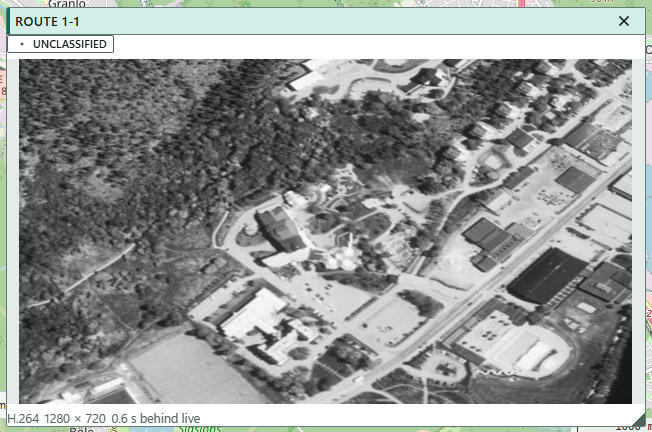
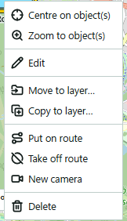
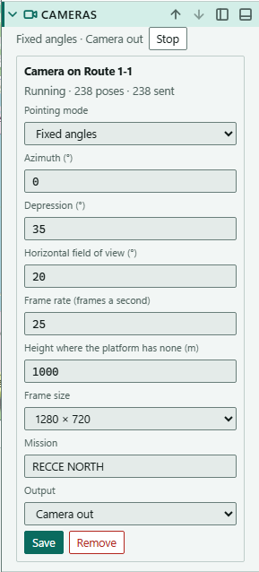
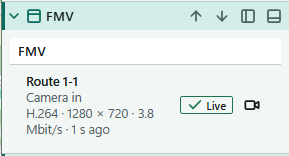
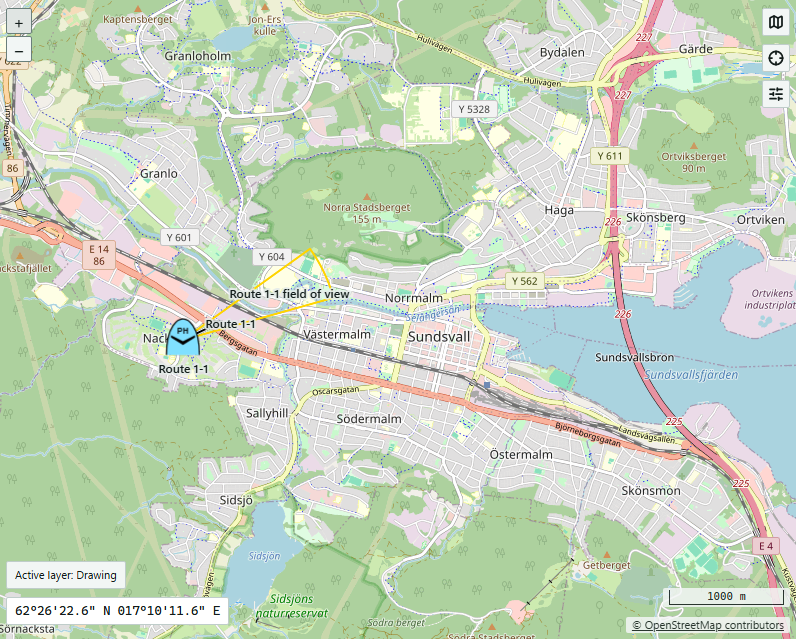

# A simulated camera

A simulated camera is a camera on a track in the simulation, as on a UAV. You point it, start it, and emcc makes **live video** from it: a picture of the ground, seen from the track's position, with the metadata that a real camera sends. The video goes out in the NATO format STANAG 4609 over UDP, so any receiver of that format can show it, and so can emcc itself.

Use it to give an exercise a video feed, or to test a system that receives full motion video, without a real UAV.

## How it works

Two plugins do the work, and you use both.

- **UAV simulation** keeps the cameras. A camera is on a track of the Simulation workspace. For every frame it works out where the camera is and where it looks. You make and start cameras in the **Cameras** panel.
- **FMV** turns that into video. An **output link** that an administrator has set up draws the picture of each frame, adds the metadata and sends it to an address.

The video can go to any receiver of STANAG 4609. To see it in emcc, an administrator adds an **input link** that listens at the address where the output link sends. The video then comes in as video from any camera does: the camera and its field of view are drawn on the map in View, and the stream is in the FMV panel. See [FMV: full motion video](03-19-fmv.md).

The guide [Setting up the UAV simulation](07-02-uav-simulation.md) takes you through all of it, from an emcc with no data to a video that plays. A camera sends nothing by itself. It needs three things, which an administrator sets up: an output link, and the images and the heights that the picture is drawn from. They are in [FMV output links, imagery and terrain](05-24-fmv-output.md). Without them you can still make cameras and start them. The Cameras panel and the Monitor say what is missing.

## Making a camera

A camera is on **one track** of the Simulation workspace: a symbol that moves, usually on a route (see [Routes](04-02-routes.md)). It must be a symbol in a Simulation layer.

1. Put a symbol on a route, or use a track that is there already.
2. Right-click the track on the map and choose **New camera**.

The **Cameras** panel, in the right pane, opens with a new camera on that track. A track has at most one camera: **New camera** on a track that has one opens its camera. There are at most 50 cameras. New camera needs the permission to edit cameras.

A camera is **not** a map object. It is kept by the Cameras panel and not drawn in Simulation. After a restart of the server every camera is back with its settings, **stopped**.

## The Cameras panel

The panel lists the cameras, each by the name of its track (**(no name)** for a track without one), with its state, its pointing mode, its output, and a **Start** or **Stop** button. Click a camera to open its form.

The line under the camera's name says how many **poses** it has made and how many it has **sent**. A pose is where the camera is and where it looks for one frame.

The form has these fields. A value outside its limit is refused, and the panel says why at the field, for example *a whole number, 1 to 30 frames a second*. Click **Save** to keep what you changed; a running camera uses it from its next frame.

| Field | What it is | Default | Limit |
|---|---|---|---|
| Pointing mode | How the camera is aimed. See below | Fixed angles | Track a point, Track an object, Fixed angles, Sweep |
| Horizontal field of view | How wide the picture is, in degrees. The vertical one follows from the frame size | 20° | 0.1° to 120° |
| Frame size | The size of the picture | 1280 × 720 | 640 × 360, 1280 × 720 or 1920 × 1080 |
| Frame rate | Pictures a second | 25 | 1 to 30 |
| Height where the platform has none | The camera's height above the ellipsoid, in metres, when its track has no altitude | 1000 m | 10 to 20 000 m |
| Mission | A text that goes into the video's metadata | Empty | 0 to 64 characters |
| Output | Which output link carries the video. See below | None | An output link that takes a camera |

The camera sits at its track's point and has the track's **height**: the altitude of the track if it has one, otherwise the field Height. It flies level. Its heading is the track's direction, and 0° if the track has none.

Heights are in metres and angles in degrees, whatever units the simulator uses.

### The four pointing modes

The form shows only the fields of the mode you choose.

| Mode | Fields | What the camera does |
|---|---|---|
| **Track a point** | Longitude, Latitude, Point's height (default 0 m) | A fixed point on the ground stays in the middle of the picture, as the camera moves. A point straight below the camera is seen at 90° down |
| **Track an object** | Target, **Use selection**, Target's height where it has none | A moving object of the Simulation workspace stays in the middle. Select **one** object on the map, not the camera's own track, and click **Use selection**. If the target is deleted, the camera keeps the angles it had and the panel says **Target gone**; it does not stop |
| **Fixed angles** | Azimuth, Depression | The camera looks in one direction **relative to the track's heading**, so it turns with the track. Azimuth is 0° straight ahead and grows clockwise. Depression is the angle below the horizon: 0° is level and 90° is straight down |
| **Sweep** | Sector start, Sector end, Sweep rate (default 10° a second), Depression | The camera pans back and forth between two azimuths, relative to the heading. An end that is smaller than the start crosses north: 315° to 45° is a sector of 90° around straight ahead. The two must differ |

The height of a point or a target is a value that you give: emcc does not look it up in the height data. A point on a hill is therefore seen a little off the middle of the picture.

### The output

The **Output** is the output link that sends this camera's video. The list shows the output links that take cameras, each marked by what the link says:

- **(used by Route 1-1)**: another camera has it. **One camera sends on one output link**, so choose another link, or ask the administrator for a second one.
- **(not sending)** or **(degraded)**: the link cannot send now, for example because it has no address yet. The form says why, for example *The output sends nothing: No destination*. The camera goes on making poses, and sends again when the link can.

A camera with the output **None** makes poses and sends nothing. If the link that a camera uses is renamed, disabled or removed, the output is shown as **missing**, it is not dropped, and the camera uses it again when a link with the same identity comes back.

## Start and stop

The **Start** and **Stop** buttons need the permission to run cameras. A camera runs on its own: it does not care whether the simulation runs. A track that stands still, or whose route is paused, gives a still picture, since the camera is where the track is.

Between the track's moves the camera is placed by the track's speed and direction, for at most one and a half seconds, and then stays. The video is therefore smooth while a route runs, and still when it does not.

| State | What it means |
|---|---|
| Running | The camera makes poses and sends them |
| Stopped | The camera has not been started, or the server was restarted |
| Platform gone | Its track was deleted, or is no longer in a Simulation layer. The camera stops by itself and keeps its settings. Make a new camera on another track |
| Target gone | **Track an object** has lost its target. The camera runs, with the angles it had |
| Output missing | The output link that it uses is renamed, disabled or removed. It sends nothing until the link is back |

## Seeing the video in emcc

The video of a simulated camera is not drawn in Simulation. It comes in through an input link, as the video of a real camera does, and you see it in **View**:

1. An administrator adds an input link in Settings, in the category FMV, with the same address and port as the output link. Both can be `127.0.0.1` and the same port on one computer. See [FMV output links, imagery and terrain](05-24-fmv-output.md).
2. Start the camera and the route. After a few seconds the camera is on the map in View, with its field of view, and the FMV panel has a row for it.
3. Click **Watch** in the FMV panel to open the video in a window.

The camera on the map is named by its track, or by the output link if the track has no name. Its field of view is the arc, and it points where the picture looks. The window and the panel are the ones described in [FMV: full motion video](03-19-fmv.md), and the window needs a browser that plays H.264, as most do.

## What the picture shows

The picture is not a camera's view of the real world. emcc **draws** it from images and heights that the administrator has put in the release:

- The ground comes from **orthophotos**, aerial photographs that are laid over **height data**, so that hills and slopes are seen from the camera's position and angle. The photographs have the age and the colours that they have, for example black and white pictures from 2001.
- The sky is above the horizon, and the air gets hazier with the distance.
- It is a **still scene**: there are no buildings that stand up, no shadows that move and nothing hides what lies behind a hill.
- Where there are no photographs, the ground is plain grey, and where there are no heights, it is flat at sea level.

The video carries what a receiver of STANAG 4609 expects: the position and height of the camera, where it looks and how wide, where the middle of the picture is on the ground, the mission, and the **security label** of the track. A camera whose track has a label above the output link's **highest classification** is not drawn or sent.

## What you may do

The Cameras panel has three permissions of its own, beside the permissions of Simulation. A user needs **Simulation: view** to see the workspace at all.

| Permission | What it lets you do |
|---|---|
| Cameras: view | See the Cameras panel and the cameras in it |
| Cameras: edit | Make a camera with New camera, and change and remove cameras |
| Cameras: run | Start and stop cameras |

Without **edit** the panel is read only, with the hint *You may look at the cameras, not change them*. Without **view** the panel is not shown. The server checks each request as well. Without login everyone has every permission. With login, the permissions come from the groups in `settings/emcc.properties`. The release has the lines for `plugin.uav-simulation.view`, `.edit` and `.run`, and they give the permissions to the groups that hold the same permissions of Simulation: `sim-viewers`, `sim-editors` and `sim-runners` (in the demo realm `editor` sees the panel, and `operator` and `admin` also make and run cameras). To use other groups, change the lines. The video window in the FMV panel needs `plugin.fmv.view` too, which the release gives to everyone who has logged in. See [Users and permissions](01-03-permissions.md) and [Plugins from others](08-07-plugins.md).

## When it does not work

| What you see | Why, and what to do |
|---|---|
| The panel has no output to choose | No output link takes cameras. An administrator adds an output link in Settings, under FMV, with the direction **out** |
| *The output sends nothing: No destination* | The output link has no address and port. A new output link sends nothing until it has them |
| The camera runs but the picture is grey | No photograph covers where the camera looks, or the imagery folder is empty. See [FMV output links, imagery and terrain](05-24-fmv-output.md) |
| The camera runs but nothing arrives in View | The input link is missing, or has another port than the output link. Check both in Settings, under FMV |
| *No encoder installed* | The server cannot make video: the folder `tools` of the release is missing, or it is not Windows. See [What you may bring yourself](08-03-infrastructure.md) |
| *Waiting for a conversion slot* | The video encoder shares its slots with the conversions of MPEG-2 streams. The camera starts when one is free |
| *No render thread* | The server runs as many compute tasks as it may. See [Compute threads](08-06-compute-threads.md) |
| The camera shows **Output missing** | The output link is disabled, renamed or removed. Enable it, or choose another output |
| The camera shows **Platform gone** | The track was deleted. Make a camera on another track |
| The picture stutters or lags | The computer cannot draw the pictures fast enough. Lower the frame rate or the frame size, or the number of cameras. See below |

## Limits of this release

- **Time to the first picture.** The video starts a couple of seconds after a camera makes its first pose: the pictures are drawn and encoded first. It plays in the window of the FMV panel after that.
- **The cost.** A camera at 1280 × 720 and 25 frames a second takes about one processor core and one conversion slot. On the project's test computer drawing one picture took about 40 milliseconds, which is the whole time between two frames at 25 a second, so the camera kept up with a little less than the rate that it was given. A camera at a lower rate or frame size keeps up better, and a faster computer too. The Monitor shows the time of a picture ([FMV output links, imagery and terrain](05-24-fmv-output.md)).
- **One camera on each output link**, one on each track, and at most 50 cameras.
- **No gimbal.** The camera turns at once to the angle that it is given, it has no zoom, and it sits at the track's point. The track flies level.
- **Cameras are not exported** with a scenario.
- **Only tracks in Simulation** can carry a camera, not objects of View.
