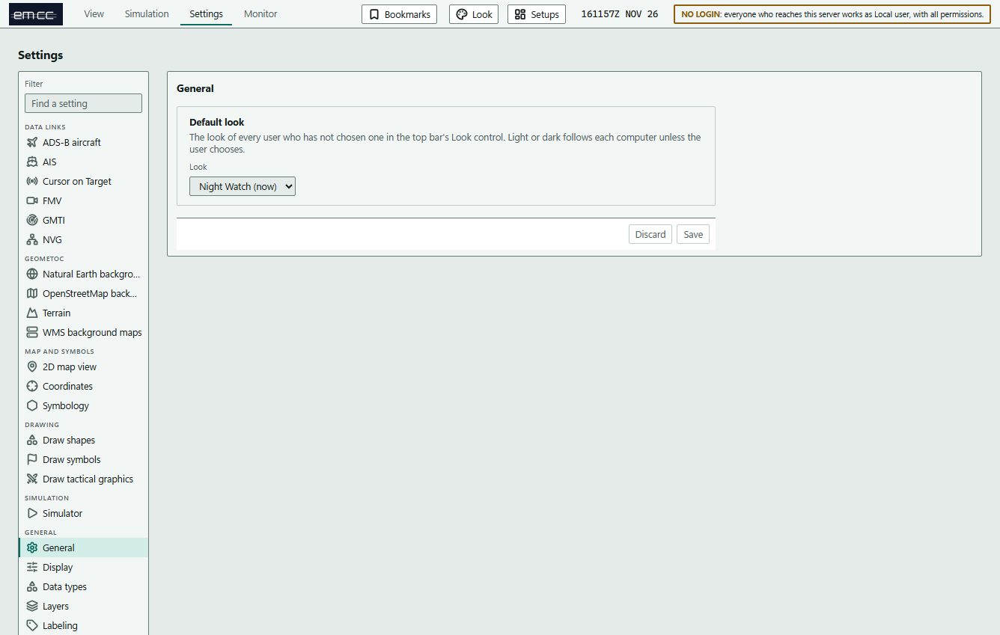
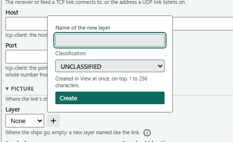
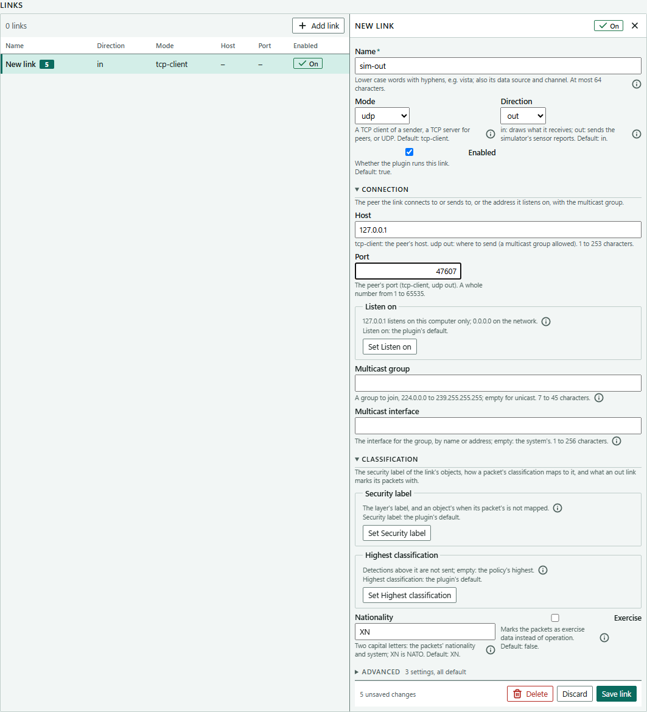

# Settings

Settings is for administrators. It is the second tab from the right in the top bar. Only users with the permission to administer settings see it. In the no-login mode everyone has every permission, so everyone sees it.

The list on the left names the categories. They stand under six headings: **Data Links**, **GeoMetoc**, **Map and Symbols**, **Drawing**, **Simulation** and **General**. A plugin names its heading itself. Under each heading the categories are in alphabetical order, and a heading with no category is left out. The last heading, General, starts with the five general categories, **General**, **Display**, **Data types**, **Layers** and **Labeling**, and has the plugins that have no other heading. Click a category to see its settings on the right. Settings opens on General.

Above the list is the field **Find a setting**. Write a part of a category's name, for example `map`, and the list shows only the categories that have it in their name. It filters the names of the categories, not the settings inside them. With a category chosen, the arrow keys, Home and End move to the next, the previous, the first and the last category.

## How settings work

- **Settings are for everyone.** A change affects every user of this emcc. Do not put secrets or passwords in them.
- **A change applies at once.** There is no need to reload. A plugin gets the new values as soon as you save.
- **The server checks the values.** When you save, the server checks them. If a value is not allowed, a message at the field says why, and nothing is saved.
- **One Save for each page.** The foot of a page stays in view at the bottom, however far you scroll. It has **Save** on the right, **Discard** beside it, and on the left the number of changes that you have not saved. Save and Discard are off while there is nothing to save. **Discard** goes back to what is saved.
- **Unsaved changes are marked.** A category that has changes you have not saved has a number in the list: how many. You can go to another category and come back. The changes wait in the page until you save or discard them.
- **A list of links is saved link by link.** See "Lists of links" below.
- **Defaults.** Under each field a short line says what it does, its limits and its default. A small **i** at the end of the line opens a longer text. A star after the name, as in **Name\***, means that the field is required. A setting that you leave empty, or that says "Not set", uses its default.
- **Groups.** The fields of a page are grouped under headings, for example Connection, Picture and Classification. The arrow at a heading folds the group or opens it. A group named **Advanced** is folded at first. It holds settings that you seldom need to change, and its line says how many settings it holds and that they are all at their defaults.
- **A setting that may be missing.** Some settings, for example a **Security label**, are only in force when you set them. Until then the page says that the plugin's default applies and offers a button, for example **Set Security label**. Click it to get the fields. The button **Use the default**, at the foot of such a group, takes the setting away again, so that the default applies. It is at the foot of the group, and the Set button that replaces it is named for the group, for example **Set Security label**.
- **Choosing a layer.** A setting that names a layer has a list of the layers and a **+** button next to it. Click **+**, type a name and click **Create**: the layer is made at once, on top, in the View workspace, and is chosen for the setting.

- **Declared fields.** The page of a plugin that adds fields to objects ends with a list of them: their names, what they mean and their limits. Users see them as field sets in [Symbol properties](03-10-symbol-properties.md).
- **Lists of simple values.** Some settings are plain lists, for example the preferred background maps. Each entry has its field and the buttons **Up**, **Down** and **Remove**. **Add** adds a new entry. A list of entries with several fields, for example the Filter of an NVG link, shows each entry as a folded section: a saved entry starts folded, a new one is open, and its arrow opens or folds it.
- **Colours.** A setting that is a colour has a colour box, which opens your browser's colour picker, and a field beside it where you type the colour as `#RRGGBB`. The two follow each other. A colour that is not six hexadecimal digits after the `#` is refused.
- **Fields that do not apply.** A field that the choice above it does not use may be shown dimmed, with a line that says when it is used (in Cursor on Target, for example, Address is used only for udp and multicast). Some fields appear only for the choice that uses them.

## Lists of links

The plugins that connect to other systems keep their links in a list: ADS-B, AIS, Cursor on Target, FMV, GMTI and NVG. The list is a table with a form beside it.

- **The table.** Under the heading **Links** it says how many links there are, and has the button **Add link**. Each link is a row with its name, its main settings and a chip that says whether it is **On** or **Off**. Click a row to open its form.
- **The form.** It opens on the right of the table. Its heading is the link's name, with the On or Off chip and a **×** that closes the form. For a link that is saved there are also two arrows that move it up or down in the table. A new link has the heading **New link** until you have saved it.
- **Saving.** Each link has its own foot: **Delete**, **Discard** and **Save link**, with the number of unsaved changes. A new link exists only in its form until you click **Save link**; then it is added to the table, and the plugin starts it if the link is On. A link that you have edited and not saved keeps its changes while you look at another row.
- **Delete and the arrows act at once.** **Delete** asks "Delete link?" and says that the link is deleted at once, with its settings. The arrows move the link and save the new order at once.
- **A page with more.** Besides the links a plugin may have settings that are for all its links, for example the colours of GMTI. They stand above the table and have their own foot with **Save** and **Discard**. The table's forms do not save them.

## The categories

| Heading | Category | What it sets |
|---|---|---|
| Data Links | [ADS-B aircraft](05-06-adsb.md) | Links to ADS-B decoders |
| | [AIS](05-07-ais.md) | Links that receive ship positions |
| | [Cursor on Target](05-10-cot.md) | Links to TAK systems |
| | FMV | Links that receive video ([FMV: full motion video](03-19-fmv.md)), and links that send a simulated camera’s video, with the imagery and the heights it is drawn from ([FMV output links, imagery and terrain](05-24-fmv-output.md)) |
| | [GMTI](05-14-gmti.md) | Links that receive and send GMTI, and their colours and fading |
| | [NVG](05-23-nvg.md) | Links to NVG web services |
| GeoMetoc | [Natural Earth background](05-15-natural-earth.md) | Country borders |
| | [OpenStreetMap background](05-17-openstreetmap.md) | The tile source and its cache |
| | [Terrain](05-20-terrain.md) | The height data for viewsheds and height maps |
| | [WMS background maps](05-21-wms.md) | Background maps from WMS servers |
| Map and Symbols | [2D map view](05-05-map-view.md) | The map: projections, start view, limits |
| | [Coordinates](05-09-coordinates.md) | The default position format |
| | [Symbology](05-19-symbology.md) | The symbol image cache, and how sensor reports look |
| Drawing | [Draw shapes](05-11-draw-shapes.md) | The style of new shapes |
| | [Draw symbols](05-12-draw-symbols.md) | The standard and size of new symbols |
| | [Draw tactical graphics](05-13-draw-tactical.md) | What new tactical graphics start with |
| Simulation | [Simulator](05-18-simulator.md) | How long sent tracks stay valid, and the colours of sensors |
| General | [General](05-01-general.md) | The default look |
| | [Display](05-02-display.md) | The default Display settings of the map |
| | [Data types](05-03-data-types.md) | When objects expire and are removed |
| | [Layers](05-04-layers.md) | The classification of each layer, and listing and emptying a layer |
| | [Labeling](05-22-labeling.md) | Premade security labels |
| | [Bookmarks](05-08-bookmarks.md) | How many bookmarks a user may have |
| | [Objects](05-16-objects.md) | The size of a page in the Objects list |

A plugin that is installed but has no settings does not appear in the list. Other settings, such as the network address the server listens on, are not set here: they are in a file next to the start script. See [Running emcc](01-02-running.md).
