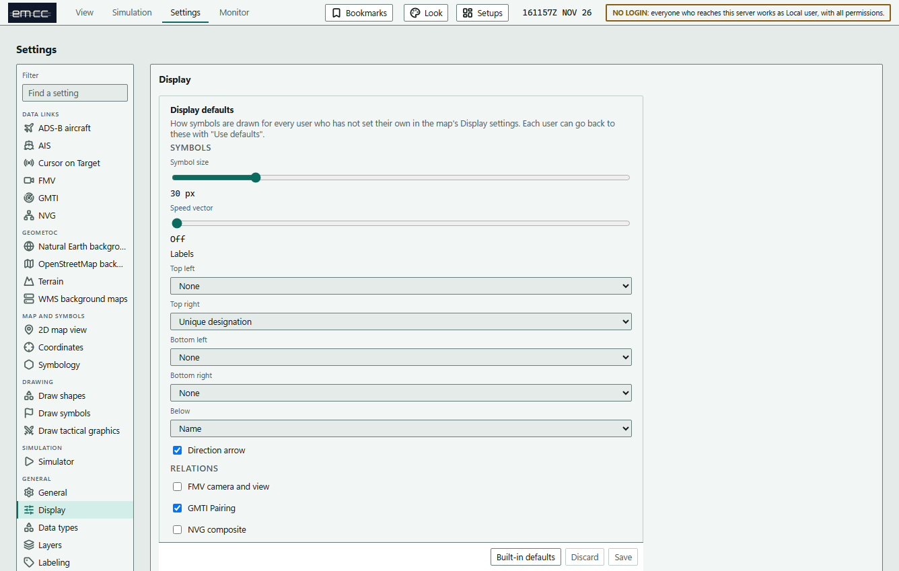

# Display

These settings are the defaults for the map's Display settings. They apply to every user who has not chosen their own. See [Display settings](03-05-display.md) for what each one does on the map.

| Setting | What it does | Default |
|---|---|---|
| Symbol size | How big symbols are drawn, in pixels, from 16 to 96 | 30 px |
| Speed vector | The length of the line from a moving symbol, as the time of travel it shows. A step from the list: Off, 5 s, 10 s, 15 s, 30 s, 1 min, 2 min, 5 min, 10 min, 20 min or 30 min | Off |
| Labels | The text of each of the five places Top left, Top right, Bottom left, Bottom right and Below: None, or Name, Unique designation, Higher formation, Additional information, Staff comments, Type, Date-time group, Altitude or depth or Speed | Unique designation at the top right, Name below, the other places None |
| Direction arrow | Draw the arrow that shows the way a symbol heads | On |
| FMV camera and view | Draw a dotted line from an FMV camera to its field of view | Off |
| GMTI Pairing | Draw a line from each GMTI detection to its platform | On |
| NVG composite | Draw a line from the first part of an NVG composite to each of its other parts | Off |
| Beyond output reach | Draw a line from a unit that a sensor detected but an output could not send | On |
| Dwell areas | Draw the dwell areas of GMTI radars and the dwells that the simulator's sensors draw | On |
| Sensor coverage | Draw the coverage of GMTI radars and, in Simulation, the coverage, job areas and labels of the sensors | On |

The page is the same as the Display settings window of the map, with the foot of a page: **Built-in defaults**, **Discard** and **Save**. Click **Save** to keep a change. It reaches every user who uses the defaults, at once. **Built-in defaults** puts the values above back into the form; click **Save** to keep them.

A user who has changed their own Display settings keeps them. They can go back to your defaults with **Use defaults** in their window.
