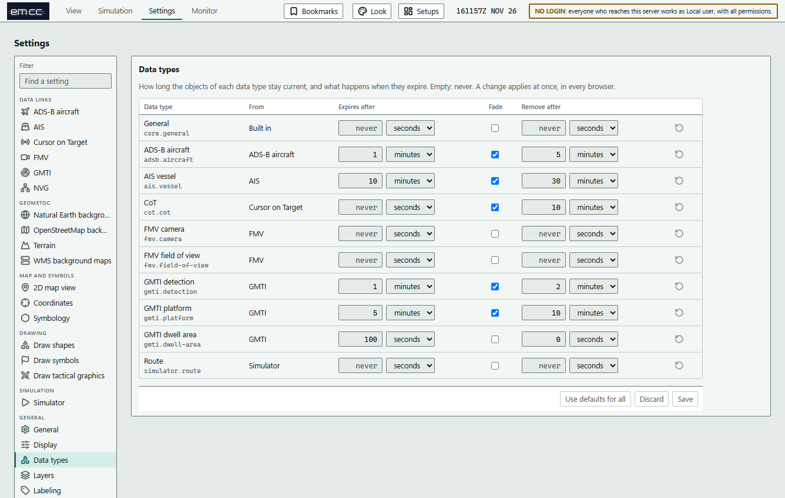

# Data types

Every object has a data type. It says what kind of object it is: for example an ordinary symbol, an aircraft from an ADS-B decoder, a ship from AIS, or a track from a TAK system. **Data types** sets how long the objects of each type stay current, and what happens when they expire. One table holds every type, with one row for each.

Data types are made by the plugins. You cannot add one here. A data type also brings its field sets: the groups of extra fields that an object of the type carries (for example CoT unit for CoT). See [Symbol properties](03-10-symbol-properties.md). The table has one row for each data type that is available. A row says the data type's name and its id (for example `gmti.detection`), and **From**: the plugin that made it.

## The settings of a data type

| Column | What it does |
|---|---|
| Expires after | How long an object stays current after it was observed, unless the object has its own expiry time. Empty (it says "never") means that it never expires. A whole number, at least 1, with a unit: seconds, minutes or hours |
| Fade | The map shows expired objects faded. An expired object is still on the map |
| Remove after | How long an expired object stays before the server removes it. 0 removes it when it expires. Empty ("never") means that it is never removed. A whole number, at least 0, with a unit |

The table has one foot, as every page of Settings has, with these buttons. A row that you have changed and not saved has a number that says how many of its values are unsaved.

| Button | What it does |
|---|---|
| Save | Saves every row that you changed. The change applies at once, in every browser |
| Discard | Goes back to what was saved |
| Use defaults for all | Asks "Use the defaults for N data types?", naming the types that differ from their defaults, and then puts all of them back at once. It is off while you have unsaved changes |
| The round arrow at the end of a row | Puts that data type back to the defaults of the plugin that made it, at once. It is off while the row has unsaved changes, and while it is at its defaults already |

## The data types and their defaults

| Data type | What it is | Defaults |
|---|---|---|
| General | The built-in type for everything without a more specific one. Objects that an NVG import or an NVG link makes have it too | Never expires, not faded, never removed |
| ADS-B aircraft | Aircraft received from an ADS-B decoder, at their last reported position | Expires after 60 s, faded when expired, removed 300 s after it expires |
| AIS vessel | Ships received as AIS messages | Expires after 600 s, faded when expired, removed 1 800 s after it expires |
| CoT | Objects received from TAK systems | Never expires, faded when expired, removed 600 s after it expires |
| GMTI detection | One target report of a GMTI radar: a detection, not a track | Expires after 60 s, faded when expired, removed 120 s after it expires |
| FMV camera | The camera of an FMV link | Never expires, not faded, never removed |
| FMV field of view | The arc that shows where an FMV camera looks | Never expires, not faded, never removed |
| GMTI dwell area | The dwell areas of a GMTI radar. There is one for each revisit of the sensor, with no name | Expires after 100 s, not faded, removed at once (0 s) when it expires |
| GMTI platform | The platform of a GMTI radar and its coverage box | Expires after 300 s, faded when expired, removed 600 s after it expires |
| Route | A route in the Simulation workspace | Never expires, not faded, never removed |

**An object that was placed by hand does not expire by its data type.** The time counts from when the object was observed, which an object from another system has and an object that a user places or copies does not. So a ship that you place with the data type AIS vessel stays on the map, and the plugins' own tracks fade and go as before.

**GMTI detections and dwell areas fade in steps.** For these two types the map does not use Fade when expired while the steps are on. It draws the steps set under [GMTI](05-14-gmti.md) (see [GMTI](03-17-gmti.md)): by default a detection is gone from the picture 100 seconds after its report, but it stays in the layer until this data type removes it, which is 180 seconds after the report with the values above (60 s to expire and 120 s more). A dwell area is removed as soon as it expires, 100 seconds after its dwell, which is when the steps make it invisible. Expiry and removal of the type work as for every type.

For an example: for aircraft, a plane that has not been heard for a minute is shown faded, and five minutes later it is removed from the map.
