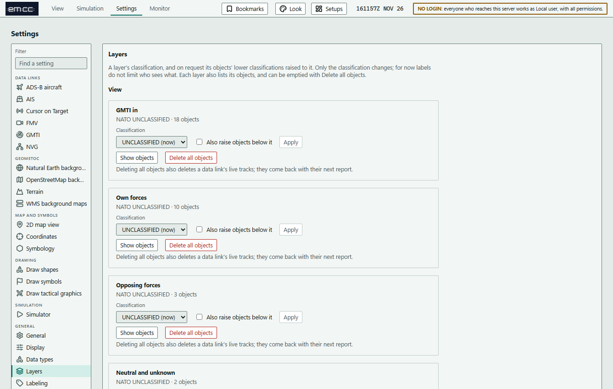
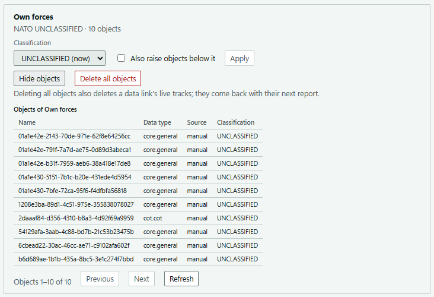
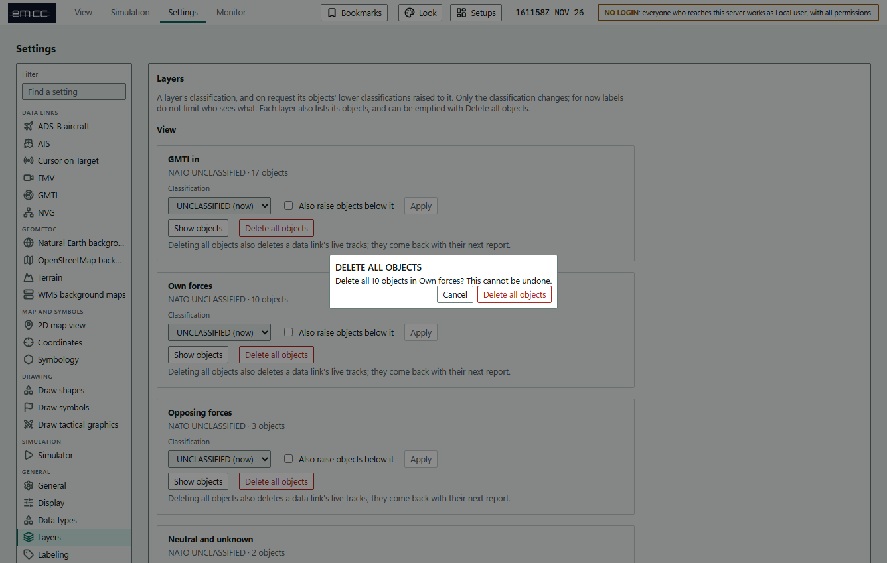

# Layers

**Layers** is where an administrator sets the security classification of a layer. For now the classification is a mark: labels do not yet limit who sees what. The classification is shown in the [Layers](03-14-layers.md) panel. Users choose a layer's first classification when they make it, in the box New layer.

The list has one section for each layer, grouped by workspace. First come the layers of View, then the layers of Simulation. Each section shows:

- the name of the layer;
- its current classification and how many objects it holds, for example "NATO UNCLASSIFIED · 7 objects".

## Changing a classification

1. Find the layer.
2. In **Classification**, choose the new classification. The one in use is marked "(now)". The choices are, from lowest to highest, UNCLASSIFIED, RESTRICTED, CONFIDENTIAL, SECRET and COSMIC TOP SECRET.
3. If the objects in the layer should be raised too, tick **Also raise objects below it**. Every object in the layer whose classification is lower than the layer's is then raised to the layer's. Only the classification changes. Objects that come from other systems may bring their own classification back with their next update.
4. Click **Apply**.

Only the classification changes. The rest of the security label stays as it is.

## Listing and emptying a layer

Each layer also has two buttons for its objects.

**Show objects** lists the objects of the layer, 50 on a page, in the order they were made. The list shows each object's name, data type, source and classification, with **Previous**, **Next** and **Refresh**, and "Objects 1–10 of 10" under it. It is read from the server when you open it, and it is not live: click **Refresh** to read it again. **Hide objects** closes it.

**Delete all objects** empties the layer. It asks first, with the number of objects:

"Delete all 10 objects in Own forces? This cannot be undone." Click **Delete all objects** to go on, or **Cancel**. The server checks your rights for every object, and a notice says how many were deleted and which could not be, with the reason for each. The button is off while the layer is locked, while it holds no objects, and while another change to a layer is running. A data link's live tracks that are deleted come back with the link's next report.
