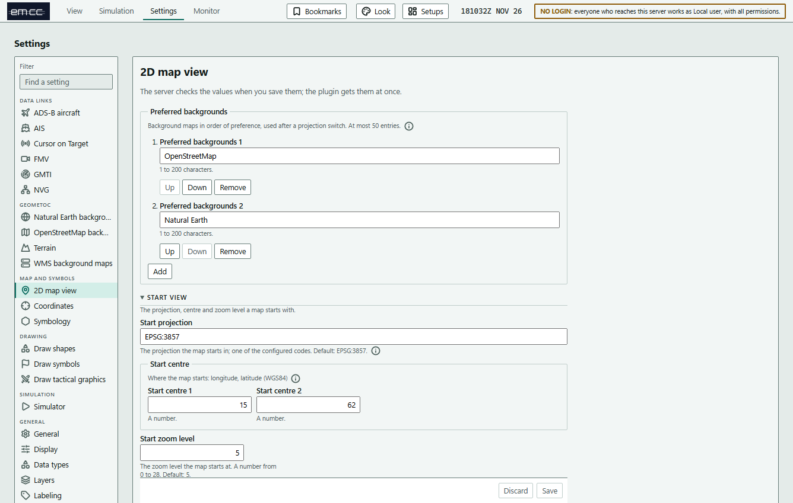

# 2D map view

These settings belong to the map itself. The server checks them when you save, and the map gets them at once. The page starts with the list of preferred backgrounds, then has the groups Start view and Controls and a folded group Performance, with **Save** and **Discard** at the foot of the settings. The projections are a table with a form beside it, below them, and are saved one by one.

## Projections

The map projections that users can switch to in [Map controls](03-03-map-controls.md). emcc comes with three: EPSG:3857, EPSG:3413 and EPSG:3031. Each entry has:

| Field | What it is |
|---|---|
| Code | The name of the projection, for example EPSG:3857. Required |
| proj4 text | The definition of the projection, as proj4 text. Required |
| Projected extent | Four numbers: the area of the projected map |
| World extent | Four numbers: the longitudes and latitudes the projection covers. Polar projections need both extents |

The projections are a table with a form beside it, as the links of the plugins are (see [Lists of links](05-00-settings.md)): **Add projection** adds one, a click on a row opens its form, with **Save projection** and **Delete**, and the arrows at the head of the form move the projection up or down. A background map is only offered in the projections it supports. Do not change the three that come with emcc unless you know the projections well. Each projection has its own foot, so **Save** at the foot of the settings above does not save it.

## The start view

| Setting | What it does | Default |
|---|---|---|
| Start projection | The code of the projection the map starts in. It must be one of the projections above | EPSG:3857 |
| Start centre | The centre the map starts at: longitude first, then latitude | |
| Start zoom level | The zoom level the map starts at, from 0 to 28 | 5 |

A user who has a saved setup gets that setup instead (see [Setups](03-08-setups.md)).

## Symbols

The size of the symbols is not set here any more. Each user sets it in [Display settings](03-05-display.md), and an administrator sets the default in [Display](05-02-display.md). The one setting about symbols that is left, **Symbols with text**, is in the folded group **Performance**, together with the three settings of the next part:

| Setting | What it does | Default |
|---|---|---|
| Symbols with text | Up to this many symbols in view, symbols are drawn with their text. Above it they are drawn without text, which is faster. From 0 to 100 000 | 2 000 |

## Speed and limits

These three are in the folded group **Performance**, which says "4 settings, all default" until you change one.

| Setting | What it does | Default |
|---|---|---|
| Update interval | How often changes of a large stream are applied to the map, in milliseconds. Faster blocks the page more. From 250 to 60 000 | 1 000 |
| Object budget without a GPU | The most objects drawn one by one when the computer has no graphics card. Above it the server sends clusters | 10 000 |
| Object budget with a GPU | The same for a computer with a graphics card | 100 000 |

## Dim and zoom

These two are in the group **Controls**.

| Setting | What it does | Default |
|---|---|---|
| Highest dim level | The highest level the dim slider in [Map controls](03-03-map-controls.md) can darken the background map to, in percent, from 0 to 90 | 90 |
| Zoom to width | How wide **Zoom to object(s)** shows a single object, in metres. From 100 to 1 000 000 | 10 000 |

## Preferred backgrounds

A list of the names of background maps, in order of preference. When a user switches to a projection that the chosen background does not support, the map takes the user's last choice for that projection, or else the first available background in this list. This is the first group of the page. Add a name with **Add**, up to 50. Use the names as shown in [Map controls](03-03-map-controls.md), for example "Natural Earth".
