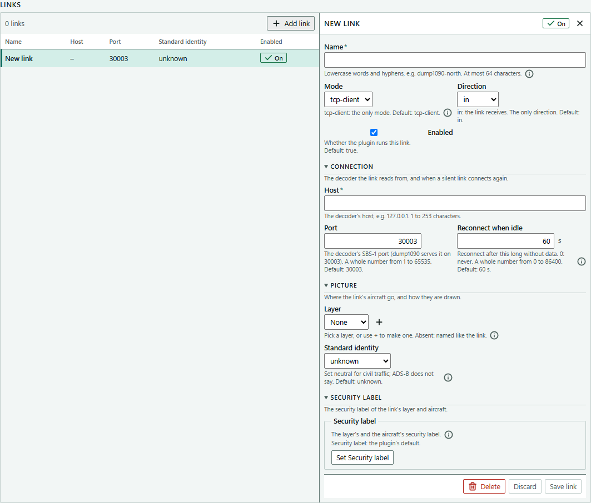

# ADS-B aircraft

The ADS-B plugin shows aircraft on the map. It reads the messages of an ADS-B decoder, for example dump1090, and places each aircraft at its last reported position. Aircraft are objects with the data type "ADS-B aircraft" (see [Data types](05-03-data-types.md)).

The plugin does nothing until you add a link. A link is a connection to one decoder.

## Links

Add a link with **Add link**: the links are a table with a form beside it (see [Lists of links](05-00-settings.md)). The form groups the settings under Connection, Picture and Security label. Each link has these settings:

| Setting | What it does |
|---|---|
| Name | The link's name. Lowercase words separated by hyphens, at most 64 characters, for example `dump1090-north`. The name is the data source of the aircraft the link receives. Required |
| Mode | `tcp-client`: connects to the decoder's SBS-1 output and reads it. This is the only mode |
| Direction | `in`: the link receives. This is the only direction |
| Host | The decoder's host, for example `127.0.0.1`. Required |
| Port | The decoder's SBS-1 port. dump1090 serves it on 30003, which is the default |
| Reconnect when idle | The link is closed and connected again when it has received nothing for this long. 0 means never. Default 60 |
| Layer | Where the aircraft go: a layer in the list, or a new layer made with the **+** button next to the list (see [Settings](05-00-settings.md)). Without one, a new layer named like the link is made. Two links that name the same new layer share it |
| Security label | The security label of the link's layer and of the aircraft it creates. It is only in force when you click **Set Security label**. Default: the server's default label |
| Standard identity | The identity of every aircraft of the link: pending, unknown, assumed-friend, friend, neutral, suspect or hostile. ADS-B does not say whether an aircraft is friend or foe. Set neutral for civil traffic. Default: unknown |
| Enabled | Whether the plugin runs this link. Default: yes |

Click **Save link** to start the link. The [Monitor](06-00-monitor.md) shows whether it is connected.

The plugin only reads. It never sends anything to the decoder.

## Reaching the decoder

The server connects to the decoder, not your browser. The decoder's address must be reachable from the computer that runs emcc. The plugin may go to any host: the Monitor shows "declared" in its Internet column. Never use a name or address that someone else gave you without checking where it leads.

## Declared fields

Every aircraft carries the field set **ADS-B aircraft**: squawk, altitude in feet, vertical rate in feet per minute, emergency and on ground. You can read them in [Symbol properties](03-10-symbol-properties.md), and other users may set them too.
