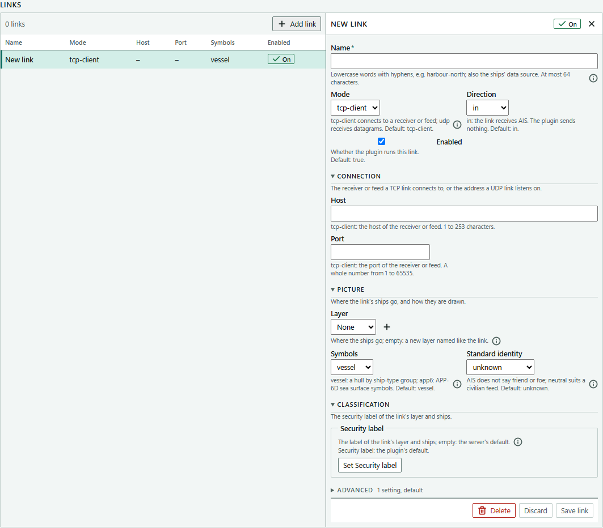

# AIS

The AIS plugin shows ships on the map. It receives AIS messages (NMEA 0183 AIVDM) from a receiver or a feed and places each ship at its last reported position. Ships are objects with the data type "AIS vessel" (see [Data types](05-03-data-types.md)).

The plugin does nothing until you add a link. A link is one connection to a receiver or feed.

## Links

Add a link with **Add link**: the links are a table with a form beside it (see [Lists of links](05-00-settings.md)). The form groups the settings under Connection, Picture and Classification, and a folded group Advanced. Each link has these settings:

| Setting | What it does |
|---|---|
| Name | The link's name. Lowercase words separated by hyphens, at most 64 characters, for example `harbour-north`. The name is the data source of the ships the link receives. "manual" is reserved. Required |
| Mode | `tcp-client`: connects to a receiver or feed that serves AIS as lines of text over TCP. `udp`: receives datagrams on the listen address and port. Default: tcp-client |
| Direction | `in`: the link receives AIS. The plugin sends nothing |
| Host | For tcp-client: the host of the receiver or feed |
| Port | For tcp-client: the port of the receiver or feed |
| Listen on | For udp: the address and port to receive on. The address is 127.0.0.1 if you leave it out, so only this computer can send to it. To receive from the network, set another address, or 0.0.0.0. See below |
| Reconnect when idle | For tcp-client: the link connects again when nothing has come for this long. 0 means never. Default 300. It is in the folded group **Advanced** |
| Layer | Where the ships go: a layer in the list, or a new layer made with the **+** button next to the list (see [Settings](05-00-settings.md)). Without one, a new layer named like the link is made. Two links that name the same new layer share it |
| Security label | The security label of the link's layer and of the ships. It is only in force when you click **Set Security label**. Default: the server's default label |
| Standard identity | The identity of the symbol of every ship of the link. AIS does not say friend or foe: the default is unknown, and neutral suits a civilian feed |
| Symbols | How the ships are drawn: `vessel` is a ship hull coloured by the group of the ship's type, and `app6` is an APP-6D sea surface symbol. A new link gets `vessel`. A link that was made before M5 keeps `app6` until you change it. A change applies to each ship at its next update, without reconnecting |
| Enabled | Whether the plugin runs this link. Default: yes |

Click **Save link** to start the link. The [Monitor](06-00-monitor.md) shows whether it is connected.

## Receiving from the network

A udp link listens on this computer only, unless you set another listen address. To receive from other computers, set the listen address to the network address of this computer, or to 0.0.0.0 for every address. Do this only on a network you trust.

## Vessel symbols

A ship drawn as a vessel symbol is a hull that points the way the ship heads. Its colour shows the group of its ship type (cargo, tanker, passenger and so on), and its frame colour the identity of the link. The ship's identity is the link's Standard identity. You can also place a vessel symbol yourself: see [Symbols](03-09-symbols.md).

## Declared fields

Under the links, the page lists the fields that AIS adds to the ships: call sign, IMO number, ship type, navigational status, heading, length, beam, draught, destination and class (A or B). They are the field set **AIS ship** in [Symbol properties](03-10-symbol-properties.md). Every ship carries the set, with the values from the AIS messages, and users may set these fields too.
