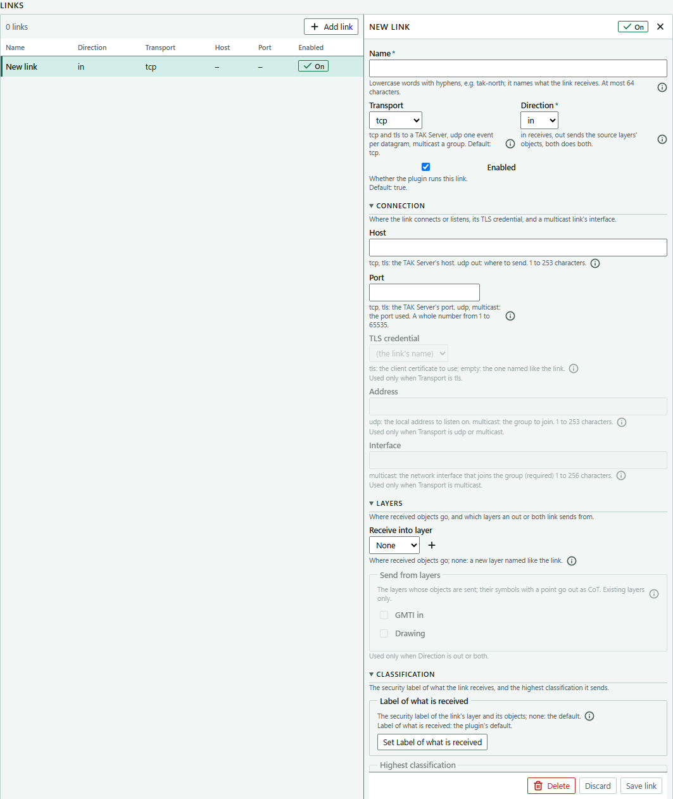
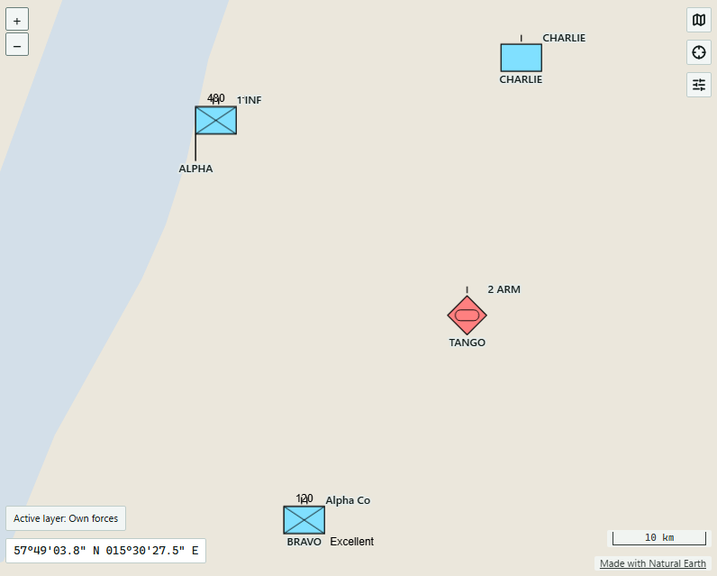
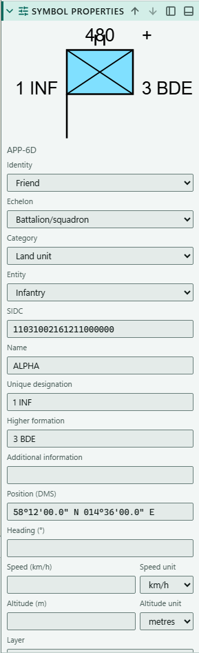

# Cursor on Target

Cursor on Target (CoT) is how emcc exchanges objects with TAK systems: a TAK Server, or TAK clients such as ATAK and WinTAK. The plugin can receive objects from them and show them as symbols, and it can send objects from chosen layers to them.

The plugin does nothing until you add a link. A link is one connection to a TAK system. Until you have set one up, the Monitor says "no link configured". That is expected.

## Links

Add a link with **Add link**: the links are a table with a form beside it (see [Lists of links](05-00-settings.md)). The form groups the settings under Connection, Layers, Classification and Sending. Each link has these settings:

| Setting | What it does |
|---|---|
| Name | The link's name. Lowercase words separated by hyphens, at most 64 characters, for example `tak-north`. The name is the data source of what the link receives, and the key of its TLS credentials. "manual" is reserved. Required |
| Direction | `in`: the link receives CoT. `out`: it sends the objects of its source layers. `both`: it does both over one connection. Required |
| Transport | `tcp`: a plain TCP connection to a TAK Server's streaming input (usually port 8087). `tls`: TCP with TLS and a client certificate (usually port 8089). `udp`: one event per datagram. `multicast`: a group, for example TAK's mesh SA, 239.2.3.1 port 6969. Default: tcp |
| Host | For tcp and tls: the host of the TAK Server. For udp: where an out or both link sends to |
| Port | For tcp and tls: the TAK Server's port. For udp and multicast: the port received on and sent to |
| Address | For udp: the local address to listen on. It is 127.0.0.1 if left out, so only this computer can send to it. Set another address, or 0.0.0.0, to receive from the network. For multicast: the group to join. Required for multicast |
| Interface | For multicast: the name of the network interface that joins the group. Required: without it the link stays stopped |
| Receive into layer | Where received objects go: a layer in the list, or a new layer made with the **+** button next to the list (see [Settings](05-00-settings.md)). Without one, a new layer named like the link is made |
| Send from layers | For out and both: the layers whose objects this link sends: tick them. Existing layers only. Symbols with a point are sent as CoT |
| Highest classification | For out and both: objects above this classification are not sent. It is only in force when you click **Set Highest classification**. Without one, the classification of the server's default label |
| Stale time | For out and both (in the group Sending): how long what is sent stays valid in TAK when the object has no expiry in the future and no stale time of its own. Default 60 |
| Refresh | For out and both (in the group Sending): an object of a source layer that has not changed is sent again after this many seconds, so TAK does not show it as stale. 0 means that only changes go out. Default 30 |
| Label of what is received | The security label of the link's layer and of the objects it creates. It is only in force when you click **Set Label of what is received**. Default: the server's default label |
| Enabled | Whether the plugin runs this link. Default: yes |

The fields that apply only to some directions or transports are greyed out when they do not apply to the one you have chosen. For example, Receive into layer is greyed out when a link only sends, and Send from layers when it only receives. Each greyed field says when it is used.

Click **Save link** to start the link.

**TLS.** A tls link needs a client certificate. The certificates are part of the server's own configuration, not of the settings, and they are named like the link. Ask whoever runs the server to set them up.

## Settings for all links

They stand above the table of links and have a foot of their own, with **Save** and **Discard**. The first four are in the group Connections. **Largest event** is in the group **Advanced**, which is folded at first.

| Setting | What it does | Default |
|---|---|---|
| Idle timeout | A TCP or TLS link that receives nothing for this long is closed and connected again. From 1 to 3 600 | 300 |
| Write stall | An out or both TCP or TLS link on which one write has not finished for this long (the peer stays connected but stops reading) is closed and connected again. From 5 to 3 600 | 60 |
| Largest event | The largest CoT event accepted. A larger one is dropped and counted, and the link goes on. From 1 024 to 1 048 576 | 65 536 |
| Send presence | Send one presence event on each TCP or TLS connection, for TAK Servers that send a client nothing until it has sent one event. It sends nothing else | yes |
| Presence callsign | The callsign in the presence event, 1 to 64 characters | emcc |

Click **Save** at the foot of the page to apply. The table of links is saved link by link, with **Save link**.

## Declared fields

At the bottom, the category lists the fields that this plugin adds to objects. They are the field set **CoT unit** in [Symbol properties](03-10-symbol-properties.md) and in the events of the simulation. They are:

| Field | What it is |
|---|---|
| Callsign | The name TAK shows for the object, at most 64 characters. It is separate from the object's Name. A link sends the Callsign; without one it sends the Name, and without that the unique designation |
| Team | The team colour of a TAK unit: White, Yellow, Orange, Magenta, Red, Maroon, Purple, Dark Blue, Blue, Cyan, Teal, Green, Dark Green or Brown |
| Role | The role of a TAK unit in its team: Team Member, Team Lead, HQ, Sniper, Medic, Forward Observer, RTO or K9 |
| Stale time | How long this object stays valid in TAK when it is sent, from 1 to 86 400 seconds |
| How | How the position was found, at most 16 characters, for example `h-e` (a person, estimated) or `m-g` (a machine, from GPS). It is sent as it is, and `h-e` when empty |
| Circular error | How uncertain the position is, in metres, from 0 to 9 999 999. 9 999 999 means unknown, and is what is sent when the field is empty |
| Linear error | The same for the height |

Anyone who can edit objects can set these on any object. A symbol that has the data type CoT carries the set: choose the data type in the Symbols panel or in [Symbol properties](03-10-symbol-properties.md) and the set appears. See [Symbol properties](03-10-symbol-properties.md). Objects that arrive from TAK carry the set from the start, with what TAK said. A value that does not fit the field, for example a callsign longer than 64 characters, is left out of the set. The object is still kept, with its name.

## What is received and what is sent

Received objects have the data type "CoT" (see [Data types](05-03-data-types.md)) and are shown as symbols. The Callsign of a symbol is sent as its callsign in TAK; without one the Name is sent. What a symbol shows beyond its type is described in the next section.

## Symbols to and from TAK

The Symbols panel has a palette **CoT** with the 147 symbols that emcc can send as a CoT type: choose it in the list **Palette**, and what you place from it goes out as the CoT type that it shows. See [Symbols](03-09-symbols.md).

A TAK unit's symbol is more than its CoT type. ATAK and WinTAK also send the unit's full symbol code, and amplifiers: the texts and marks around a symbol, such as its designation or its size. emcc reads them, draws the symbol as TAK draws it, and sends them back.

### What is received

The symbol code is the first of these that the event has:

| Where | Whose format |
|---|---|
| `__milsym` | ATAK |
| `__milicon` | ATAK, the same again |
| `mil2525c` | WinTAK |

The code is a MIL-STD-2525C code of 15 characters. emcc converts it to APP-6D, the standard of its own symbols, and the symbol gets everything the code says: the identity, the function, the echelon (size), headquarters, task force and feint or dummy marks, mobility and the status (for example planned or damaged). An event without a code, or with a code that emcc cannot convert, gives the symbol as before: from the CoT type alone, with the identity and the function but no echelon and no amplifiers. A unit that ATAK sends as a plain land unit, with no function, comes as a land unit with no function, and with its echelon.

The amplifiers come from ATAK's `unitmodifier` elements and from WinTAK's `amp` element. They become the amplifiers of the symbol:

| ATAK code | What it is in emcc |
|---|---|
| C | Quantity |
| F | Reinforced or reduced (`+` or `-`) |
| G | Staff comments |
| H | Additional information |
| J | Evaluation rating |
| K | Combat effectiveness |
| L | Signature equipment |
| M | Higher formation |
| N | Hostile (enemy) mark |
| P | IFF/SIF |
| R2 | SIGINT |
| T | Unique designation |
| V | Type |
| W | Date-time group |
| X | Altitude or depth |
| Y | Location |
| AA | Special headquarters |
| AD, AE, AF, AG, AO | Platform type, equipment teardown time, common identifier, auxiliary equipment indicator, engagement bar |

WinTAK's `amp` gives the unique designation, the higher formation and the quantity by the same names, and its status is the combat effectiveness. When an event has both, ATAK's amplifier wins.

Some things to know:

- **The unique designation.** The unique designation from TAK is the text next to the symbol. It wins over the callsign. The callsign is still the symbol's Name, and the Callsign of the field set CoT unit. Without a designation from TAK, the callsign is the designation.
- **What Symbol properties shows.** It has a field for the unique designation, the higher formation and the additional information, and a list for the echelon. The other amplifiers are drawn on the symbol, and have no field. Staff comments, the type and the date-time group are drawn only when they are ticked in [Display settings](03-05-display.md).
- **What is not used.** An amplifier that emcc has no place for, or that is empty or longer than 128 characters, is not shown. It stays in the event that emcc keeps, and is sent back as it came only while the symbol itself is unchanged. The text in `remarks` is a description and is not read for amplifiers.
- **Every event replaces the symbol.** An event without amplifiers leaves the symbol without them. An amplifier that you add in emcc to an object from TAK is overwritten by the next event from TAK.

### What is sent

Every symbol that a link sends gets, besides its CoT type, the code in ATAK's format: `__milsym` and `__milicon`, with the code converted back to MIL-STD-2525C, and a `unitmodifier` for every amplifier that is set. The type is as before, and WinTAK's elements (`mil2525c` and `amp`) are not sent. For an object that came from TAK, emcc takes WinTAK's elements out when it sends, so that an event never says two different things after you have changed the symbol.

- **ATAK shows it.** ATAK draws the symbol with its echelon and amplifiers as they are in emcc, and the other marks (headquarters, task force, feint or dummy, mobility, planned) as its own symbol standard draws them. WinTAK draws a symbol from the CoT type alone. From what emcc sends, it shows the identity and the function, and not the echelon or the amplifiers.
- **What cannot be sent.** A vessel symbol, and a code that has no MIL-STD-2525C counterpart, go with the type only. A symbol in the older APP-6B standard goes out as it is stored. Some parts of an APP-6D symbol have no counterpart in the older code and are left out: the leadership indicator, and a headquarters, task force or dummy mark on a unit that also has a mobility mark.
- **The designation.** The unique designation is not sent while it is the same as the callsign, so that ATAK does not show it twice.

On Windows, WinTAK needs a dot as the decimal symbol in the Windows regional settings, or it will not read positions that emcc sends.
