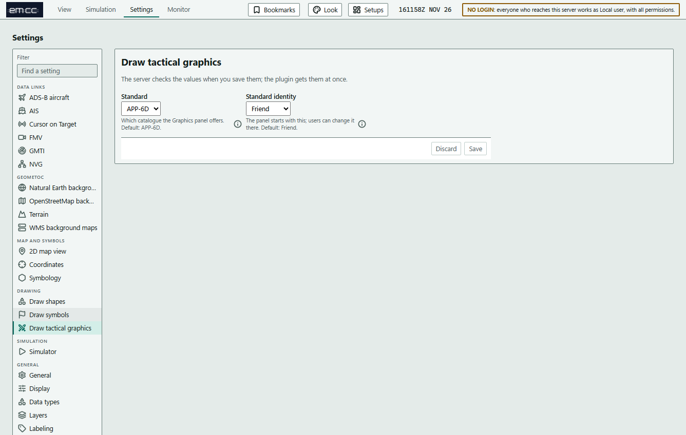

# Draw tactical graphics

These settings decide what a new tactical graphic starts with in the [Graphics](03-12-graphics.md) panel. A user can change each of them in the panel for as long as they work.

| Setting | What it does | Default |
|---|---|---|
| Standard | The APP-6 standard of new graphics: APP-6D or APP-6E | APP-6D |
| Standard identity | The identity a new graphic starts with: Friend, Hostile, Neutral or Unknown | Friend |

The settings do not change graphics that are already on the map. A new graphic always has the data type General, so there is no setting for it: a graphic that was made with another data type before keeps that type.
