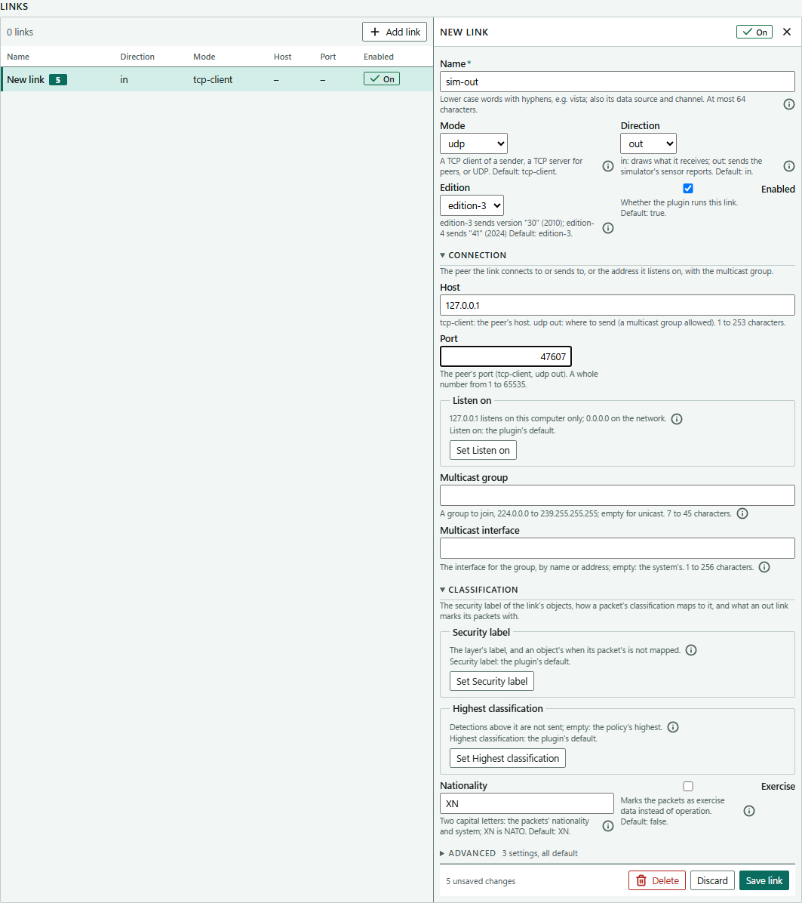
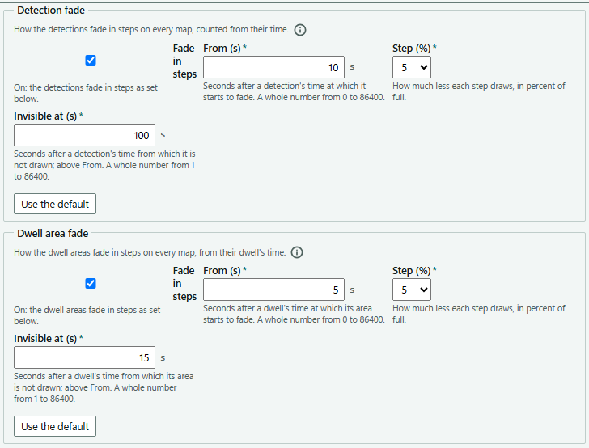

# GMTI

The GMTI plugin receives ground moving target indicator data (STANAG 4607) from radars and recordings, and sends the simulator's sensor reports out in the same format. What it shows on the map is described in [GMTI on the map](03-17-gmti.md). This page is about its settings.

The plugin does nothing until you add a link. A link is one connection, either **in** (it receives) or **out** (it sends).

## Links

Add a link with **Add link**: the links are a table with a form beside it (see [Lists of links](05-00-settings.md)). The form groups the settings under Connection, Picture, Classification and a folded group Advanced. **The form shows the fields that the link's direction uses**: the group Picture and the settings marked in below are for a link that receives, and the settings marked out are for a link that sends. The hint under each field says for which modes it is used: Host and Port are for tcp-client and udp out, Listen is for tcp-server and udp in, and the multicast fields are for udp. The settings that every link has:

| Setting | What it does |
|---|---|
| Name | The link's name: lowercase words separated by hyphens, at most 64 characters, for example `vista`. It is the data source of what the link receives and the name of its output channel. "manual" is reserved. Required |
| Mode | `tcp-client` connects to a sensor, a ground station or a replay that serves 4607 packets over TCP. `tcp-server`: peers connect to this server. `udp`: one packet in each datagram. Default: tcp-client |
| Direction | `in` receives 4607 and writes the platforms, their dwell areas, their coverage and the detections into a layer. `out` is an output channel that sends the simulator's ground radar reports as 4607. Only ground radars can use it: a report from another kind of sensor is not sent. Default: in |
| Host | For tcp-client: the peer's host. For udp out: where to send. A multicast group is allowed |
| Port | The peer's port, for tcp-client and udp out |
| Listen on | For tcp-server and udp in: the address and port to listen on. Click **Set Listen on** to get the two fields **Address** and **Port** (the port is required). The address is 127.0.0.1 if you leave it out, so only this computer can reach it. To listen on the network, an administrator sets another address, or 0.0.0.0. **Use the default** takes Listen away again |
| Multicast group | For udp in: the group to join, from 224.0.0.0 to 239.255.255.255, received on the listen port. Empty means unicast |
| Multicast interface | For udp: the network interface that joins the group (in) or sends to it (out), by name or address, for example 127.0.0.1 for this computer only. Empty: the system chooses |
| Reconnect when idle | For in over TCP: connect again when nothing has come for this long. 0 means never. Default 120. It is in the group **Advanced** |
| Enabled | Whether the plugin runs this link. Default: yes |

Click **Save link** to start the link. The [Monitor](06-00-monitor.md) shows whether it is connected.

## Settings for a link that receives (in)

| Setting | What it does |
|---|---|
| Layer | Where the received objects go: a layer in the list, or a new layer made with the **+** button next to the list (see [Settings](05-00-settings.md)). Empty: a new layer named like the link. Two links that name the same new layer share it |
| Security label | The security label of the link's layer, and of objects whose packet's classification is not mapped. It is only in force when you click **Set Security label**. Default: the server's default label |
| Platform symbol | The APP-6D symbol code (20 digits) of the sensor platform. Empty: chosen from the platform type: fixed wing for aircraft, a sensor for ground based, unknown otherwise |
| Platform identity | The identity of the platform's symbol and the colour of its dwell area. Default: unknown |
| Most reports per dwell | At most this many target reports of one dwell become detections. The rest are skipped and counted. From 1 to 65 535. Default 1 000. In the group **Advanced** |
| Time | `as-recorded` keeps the times of the packets. `as-received` shifts every time of the link by one offset, so that its newest dwell is now. Use it to replay an old recording: with as-recorded, the detections would have expired already. Default: as-recorded |
| Classification | `map` gives the objects the classification the packet says. `link-label` gives every object the link's label. Default: map |
| Coverage | Draws the sensor's coverage: the box that the radar's job description says it works in, as a dashed outline. Switch it off to have none drawn, and to have an existing one removed. Default: on |
| Classification names | The names of the classifications 1 (top secret) to 5 (unclassified) in the packets. Defaults: COSMIC TOP SECRET, SECRET, CONFIDENTIAL, RESTRICTED, UNCLASSIFIED |

## Settings for a link that sends (out)

| Setting | What it does |
|---|---|
| Edition | The edition of STANAG 4607 that the packets follow. `edition-3`: STANAG 4607 Edition 3 (2010), packet version "30". `edition-4`: AEDP-4607 Edition A Version 1, which is STANAG 4607 Edition 4 (2024), packet version "41". Default: edition-3, also for a link that was set up before M9.1. **Choose edition-4 only when the receiver asks for it.** The form shows the field only when the direction is out |
| Security label | The lowest classification that a packet says, so that an empty dwell gets one |
| Highest classification | Detections above this classification are not sent. It is only in force when you click **Set Highest classification**. Otherwise: the highest classification of the label's policy |
| Nationality | The nationality and classification system of the packets, two capital letters. XN is NATO. Default: XN |
| Exercise | Marks the packets as exercise data instead of operation. The data is simulated either way. Default: no |
| Most reports per segment | At most this many target reports in one dwell segment. A larger dwell goes as several segments. From 1 to 65 535. Default 120. In the group **Advanced** |
| One segment per packet | Each part of a sensor report goes in a packet of its own: the mission, the job definition when it is due, and each dwell segment. Switch it off to send one packet for each report. Some tools, for example a packet dissector, read only the first part of a packet and so need it on. Over UDP each packet is one datagram. Default: on. In the group **Advanced** |

The two editions are laid out alike. What differs is the version number in each packet and one number for a packet without a dwell: the job number of the mission's packet and of the job definition's packet is 0 in Edition 4 (when **One segment per packet** is on), and in Edition 3 it is the job's own number. A link that receives reads both editions, and older packets too (version "21"), so it needs no setting.

A receiving system sees each restart of an out link as a new mission. The job definition goes out before the first dwell, and then with the next dwell once 20 seconds of dwell time have passed, so that the gap between two of them stays inside the 30 seconds that the standard allows. When the dwells are far apart in time, the gap can be longer. A changed setting reaches the receiver with the next job definition. **One segment per packet** and **Edition** take effect with the next report. The coverage box that a receiver draws for a simulated sensor is the sensor's job area when it has one (a job area that is not a convex four-cornered area goes as the box round it). Without a job area it is the box, with its sides north-south and east-west, round the sensor's dwell area. The out link sends it in the job definition.

## Colours

Three settings of the GMTI plugin, in the group **Colours** above the table of links, give the colours of what the GMTI links write to the map. They are the same for every user and every link. When a change reaches the map differs for each of them: see "Which setting colours what" below. Save them with **Save** at the foot of the page.

| Setting | What it colours | Default |
|---|---|---|
| Dwell area colour | The outline of the dwell areas | Fixed, `#7EF26A` (green) |
| Coverage colour | The outline of the coverage box | Fixed, `#BDCF3D` (yellow-green) |
| Pairing line colour | The line from a detection to its platform | `#FFFF00` (yellow) |

The first two have **Use**: **fixed** (the default) or **identity**, and a **Colour** that you pick with the colour box or type as `#RRGGBB`, as in [Simulator](05-18-simulator.md). With **identity** the colour of the platform's identity is used instead, and the Colour is not. The pairing colour is one colour. **Use the default** at a group takes the setting away, so that the default above applies again; the group then says that the plugin's default is in force and offers a button to set it.

### Which setting colours what

There are two groups of colour settings, and each group colours its own things. The simulator's own drawing in the Simulation workspace follows **Settings, Simulation, Simulator**. What the GMTI links write, and the pairing line, follow **Settings, Data Links, GMTI**.

| What you see | Colour set in | When a change reaches the map |
|---|---|---|
| The **dwells** that the simulator's ground radars draw in Simulation (not objects) | Simulator: **Dwell colour** | At once, in every browser |
| The **coverage** of a sensor in Simulation, and its bearing and range labels | Simulator: **Coverage colour** | At once |
| The **job area** of a sensor in Simulation | Simulator: **Job area colour** | At once |
| The **dwell areas** that a GMTI link writes (objects, in the link's layer) | GMTI: **Dwell area colour** | From each sensor's **next dwell**. A dwell area that is already drawn keeps its colour |
| The **coverage box** that a GMTI link writes | GMTI: **Coverage colour** | Within 30 seconds, while its sensor sends |
| The **pairing line** from a detection to its sensor, whether the detections come from a GMTI link or from a sensor in Simulation | GMTI: **Pairing line colour** | At once, without a reload |

So the dwell colour in the Simulator category does not colour the dwell areas of a receiving GMTI link, and the other way round, even when the sender is the simulator of another emcc. Whether a user sees the pairing lines at all is the user's own switch **GMTI Pairing** in [Display settings](03-05-display.md).

## Fading

Two more settings, in the group **Fading** above the table of links, say how the detections and the dwell areas fade in View. They are the same for every user and every link. The page shows them as **Detection fade** and **Dwell area fade**, with the same four fields each. What users see is described in [GMTI](03-17-gmti.md).

| Setting | What it does | Default |
|---|---|---|
| Fade in steps | On: the detections (or the dwell areas) fade in steps as set below. Off: the data type's own expiry fade is used | On |
| From (s) | Seconds after the report at which the fading starts. Until then it is drawn fully, and the first step comes one interval later (see below). From 0 to 86 400 | 10 |
| Step (%) | The size of each step: 1, 2, 4, 5, 10, 20, 25 or 50 | 5 |
| Invisible at (s) | Seconds after the report from which it is not drawn. It must be **above From**. From 1 to 86 400 | 100 |

The three last fields are shown only while Fade in steps is on. **Use the default** at the foot of the group Detection fade (or Dwell area fade) takes the group away, so that the plugin's defaults in the table apply, and the button **Set Detection fade** (or **Set Dwell area fade**) brings the group back. The steps are evenly spread between From and Invisible at, one step less every (Invisible at − From) × Step ÷ 100 seconds: with the defaults that is 4.5 seconds, so 95 % from 14.5 seconds, 50 % from 55 seconds and nothing from 100 seconds. A change reaches the map at once, without a reload and without a reconnection.

- **Invisible is not removed.** What is no longer drawn stays until its data type removes it (GMTI detection, and GMTI dwell area: see [Data types](05-03-data-types.md)). Set the data type's **Remove after** so that it fits the steps, if you want an invisible detection to go sooner.
- **An end that is not above the start** cannot be refused by the form. Such a setting gives no fading in steps, and the [Monitor](06-00-monitor.md) shows GMTI as Degraded, tagged Check and listed under Problems, naming the setting and the two values, for example "detectionFade: invisibleAtSeconds 5 is not above fromSeconds 10, so there is no fade in steps", until it is corrected.

## Declared fields

Under the links, the page lists the fields that GMTI adds to the objects it makes: radial velocity, wrap velocity, signal to noise, classification, class probability, the errors, radar cross section, the job, the revisit, the dwell and the report. They are set by the plugin only, and users cannot change them. They show in Symbol properties when you select a GMTI object. See [Symbol properties](03-10-symbol-properties.md).
