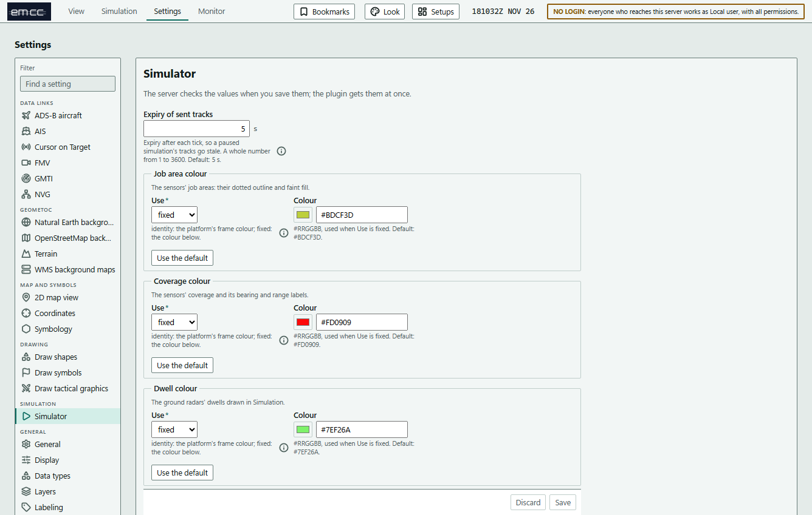

# Simulator

Settings for the simulation in the [Simulation workspace](04-00-simulation.md).

| Setting | What it does | Default |
|---|---|---|
| Expiry of sent tracks | The time, in seconds after each tick, after which what the simulator sends to the outputs goes stale at the receiver. It makes the tracks of a paused simulation go stale in TAK. A whole number from 1 to 3 600 | 5 |
| Job area colour | The colour of the sensors' job areas: their dotted outline and faint fill | Fixed, `#BDCF3D` (yellow-green) |
| Coverage colour | The colour of the sensors' coverage and of its bearing and range labels | Fixed, `#FD0909` (red) |
| Dwell colour | The colour of the dwells that the ground radars draw in Simulation | Fixed, `#7EF26A` (green) |

It applies to everything the simulator sends to its [outputs](04-05-outputs.md). It does not change the objects in emcc itself.

The number of empty dwells that a ground radar adds to a revisit is no longer a setting here. A sensor's own settings and its preset decide it: see [Sensors](04-04-sensors.md).

## The three colours

Each colour is a group with the same two fields:

- **Use** is **fixed** (the default) or **identity**. With **fixed** every sensor is drawn in the colour below. With **identity** each sensor is drawn in the colour of its platform's identity: the colours of APP-6 for a friend, a hostile and so on.
- **Colour** has a colour box that you click to pick a colour, and a field where you can type it as `#RRGGBB`, for example `#00FFFF`. It is shown only when Use is fixed. The defaults are in the table above.

The colours are the same for every user and every sensor. A change applies at once in every browser, without a reload. **Use the default** at the foot of a colour takes the setting away, which brings back the default colour in the table. The group then says that the plugin's default is in force, and a button named for the colour, for example **Set Dwell colour**, brings the fields back. These three colour what the simulator draws itself in the Simulation workspace. The colours of the GMTI plugin's dwell areas, coverage box and pairing line are set in [GMTI](05-14-gmti.md), and the table "Which setting colours what" there lists every one.

Click **Save** at the foot of the page to apply a change.
