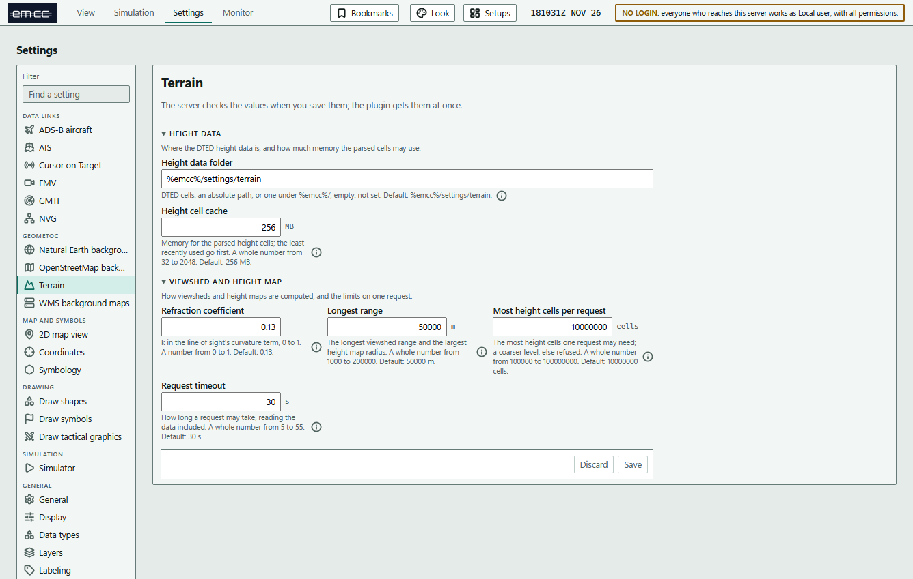

# Terrain

These settings belong to the [Terrain](03-13-terrain.md) panel. The most important one is the folder with the height data: without data in it, viewsheds and height maps are not available. Range and bearing work without it.

| Setting | What it does | Default |
|---|---|---|
| Height data folder (group Height data) | The folder with the DTED height data, on the computer that runs the server. It is either a **full path**, for example `D:\shared\height`, or a path that **starts with `%emcc%/`**, which means "below the emcc folder" (the folder with `start.bat`). Empty means not set. The path is read by the server only, but it reaches every logged-in browser | `%emcc%/settings/terrain` |
| Refraction coefficient (group Viewshed and height map) | How much the air bends the line of sight, a number from 0 to 1. A height at a distance is lowered by the curve of the earth times one minus this number | 0.13 |
| Longest range | The longest range a viewshed may have, in metres, from 1 000 to 200 000. It is also the largest radius of a height map | 50 000 |
| Most height cells per request | The most height cells one viewshed may need within its range, from 100 000 to 100 000 000. When a finer level needs more, a coarser one is used. When none fits, the request is refused | 10 000 000 |
| Request timeout | How long a viewshed may take, from 5 to 55. A slower one is refused | 30 |
| Height cell cache (group Height data) | How much memory the loaded height cells may use together, from 32 to 2 048. The ones used least go first | 256 |

## The height data

The data is in DTED format, levels 0, 1 and 2, one file for each cell, in folders named by longitude: `e<lon>/n<lat>.dt0`, `.dt1` or `.dt2` (`w` and `s` for west and south). Height data is not part of the emcc zip: you provide it: your own DTED files, from a source that you may use. The release has an empty folder `settings\terrain` with a short readme for it. The server reads the folder when it starts and when you save a new folder. A cell you add later is found when you save the setting again, or when the server restarts. The [Monitor](06-00-monitor.md) shows how many cells it found.

A viewshed uses the finest level that has data at the observer's point. The panel says which level it used.

### The folder: `%emcc%/` and full paths

- **`%emcc%/settings/terrain`**, the default, is the folder `settings\terrain` below the emcc folder. `%emcc%` is emcc's own marker. It is not an environment variable, and it is written with a forward slash on every system. Write `%emcc%/height` for another folder below the emcc folder.
- **A full path** works as before. Use one when the data is on storage that other programs share, for example `D:\shared\height`.
- **Anything else is refused**: a relative path without the marker, or a full path with `%emcc%` inside it. A path that starts with `%emcc%/` but ends up outside the emcc folder (for example `%emcc%/../elsewhere`, or through a link) is not used either: the Terrain panel then says that the height folder cannot be read, with the reason "outside the emcc folder".

The [Monitor](06-00-monitor.md) shows how many cells it found.

## Putting in your own height data

emcc comes with no height data. You supply it: DTED files with the extension `.dt0`, `.dt1` or `.dt2`, from a source that you have the right to use. Outside the cells that you supply there is no height data.

To put it in:

1. Put the files into the terrain folder, in the folders that are named above, for example `settings\terrain\e011\n59.dt2`. The folder `settings\terrain` is below the emcc folder, next to `start.bat`.
2. That is all: the terrain tools read `settings\terrain` by themselves. Nothing has to be set. If the server is already running, save the Terrain settings once so that it reads the folder again, or restart it.
3. In View, click **Pick the observer** in the Terrain panel and click a point inside an area that your cells cover. The panel says the height at the point.

A viewshed that crosses the edge of a cell uses both cells.
