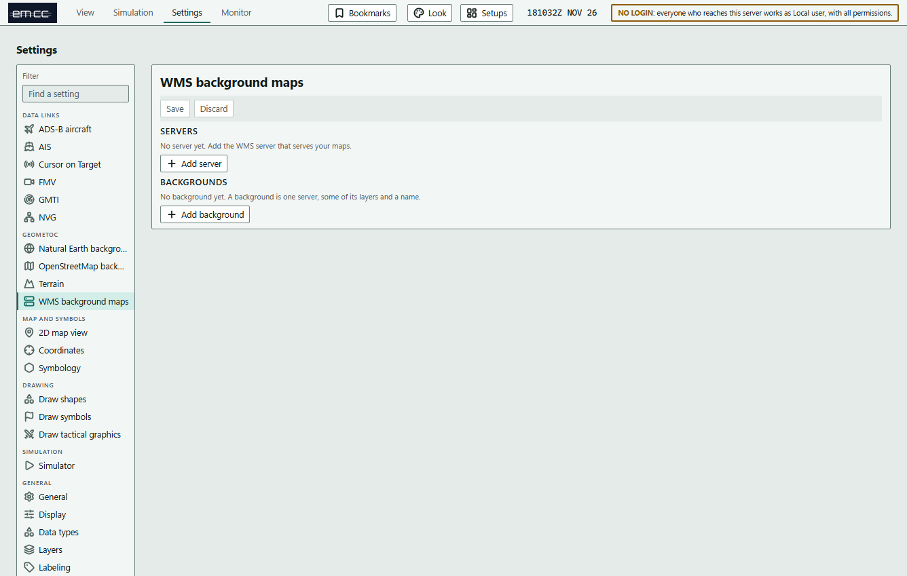

# WMS background maps

A WMS server serves maps as pictures over the internet or a network. This plugin lets an administrator add WMS servers and choose some of their layers as background maps. The backgrounds then appear in [Map controls](03-03-map-controls.md), next to Natural Earth and OpenStreetMap.

There is no server and no background until an administrator adds them. Until then the [Status](03-16-status.md) panel says "0 background maps provided".

The settings of this plugin hold no secrets and no logins. They reach every browser.

## Servers

Add a server with **Add server**. Each server has:

| Field | What it does |
|---|---|
| Name | The name you give the server |
| Address | The address of the WMS server |
| WMS version | 1.3.0 or 1.1.1 |
| Request timeout | How long one call to the server may take, in seconds, from 1 to 20. Default 8 |

Click **Save** to save the server. emcc then reads the layers the server offers.

## Backgrounds

A background is one server, some of its layers and a name. Add one with **Add background**. Each background has:

| Field | What it does |
|---|---|
| Name | The name shown in Map controls |
| Server | The server to use. Choose one you have saved |
| Layers | The server's layers to draw, in order from the bottom. They are shown once the server has been saved and its layers read |
| Mode | **tiles**: many small pictures, quick to move around. **image**: one picture for what the map shows (one image per view). Tiles are only used where the projection allows them. In other projections a background of this kind is drawn as one image per view |
| Image format | PNG or JPEG |
| Transparent (PNG only) | Draws the layers with a transparent background, so that what is below shows through |
| Attribution, Text | The credit shown on the map |
| Attribution, Link | An address for the credit, starting with `http://` or `https://`. Empty: no link |

The line "Offered in" tells in which projections the background will be offered, once the layers are read. A background is only offered in the projections that its layers support, and the polar ones are included when the server has them.

The checks happen when you save. A background that names a server that does not exist, or a layer the server does not have, is reported and not saved. Click **Discard** to go back to what was saved.

If the server goes away while a user shows its background, the map falls back to another background and says so.

## Reaching the server

The emcc server fetches the maps, not your browser. The plugin goes to the internet or the network: the Monitor shows "declared" in its Internet column. It sends only requests for the server's capabilities and for map pictures.
