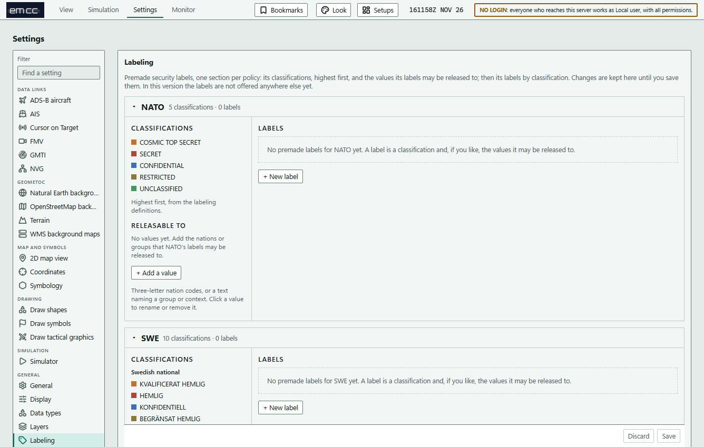
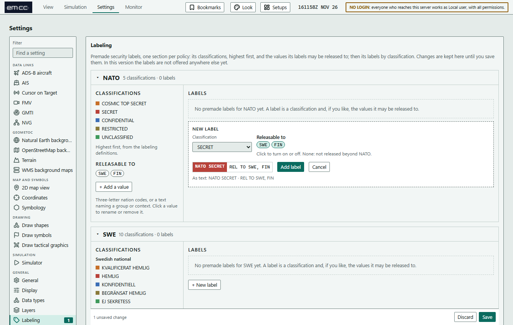
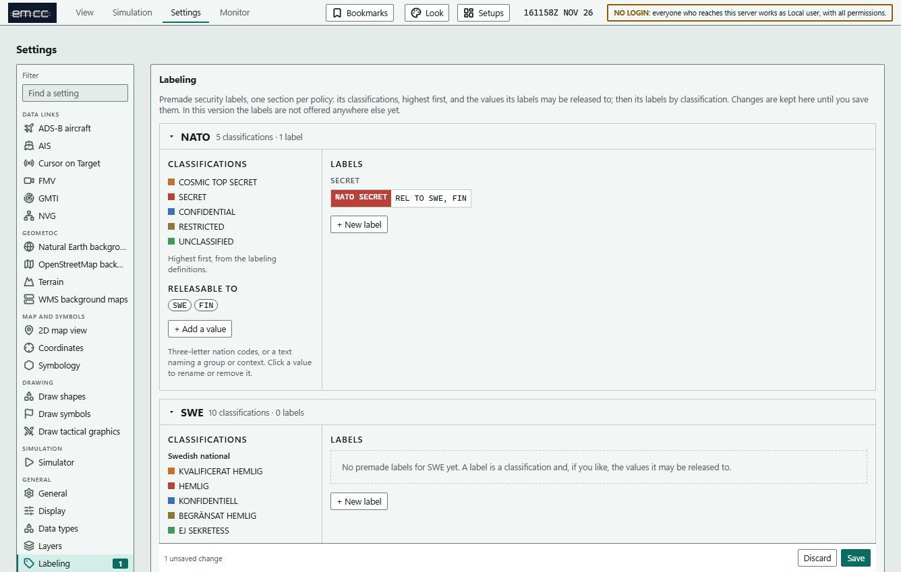

# Labeling

**Labeling** is where an administrator prepares **premade security labels**. A security label says how an object or a layer is classified, for example NATO SECRET. In this release the labels are only prepared here: nothing else in emcc offers them yet, and a label does not limit who sees what. The page is for what comes later, and it can be used and tried now.



The category is after Layers in the list. Like all of Settings it needs the permission to administer settings.

## The policies

The page has one card for each **policy**: a set of rules for labels that has its own classifications. The demo has two:

| Policy | Its classifications, highest first |
|---|---|
| NATO | COSMIC TOP SECRET, SECRET, CONFIDENTIAL, RESTRICTED, UNCLASSIFIED |
| SWE | The Swedish national ones (KVALIFICERAT HEMLIG, HEMLIG, KONFIDENTIELL, BEGRÄNSAT HEMLIG, EJ SEKRETESS), then NATO's |

Click the arrow at the left of a card's name to fold the card or open it. The line beside the name says how many classifications and labels the policy has.

Each card has two parts:

- **On the left:** the **classifications** of the policy, highest first, each with a colour that shows its rank, and the list **Releasable to**: the nations or groups that the policy's labels may be released to.
- **On the right:** the policy's **labels**, grouped by classification, highest first. Before you make one, the part says "No premade labels for NATO yet".

The classifications and the policies themselves are not set here. They come from a file that the server reads when it starts: see "Changing the policies" below.

## Releasable to

This is a list of values, for example three-letter nation codes such as SWE and FIN, or a text that names a group or a context. It belongs to the policy: every label of the policy chooses among its values.

- Click **+ Add a value**, type the value and press Enter.
- Click a value to rename or remove it. A value that you rename changes in every label that uses it. A value that a label still uses cannot be removed.
- A value that is already in the list, in any case, is refused.

## Making a label

A label is a classification and, if you like, some of the values it may be released to.

1. Click **+ New label** in the policy's card.
2. Choose the **Classification**.
3. Click the values under **Releasable to** that the label may be released to. A value is on or off each time you click it. With none on, the label has no "REL TO" part.
4. Look at the preview: a band in the colour of the classification, with the label's text. It is also written out below it, for example "As text: NATO SECRET · REL TO SWE, FIN".
5. Click **Add label**. **Cancel** closes the form.



The new label shows in its policy, under its classification.



Click a label to change it. The form says **Edit label**, and **Change label** keeps the change. **Delete label** deletes it after a question. A label that you have changed shows what it was before. The page holds at most 500 labels and 200 values.

## Saving

Nothing is saved until you click **Save** at the bottom of the page. All the changes to the page are saved together. Until then the category has a number in the list of Settings, and the foot of the page says how many changes are unsaved, for example "3 unsaved changes". **Discard** goes back to what is saved.

The server checks the labels when you save them. It refuses, with a message, a label that names a policy or a classification that is not defined, a value that is not in the policy's list, or a duplicate. If someone else saves the page while you work on it, the page tells you, and **Take their labels** replaces yours with theirs.

## Changing the policies

The policies and their classifications are defined in a file, `labeling-definitions.json`, that is part of the server. An administrator who needs other policies or other classifications puts a file called `labeling-definitions.local.json` in the emcc folder, next to `start.bat`. The server looks first for a file that the setting `emc2.labeling.definitions` names, then for `labeling-definitions.local.json`, then for the shipped file. It uses the first one it finds, whole: it replaces the shipped one. A file that is wrong stops the server at the start, and the message names the file and every problem. The file lists the classification sets (each with its classifications, highest first, and a colour for each) and the policies (each naming its sets). Its shape is:

```
{
  "classificationSets": [
    { "id": "nato", "name": "NATO",
      "classifications": [ { "name": "SECRET", "color": "#b8423a" }, { "name": "UNCLASSIFIED", "color": "#3a9a5b" } ] }
  ],
  "policies": [ { "name": "NATO", "classificationSets": ["nato"] } ]
}
```

A set's classifications are listed highest first, each with a colour as `#rrggbb`. A policy names its sets, and its sections follow in that order. The example is cut short: the shipped file has all five NATO classifications.

How a label is written out as text can also be set in `settings/emcc.properties`: `emc2.labeling.field-separator` (the default is " · "), `emc2.labeling.releasable-to-separator` (", ") and `emc2.labeling.releasable-to-prefix` ("REL TO"). Put a value in double quotes to keep the spaces in it. See [The settings files](08-01-settings-files.md) for the file.

## What it does not do

- Labels are not offered anywhere else in this release: a layer or an object does not get one from here.
- Classifications and policies are not changed here, only the premade labels and the values they may be released to.
- Everything on the page is a mark: it limits nobody's access.
